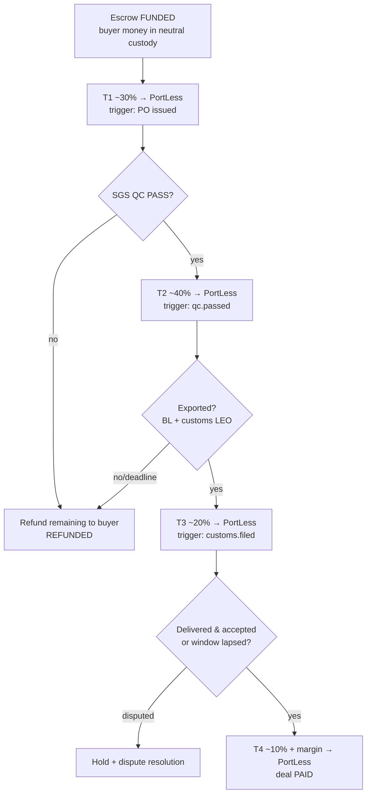
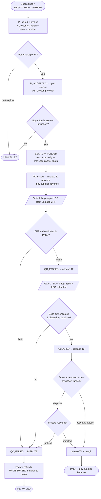
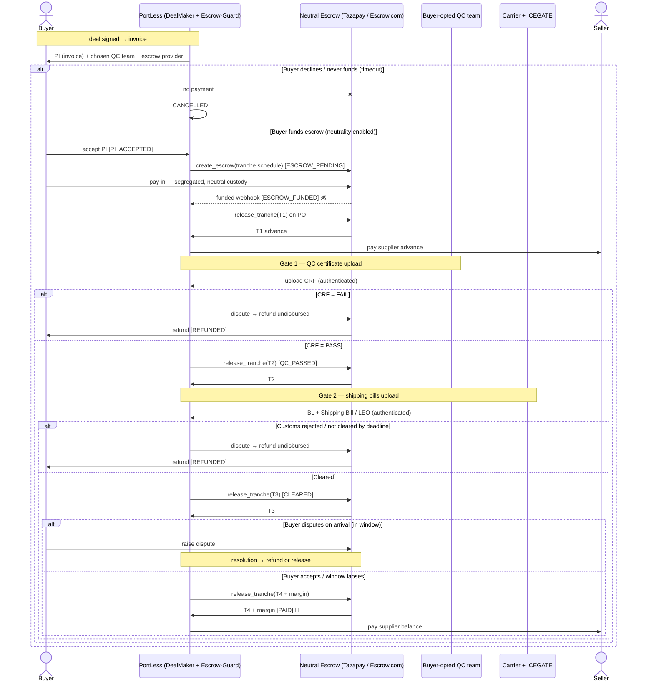

# Escrow-Guard — Target Architecture: Multi-Provider Escrow + LC-style Staged Release

> **Status:** ✅ **Core implemented (2026-07-10)** — provider connectors, staged
> tranches, buyer **accept / dispute / inspection-window** release authority, and
> the full API are live (graceful stubs when provider keys are absent). **Pending
> integration:** auto-firing releases from `qc.passed` / `customs.filed` events,
> supplier payout funded from released tranches, and the deal `REFUNDED`
> transition — see [§14](#14-implementation-checklist). The legacy Stripe-hold
> path (`create_hold` / `request_payout`) remains in the service code for
> backward compatibility, unchanged.
> **Goal:** Guard the **buyer's money** with a **neutral, licensed escrow** the
> buyer can choose (**Tazapay _or_ Escrow.com**), and **release it in stages** to
> PortLess as the trade provably advances. PortLess then syncs the supplier
> payments against those releases.

> ⚠️ **Two honesty notes before you build on this:**
> 1. **Escrow ≠ document examiner.** Escrow-as-a-service holds funds and releases
>    them on *milestones/proofs you register* — it does **not** authenticate a
>    bill of lading or QC report like an LC bank does (see [§5](#5-how-release-is-decided--document--condition-validation-read-this)).
> 2. **Fees/coverage move fast.** The numbers in [§8](#8-what-it-costs--tazapay--escrowcom) are
>    **indicative** — confirm with each provider before committing.

---

## Table of Contents

- [1. What we are building & why](#1-what-we-are-building--why)
- [2. Roles & players](#2-roles--players)
- [3. Provider-agnostic design (Tazapay + Escrow.com, buyer chooses)](#3-provider-agnostic-design-tazapay--escrowcom-buyer-chooses)
- [4. Staged / partial-release model (the core)](#4-staged--partial-release-model-the-core)
- [5. How release is decided — document & condition validation (READ THIS)](#5-how-release-is-decided--document--condition-validation-read-this)
- [6. Complete lifecycle after the deal is signed](#6-complete-lifecycle-after-the-deal-is-signed)
- [7. Syncing supplier payments](#7-syncing-supplier-payments)
- [8. What it costs — Tazapay & Escrow.com](#8-what-it-costs--tazapay--escrowcom)
- [9. Deal-state & data-model changes](#9-deal-state--data-model-changes)
- [10. Proposed API surface](#10-proposed-api-surface)
- [11. Security, compliance & KYC](#11-security-compliance--kyc)
- [12. Important considerations & risks](#12-important-considerations--risks)
- [13. Nice-to-have features](#13-nice-to-have-features)
- [14. Implementation checklist](#14-implementation-checklist)
- [15. Open questions to verify with providers](#15-open-questions-to-verify-with-providers)
- [16. Configuration (env vars) & proposed files](#16-configuration-env-vars--proposed-files)
- [Appendix A — Legacy Stripe/Payoneer path (as-built)](#appendix-a--legacy-stripepayoneer-path-as-built-still-in-the-code)
- [Appendix B — Account setup](#appendix-b--account-setup)
- [Appendix C — Base service reference](#appendix-c--base-service-reference)

---

## 1. What we are building & why

**Problem (today):** the buyer pays into PortLess's *own* Stripe account, so the
buyer must trust PortLess not to disappear with the money. That is the wrong
trust anchor.

**Target:** a **neutral, licensed escrow** holds the buyer's funds in a
segregated account. The buyer picks the provider they trust (**Tazapay** or
**Escrow.com**). Funds are **released in tranches to PortLess** only as
independently verifiable milestones are met (inspection passed, exported,
delivered). If the trade fails, the escrow **refunds the buyer**.

**Why staged release:** a single "pay at the end" release starves PortLess of the
cash it needs to pay the supplier's advance; a single "pay up front" release
re-creates the trust problem. **Milestone tranches** balance both — the buyer's
exposure shrinks step by step as proof accumulates, and PortLess gets working
capital exactly when each obligation falls due.

Because **PortLess is a merchant-exporter** (it buys from the Indian supplier and
resells to the overseas buyer), the escrow correctly **releases to PortLess**,
which then **pays the supplier**. The buyer is protected by the escrow's neutral
custody + the independent pre-shipment inspection + the dispute/refund window.

---

## 2. Roles & players

| Player | Role in the target flow | Holds the principal? |
|---|---|---|
| **Buyer** | Chooses the escrow provider, funds the escrow after accepting the PI, can dispute within the inspection window | No |
| **Neutral escrow** (Tazapay **or** Escrow.com) | Holds the buyer's funds in a **segregated** account; **releases tranches** to PortLess on registered proof; **refunds** on failure. The trust anchor. | ✅ **Yes** |
| **PortLess** (Escrow-Guard) | Orchestrator + **merchant-of-record**; registers proofs/milestones, receives released tranches, **pays the supplier** | Receives releases |
| **Seller / supplier** | Manufactures & ships; paid by PortLess per PO terms (advance + balance) | No |
| **Independent verifiers** | **SGS** (pre-shipment QC → CRF), **ICEGATE/customs** (Shipping Bill + LEO), **carrier** (Bill of Lading / tracking) — supply the *trustworthy* proof the escrow releases against | — |

### 2.1 Where it sits (callers ↔ callees)

| Invoked by (upstream) | Why |
|---|---|
| **DealMaker / api_gateway** | On `PI_ACCEPTED`, open the escrow with the buyer's chosen provider ([DealMaker §3.1](../dealmaker/workflow_dealmaker.md#31-buyer-selections-on-the-pi-target)) |
| **Shield-Link** (QC webhook) | Authenticated **CRF** (`qc.passed`) → triggers the **T2** release |
| **Shield-Link / DocuGen** (freight + customs) | **BL + Shipping Bill/LEO** (`customs.filed`) → triggers the **T3** release |
| **hitl_approval.callbacks** | On approve of a release / payout gate |
| **Buyer** (via escrow provider) | Pay-in; accept / dispute within the inspection window |
| **Providers** (Tazapay / Escrow.com) | `funded` / `release` / `refund` webhooks (HMAC) |

| Invokes (downstream) | Why |
|---|---|
| `shared/connectors/escrow/*` (Tazapay, Escrow.com) | open / fund-status / release-tranche / refund; **stub when key absent** |
| Payoneer connector | Supplier payout, funded from released tranches |
| `deals.service.update_status` | `ESCROW_FUNDED`, `PAID`, `REFUNDED`, `CANCELLED` |

### 2.2 When & from where each API is called

Every endpoint, the **trigger** (when) and the **caller** (from where). External
callers reach the service through the **API gateway**, which registers
`EscrowGuardClient` as `"escrow-guard"` (`api_gateway/clients.py`); provider
webhooks arrive **inbound** from Stripe / Tazapay / Escrow.com / Payoneer; saga
callbacks fire **in-process** (monolith) or via the client over HTTP
(microservices).

| API | When (trigger) | From where (caller) |
|---|---|---|
| `GET /providers` | Buyer is picking an escrow provider on the PI | **DealMaker / UI** → api_gateway |
| `POST /escrows` | Buyer **accepts the PI** (`PI_ACCEPTED`) | **Operator / UI** → api_gateway *(target: DealMaker on accept)* |
| `POST /webhooks/escrow-funded` | Buyer **funds** the escrow | **Payment/escrow provider** (Stripe / Tazapay / Escrow.com), inbound HMAC |
| `POST /escrows/{id}/release` | Proof authenticated — `qc.passed` (T2), `customs.filed` (T3) | **Shield-Link / DocuGen** *(target — event wiring pending [§14](#14-implementation-checklist))*; today Operator / HITL → api_gateway |
| `POST /escrows/{id}/accept` | Goods delivered & **buyer accepts** | **Buyer** → api_gateway |
| `POST /escrows/{id}/dispute` | Buyer disputes within the inspection window | **Buyer** → api_gateway |
| `POST /escrows/{id}/refund` | QC fail / non-clearance / dispute upheld | **Operator / Exception-Resolver** → api_gateway |
| `GET /escrows/{id}` · `/deals/{id}/summary` | On demand (status / reconciliation) | **UI / Operator** → api_gateway |
| *(internal)* `check_inspection_windows()` + `check_reconciliation()` | Every `inspection_watcher_interval_seconds` (60 s) | **Escrow watcher** — background task in the service lifespan: final-tranche auto-release **and** a ledger-reconciliation sweep |
| **Legacy** `POST /holds` | Deal at `ESCROW_PENDING` (Stripe path) | Operator / UI → api_gateway |
| **Legacy** `POST /payouts` | Deal `CLEARED` + funded hold | **HITL saga callback** `RELEASE_SUPPLIER_PAYOUT` → `escrow_guard.service.request_payout()` (`hitl_approval/callbacks.py`); or Operator / UI |
| **Legacy** `POST /webhooks/payout` | Payoneer confirms payout status | **Payoneer**, inbound HMAC |

**Trigger chain (staged model, happy path):**

```
DealMaker issues PI (buyer picks provider via GET /providers)
  → buyer accepts  → POST /escrows                  [PI_ACCEPTED → ESCROW_PENDING]
  → buyer funds    → POST /webhooks/escrow-funded    [→ ESCROW_FUNDED]
  → PO issued      → POST /escrows/{id}/release T1
  → SGS qc.passed  → POST /escrows/{id}/release T2    [via Shield-Link, target]
  → customs.filed  → POST /escrows/{id}/release T3    [via DocuGen/Shield-Link, target]
  → buyer accepts  → POST /escrows/{id}/accept        [or inspection-window lapse → PAID]
```

> **Client note:** `EscrowGuardClient` (used by the gateway in microservice mode)
> currently exposes only the **legacy** methods (`create_hold`, `request_payout`,
> reads). The staged endpoints (`/escrows`, `/release`, `/accept`, `/dispute`,
> `/refund`, `/providers`) are reachable over direct HTTP but are **not yet added
> to the typed client** — part of the pending integration ([§14](#14-implementation-checklist)).

---

## 3. Provider-agnostic design (Tazapay + Escrow.com, buyer chooses)

The service must treat the escrow provider as **pluggable**, exactly like the
existing connector pattern. The buyer selects a provider at deal setup; PortLess
exposes **whatever payment methods that provider supports**.

### 3.1 The `EscrowProvider` interface

```python
# shared/connectors/escrow/base.py  (new)
class EscrowProvider(Connector):
    name: str                       # "tazapay" | "escrow_com"
    async def list_payment_methods(self, corridor: dict) -> list[str]: ...
    async def create_escrow(self, req: dict) -> dict:      # open + get pay-in instructions
    async def fund_status(self, ext_ref: str) -> dict: ...
    async def release_tranche(self, ext_ref: str, tranche: dict) -> dict: ...
    async def refund(self, ext_ref: str, reason: str) -> dict: ...
    async def webhook_verify(self, headers, body) -> bool: ...
```

Two concrete adapters — `TazapayEscrowConnector`, `EscrowComConnector` — register
in `shared/connectors/registry.py`. `create_escrow()` returns provider-specific
**pay-in instructions** (hosted checkout URL / bank-wire details) that PortLess
hands to the buyer.

### 3.2 "PortLess supports every payment method the provider does"

PortLess does **not** hard-code payment methods. It calls
`list_payment_methods(corridor)` and surfaces the provider's full set to the
buyer:

| Provider | Typical buyer pay-in methods (verify) | Payout / release rails (verify) |
|---|---|---|
| **Tazapay** | Cards, local bank transfers & local payment methods across many countries, wire | Bank payout to 100+ countries incl. **INR to India** |
| **Escrow.com** | **Wire** (primary for large B2B), credit card (limits + higher fee), sometimes PayPal/check | Wire to bank, escrow balance |

> Practical consequence: **Tazapay** tends to fit cross-border B2B (local pay-in +
> India payout) better; **Escrow.com** is the more established licensed escrow but
> is wire-centric. Offering both lets the buyer pick on trust/convenience.

### 3.3 Provider selection

- **Buyer preference** wins (they must trust the custodian).
- Fallback/routing hints: corridor + currency support, payment-method
  availability, transaction-size fee efficiency (see [§8](#8-what-it-costs--tazapay--escrowcom)).
- Store the chosen provider on the escrow record so tranches, webhooks and
  refunds all route back to the same provider.

---

## 4. Staged / partial-release model (the core)

Each deal carries a **tranche schedule** (configurable per deal). A tranche
releases to PortLess only when its **trigger proof** is registered *and* no buyer
dispute is open.

### 4.1 Recommended default schedule

| Tranche | Release trigger (independent proof) | Deal state | % of principal | Funds… |
|---|---|---|---|---|
| **T1 — Production advance** | Escrow `FUNDED` + PO issued | `ESCROW_FUNDED → PO_ISSUED` | ~30% | Supplier's advance so production can start |
| **T2 — Quality cleared** | **SGS CRF = PASS** (`qc.passed`) | `QC_PASSED` | ~40% | Balance of production + freight booking |
| **T3 — Exported** | **Carrier BL** + **ICEGATE LEO / Shipping Bill** (`customs.filed`) | `IN_TRANSIT → CLEARED` | ~20% | Confirms goods actually left the country |
| **T4 — Settled** | Arrival + buyer acceptance **or** inspection window lapses | `CLEARED → PAID` | ~10% **+ PortLess margin** | Final settlement + margin |

> **Risk trade-off (call it out to the buyer):** T1 releases *before* the goods
> exist, so the buyer/PortLess carry production risk on that slice. Mitigants:
> supplier already verified (GSTN/DGFT/MCA/Udyam), **SGS pre-shipment inspection**
> gates the big T2 slice, and T1 can be set to **0%** for first-time or high-risk
> suppliers (fully buyer-protective, PortLess funds the advance itself).

The schedule is **data-driven** — a conservative buyer can demand
`0 / 40 / 30 / 30`; a trusted repeat supplier can get `40 / 40 / 15 / 5`.

### 4.2 Staged-release diagram



---

## 5. How release is decided — document & condition validation (READ THIS)

This is the question that decides whether the whole design works, so be precise.

### 5.1 What escrow-as-a-service actually does vs. does NOT do

| Capability | Tazapay / Escrow.com | Notes |
|---|---|---|
| Hold funds in segregated neutral custody | ✅ | Core product |
| Release on **milestones / proof upload** | ✅ | You register the milestone as met |
| **Inspection window** + buyer accept / auto-release | ✅ | Buyer's protection lever |
| Dispute handling + **refund** to buyer | ✅ | Core product |
| Cross-border **payout** to seller/PortLess | ✅ (Tazapay strong) | — |
| **Authenticate** a Bill of Lading / QC report (is it genuine & compliant?) | ❌ | **They are not LC banks.** No UCP 600 document examination |
| Judge whether goods actually match the contract | ❌ | Not their job |

**Bottom line:** escrow-as-a-service gives you the *custody + conditional-release
+ dispute* machinery. It does **not** validate trade documents. So "release the
budget to PortLess when the container-shipped / QC document is present" cannot
rely on the escrow provider to *check* that document — **PortLess must supply the
verification layer.**

### 5.2 Where the trust in the documents comes from (PortLess's job)

Make each release trigger a proof that is **independently trustworthy at source**,
so neither PortLess nor the seller can forge it:

| Release proof | Authoritative source | Why it's trustworthy | Already in PortLess? |
|---|---|---|---|
| **Quality OK** | **SGS / Bureau Veritas** pre-shipment inspection → **Clean Report of Findings**, HMAC-signed, hash stored | Independent inspector; webhook is HMAC-verified (`qc.passed`) | ✅ Shield-Link |
| **Exported / cleared** | **ICEGATE** (Indian customs) → **Shipping Bill + LEO** | Government EDI system (`customs.filed`) | ✅ DocuGen / Shield-Link |
| **Shipped** | **Carrier / freight forwarder** → **Bill of Lading**, container/tracking | Third-party carrier milestone webhook | ✅ Shield-Link freight |
| **Received/accepted** | **Buyer** confirmation, or inspection-window auto-lapse | The paying party attests, or time-based | Buyer action |

PortLess registers these signals against the escrow's milestones. Two integration
patterns, depending on provider capability:

- **Proof-upload / milestone API (preferred):** PortLess pushes the signed
  CRF / shipping-bill reference (and their hashes) to the escrow as the milestone
  evidence, and calls `release_tranche()`. The escrow records the evidence and
  releases.
- **Inspection-window model (fallback / Escrow.com-style):** the escrow opens an
  inspection period on "shipped"; if the buyer does not dispute within the window,
  funds auto-release. PortLess's SGS/customs proofs are what make the buyer
  comfortable *not* to dispute.

### 5.3 Is escrow-as-a-service capable of solving this scenario?

**Yes — with the split of responsibility above.** The escrow solves neutrality,
staged release, dispute and refund. The **document authenticity/validation is
solved by SGS + ICEGATE + carrier**, integrated by PortLess and mapped to escrow
milestones. The only thing that does true *bank-grade document examination* is a
**documentary Letter of Credit from a bank** — heavier, relationship-based, not a
turnkey API; keep it as a future option for very large deals ([§13](#13-nice-to-have-features)).

### 5.4 Who authorizes the release, and who validates each proof

**Who moves the money vs. who authorizes it.** The escrow provider *executes* the
transfer, but only when an **authorizer it trusts** says the milestone is met. If
PortLess self-certifies its own milestones, the buyer's trust breaks — so the
authorizer must be **independent** (or a rule keyed to independent proof + a buyer
backstop). This is fixed once in the **escrow instructions** at `create_escrow`
time.

**Yes — there are established third parties whose actual job is this**, one per
proof layer:

| Proof / tranche | Independent third party (the validator) | What they attest | How PortLess authenticates it |
|---|---|---|---|
| **Quality / quantity** (T2) | **Inspection agency** — SGS, Bureau Veritas, Intertek, Cotecna, TÜV | Pre-shipment inspection → **Clean Report of Findings**; the classic "inspection-against-payment" | HMAC-signed CRF webhook + stored hash (already in Shield-Link); optional lookup on the agency portal |
| **Export / clearance** (T3) | **Government customs — ICEGATE** | Shipping Bill + **Let Export Order** | Government EDI is source-of-truth; verify via ICEGATE status API |
| **Shipment / title** (T3) | **Carrier / NVOCC**, or **eBL platform** (WaveBL, Bolero) | **Bill of Lading** (document of title) | Carrier milestone webhook; eBL is cryptographically verifiable |
| **Receipt / acceptance** (T4) | **The buyer** + escrow **inspection-window** auto-lapse backstop | Buyer accepts, or window expires with no dispute | Escrow provider native feature |
| **Full documentary compliance** (LC-grade) | **A bank** under an LC, optionally AI doc-checkers (**Traydstream, Cleareye.ai / ClearTrade, Conpend**) | UCP 600 examination of the whole document set | Only via a bank LC — heavyweight; future option |

**Recommended rule for PortLess (trust-minimized):**

> A tranche releases when its proof is **(1) present**, **(2) authenticated against
> its independent source** (signed CRF / government LEO / carrier BL), and **(3) not
> under buyer dispute**. PortLess may *call* `release_tranche()`, but the
> **authorization is the authenticated third-party proof attached to the call** —
> not PortLess's word. The final tranche adds the buyer's acceptance or the
> escrow's inspection-window lapse.

**Release authority per tranche (enforced in code):**

| Tranche | Trigger | Who authorizes the release | How it fires |
|---|---|---|---|
| **T1** advance | `PO_ISSUED` | **PortLess** (accepted risk; default 0 for risky suppliers) | `release_tranche()` |
| **T2** quality | `QC_PASSED` | Buyer's chosen **QC inspector** — authenticated CRF | `release_tranche()` + `proof_refs` |
| **T3** export | `CLEARED` | **Customs LEO + carrier BL** | `release_tranche()` + `proof_refs` |
| **T4** final | `ACCEPTED` | **The buyer** (`POST /escrows/{id}/accept`) **or** inspection-window auto-lapse | `accept_escrow()` / `check_inspection_windows()` |

The service **prevents PortLess from self-releasing the final tranche**:
`release_tranche()` **raises** on an `ACCEPTED`-trigger tranche — only buyer
acceptance (`accept_escrow`) or the inspection-window watcher
(`check_inspection_windows`, default **72 h**, silence = consent) releases it. A
buyer `POST /escrows/{id}/dispute` within the window sets a `disputed` flag that
**blocks both auto- and manual release** until it is resolved (→ `refund` to the
buyer, or `accept` once cleared).

So the gap is filled by parties PortLess **already integrates**: the **inspection
agency (SGS)** is the neutral validator for goods, **customs (ICEGATE)** for
export, the **carrier** for shipment. A **bank/LC + AI doc-checker** is the only
route to true document *examination*, reserved for very large deals.

### 5.5 Does a trusted QC check fill the gap? Yes — the mechanism

A **digitally-issued, verifiable QC certificate** from a **mutually-agreed,
name-brand inspector** (SGS / Bureau Veritas / Intertek / QIMA — see
[Shield-Link §7.1](../shield_link/workflow_shield_link.md#71-trusted-digital-widely-accepted-inspection-providers))
closes the loop between "the goods are good" and "release the money":

1. **Buyer trusts it** — it's an **independent, name-brand inspector, not
   PortLess**. (Name the inspector in the PI so acceptance is pre-agreed.)
2. **PortLess authenticates it** — verify the digital signature / QR /
   issuer-portal or API lookup. PortLess already **HMAC-verifies the SGS CRF
   webhook and stores its hash** in Shield-Link.
3. **Escrow releases the tranche** — the **authenticated CRF is the
   authorization** for the quality tranche (**T2** in [§4.1](#41-recommended-default-schedule)).

That is exactly the
[§5.4](#54-who-authorizes-the-release-and-who-validates-each-proof)
"who validates the proof" role — satisfied by a **real, trusted third party**, not
by PortLess self-certifying. The escrow supplies custody + release; the
inspector supplies the trusted proof.

---

## 6. Complete lifecycle after the deal is signed

The full cycle from a **signed deal** to a terminal state (`PAID`, `REFUNDED`, or
`CANCELLED`), covering the happy path **and every failure branch**. The two
money-release gates are the **buyer-opted QC team's certificate upload** and the
**shipping-bill upload** — nothing is released to PortLess until the relevant
proof is uploaded and authenticated.

### 6.1 Happy-path steps

1. Deal is **signed** (`NEGOTIATION_AGREED`) → DealMaker issues the **PI (the
   invoice)** carrying the buyer's chosen **QC team** and **escrow provider**
   ([DealMaker §3.1](../dealmaker/workflow_dealmaker.md#31-buyer-selections-on-the-pi-target)).
2. **Buyer receives the invoice and accepts** → `PI_ACCEPTED`.
3. Escrow-Guard **opens the escrow** with the chosen provider; buyer receives
   pay-in instructions → `ESCROW_PENDING`.
4. **Buyer pays into the escrow.** Funds sit in a **segregated, neutral** account
   — **neutrality enabled: PortLess cannot touch the money; the escrow can only
   release on authenticated proof or refund the buyer.** Provider webhook →
   `ESCROW_FUNDED`.
5. PortLess issues the **PO** → **T1 (advance)** releases → PortLess pays the
   supplier advance.
6. **Gate 1 — QC certificate upload.** The **buyer-opted QC team**
   (SGS / BV / Intertek / Cotecna / QIMA) inspects and **uploads the CRF**;
   PortLess authenticates it (signature / hash / portal). On **PASS** →
   `QC_PASSED` → **T2** releases.
7. **Gate 2 — shipping-bill upload.** The **Bill of Lading + ICEGATE Shipping
   Bill / LEO** are **uploaded** and authenticated → `CLEARED` → **T3** releases.
8. Arrival + **buyer acceptance** (or the inspection window lapses) → **T4 +
   PortLess margin** releases → `PAID`.
9. PortLess pays the **supplier balance**.

### 6.2 Full lifecycle flow (all cases)



> **Terminal states:** `PAID` (success), `REFUNDED` (dispute/failure after
> funding), `CANCELLED` (never funded). Only the **undisbursed** balance can be
> refunded — already-released tranches (e.g. the T1 advance) are PortLess's
> exposure, which is why the largest slice (T2) is gated on the independent QC
> pass.

### 6.3 Sequence diagram — all scenarios



### 6.4 Scenario / edge-case matrix

| Scenario | Trigger | Funds outcome | Terminal state | Loss borne by |
|---|---|---|---|---|
| **Happy path** | All gates pass | Full staged release to PortLess; supplier paid | `PAID` | — |
| **Buyer never funds** | PI expiry / funding timeout | Nothing collected | `CANCELLED` | — (no money moved) |
| **QC fails** | CRF = FAIL | Undisbursed balance refunded; **T1 advance already paid** | `REFUNDED` (partial) | PortLess (T1 slice) — set T1 = 0 for risky suppliers |
| **Customs rejected / no clearance** | LEO not issued by deadline | Post-T2 undisbursed balance refunded | `REFUNDED` (partial) | PortLess (T1 + T2) |
| **Arrival dispute upheld** | Buyer proves transit damage in window | T4 withheld / refunded | `REFUNDED` / partial | Cargo insurer / carrier claim |
| **Buyer silent at arrival** | Inspection window lapses | Auto-accept → T4 released | `PAID` | — |
| **Provider / connector error** | API failure | `PENDING` record kept → retry / manual | (unchanged) | — (crash-safe) |

---

## 7. Syncing supplier payments

PortLess pays the supplier **out of released tranches**, matching PO terms
(commonly "30% advance + 70% on BL"). Suggested mapping:

| Released tranche | Supplier payment it funds |
|---|---|
| **T1** (PO issued) | Supplier **advance** (e.g. 30%) via Payoneer/bank |
| **T2** (QC pass) | Optional interim / production balance |
| **T3** (exported) | Supplier **balance** (e.g. 70% on BL) |
| **T4** (settled) | PortLess **margin** retained; nothing to supplier |

- Supplier payout keeps the existing **Payoneer** rail (or the escrow provider's
  own payout, e.g. Tazapay → INR).
- **Reconciliation invariant:** `Σ released_to_portless = supplier_paid +
  portless_margin + fees`. Persist a per-deal **ledger** (held / released /
  refunded / paid-out) so money-in and money-out always tie.

---

## 8. What it costs — Tazapay & Escrow.com

> **Indicative only — confirm with each provider; pricing is tiered, corridor-
> and volume-dependent, and often quote-based for B2B.**

### 8.1 Fee dimensions to budget for

- **Escrow / transaction fee** — % of the transaction (usually **decreases** with
  size and volume).
- **FX spread** — margin on USD→INR conversion (matters on the payout leg).
- **Pay-in cost** — card fees are higher than bank/wire.
- **Payout / disbursement fee** — per wire/transfer (esp. Escrow.com wire-out).
- **One-off** — onboarding / KYB, dispute or chargeback fees, minimum per-deal fee.

### 8.2 Indicative rates (VERIFY)

| Provider | Escrow/txn fee | FX spread | Payout fee | Notes |
|---|---|---|---|---|
| **Escrow.com** | Tiered ~**0.9%–3.25%** (lower % on larger amounts) | n/a (USD) | ~**$25** wire-out; min fee ~$10–25 | Established, licensed; wire-centric; card adds cost |
| **Tazapay** | **Quote-based**, commonly ~**0.5%–1.5%** per txn | ~**0.5%–1%** on FX | Included/low for supported corridors | B2B/cross-border focus; local pay-in + INR payout |

### 8.3 Worked example (swap in real rates)

Trade principal **USD 50,000**, buyer pays by bank transfer, supplier paid in INR:

| Line | Escrow.com (indicative) | Tazapay (indicative) |
|---|---|---|
| Escrow fee | ~1.0% → **$500** | ~1.0% → **$500** |
| FX spread (payout leg) | — (PortLess converts) | ~0.75% → **$375** |
| Payout/wire | ~**$25** | ~included |
| **Est. total** | **~$525 (~1.05%)** | **~$875 (~1.75%)** |

> These land in the **~1–2%** band typical of trade escrow — materially cheaper
> than a bank LC's issuance + amendment + confirmation fees, but **not free**.
> Decide who absorbs it (build into PortLess margin, or a line item to the buyer).

---

## 9. Deal-state & data-model changes

- **Reuse existing deal states** — tranches ride the existing
  `ESCROW_FUNDED → PO_ISSUED → QC_PASSED → CLEARED → PAID` path; `REFUNDED` is the
  dispute terminal. ✅
- **Implemented fields on `EscrowHoldRecord`:**
  - `provider` (`tazapay` | `escrow_com`), `payment_method`, `qc_provider`,
    `ext_ref`, `checkout_url`
  - `tranches: [TrancheSpec{ tranche_id, trigger, pct, amount, status, proof_refs[], ext_ref, released_at }]`
  - `released_total`, `refunded_total`, `funded_amount`
  - `inspection_deadline`, `buyer_accepted_at`, `disputed`, `disputed_at`
- **Funding reconciliation** — the funded webhook records `funded_amount`
  (normalized to major units) and emits `deal.exception` if it differs from the
  requested principal; `release_tranche` refuses to over-disburse beyond it. A
  **background sweep** (`check_reconciliation`, in the escrow watcher) re-checks
  every hold each tick and raises `deal.exception` **once** for any unreconciled
  ledger (`reconciliation_flagged` guards against duplicate alerts; it resets when
  the hold reconciles again).
- **No separate ledger collection** — the tranche list + totals live on the hold
  record (`escrow_holds`). `GET /deals/{id}/summary` returns hold + payouts;
  `GET /deals/{id}/ledger` computes held / released / refunded / outstanding /
  payouts with a `reconciled` flag + `issues`.

---

## 10. Proposed API surface

All routes below are **implemented**.

| Method | Path | Purpose |
|---|---|---|
| `GET` | `/escrow-guard/providers` | List supported providers + their pay-in methods |
| `POST` | `/escrow-guard/escrows` | Open escrow `{deal_id, provider, amount, currency, payment_method, qc_provider, tranche_schedule?}` → pay-in instructions |
| `GET` | `/escrow-guard/escrows/{id}` | Escrow + tranche status |
| `POST` | `/escrow-guard/webhooks/escrow-funded` | Provider funded webhook (HMAC, provider-routed) → `ESCROW_FUNDED` |
| `POST` | `/escrow-guard/escrows/{id}/release` | Release a **proof-gated** tranche `{tranche_id, proof_refs}` (idempotent; **refuses** the final `ACCEPTED` tranche) |
| `POST` | `/escrow-guard/escrows/{id}/accept` | **Buyer** acceptance → releases the final tranche(s) |
| `POST` | `/escrow-guard/escrows/{id}/dispute` | **Buyer** dispute within the window → blocks auto/manual release |
| `POST` | `/escrow-guard/escrows/{id}/refund` | Refund undisbursed balance `{reason}` → escrow `REFUNDED` |
| `GET` | `/escrow-guard/deals/{deal_id}/summary` | Hold (tranches + totals) + payouts for a deal |
| `GET` | `/escrow-guard/deals/{deal_id}/ledger` | Held / released / refunded / outstanding / payouts + `reconciled` flag & `issues` |

Preserved patterns: **crash-safe PENDING record before each provider call**,
**idempotency key** on create, **HMAC webhook verification**.

---

## 11. Security, compliance & KYC

- **KYC/KYB** on buyer and seller is handled by the escrow provider — a major
  reason to use one (offloads regulatory burden). Confirm both parties can
  onboard in their countries.
- **Sanctions / AML screening** — provider-side; verify India + destination
  coverage.
- **Money-transmission licensing** — by letting the *provider* hold funds,
  PortLess avoids being a custodian/MSB itself. Do **not** route the principal
  through PortLess's own balance.
- **Webhook security** — HMAC-verify every provider callback; never accept-all in
  production.
- **Segregation** — confirm funds sit in a segregated/safeguarded client account,
  not the provider's operating funds.

---

## 12. Important considerations & risks

- **Escrow is not a document examiner** — the SGS/ICEGATE/carrier integration is
  load-bearing; if those proofs are weak, the whole guarantee is weak ([§5](#5-how-release-is-decided--document--condition-validation-read-this)).
- **T1 production-risk slice** — releasing before goods exist; make it configurable
  and default low for new suppliers.
- **Inspection-window tuning** — too short harms the buyer, too long starves
  PortLess/supplier of cash.
- **FX timing** — rate can move between funding and payout; decide who bears it.
- **Partial-refund accounting** — if T1/T2 already released and QC later fails,
  only the *undisbursed* balance can be refunded; PortLess bears the released
  slice → underscores gating the big tranche on **SGS QC**, not before.
- **Provider outage / dispute lock** — funds can be frozen during disputes; model
  a `DISPUTED` hold state.
- **Reconciliation** — enforce the ledger invariant every state change.

---

## 13. Nice-to-have features

- **Dynamic provider routing** — auto-pick cheapest/most-supported provider per
  corridor (buyer can still override).
- **Trade credit insurance** (e.g. Allianz Trade, already a connector) layered on
  top for high-risk buyers.
- **True documentary LC** option for very large deals via a bank partner /
  trade-finance API — the only path to real document examination.
- **Electronic Bill of Lading** (WaveBL / Bolero-style) integration so the BL
  proof is digital and tamper-evident.
- **Automated dispute evidence pack** — bundle CRF + BL + LEO + photos to the
  provider on dispute.
- **Buyer-facing escrow status page** (funds held, tranches released) for trust.
- **Multi-currency holding** and **RODTEP/drawback** reconciliation on settlement.
- **Provider-health failover** — if the chosen provider is down at payout, alert +
  manual rail.

---

## 14. Implementation checklist

Status of the build (✅ done · ⏳ pending integration):

1. ✅ **Escrow connectors** — `TazapayEscrowConnector` + `EscrowComConnector` in
   `shared/connectors/escrow.py`, registered in `registry.py` (graceful stubs).
2. ✅ **Schemas** — `provider`, `payment_method`, `qc_provider`, `tranches`,
   `released_total`, `refunded_total`, inspection / dispute fields.
3. ✅ **Service** — `create_escrow` / `release_tranche` / `refund` /
   `accept_escrow` / `dispute_escrow` / `check_inspection_windows` (+ background
   watcher), added **alongside** the legacy `create_hold` / `request_payout`
   (unchanged). PENDING-first + idempotency + HMAC preserved.
4. ✅ **Router** — `/providers`, `/escrows`, `/escrows/{id}`, `/release`,
   `/accept`, `/dispute`, `/refund`; provider-routed webhooks.
5. ⏳ **Wire release triggers to events** — have Shield-Link / DocuGen call
   `release_tranche()` on `qc.passed` (T2) and `customs.filed` (T3) instead of a
   manual API call.
6. ⏳ **Supplier payout from tranches** — auto-fund the Payoneer payout from
   released tranches (today `release_tranche` emits `payout.requested`; the
   Payoneer leg is still the separate `request_payout`).
7. ⏳ **Deal `REFUNDED` transition** — `refund()` sets the escrow `REFUNDED` and
   emits `deal.exception`; it still needs to transition the *deal* to `REFUNDED`.
8. ✅ **Tests** — 40 in `tests/test_escrow_guard.py` (multi-provider, staged
   release, accept / dispute / window, refund). ⏳ mocked JSON fixtures.
9. ✅ **Docs** — this target spec and DealMaker §3.1 updated. (The former interim
   `workflow_escrow_guard.md` is no longer in the tree; this doc is now self-contained.)

---

## 15. Open questions to verify with providers

- [ ] Do Tazapay / Escrow.com support **multi-milestone / partial** release via
      API (vs. single release)?
- [ ] Can we attach **proof references (CRF hash, shipping-bill no., BL)** to a
      milestone, and does the provider surface them to the buyer?
- [ ] India-corridor coverage: **INR payout** and buyer pay-in methods per target
      market (ES/DE/US/AE…).
- [ ] Exact **fee schedule** + FX spread + minimums (fills [§8](#8-what-it-costs--tazapay--escrowcom)).
- [ ] **KYB onboarding** time & requirements for PortLess, buyers, suppliers.
- [ ] **Dispute** SLA and evidence format.
- [ ] Sandbox availability for both providers (for CI, like the current stubs).

---

## 16. Configuration (env vars) & proposed files

> **Build status:** ✅ **Core implemented (2026-07-10)** — realistic stubs when
> provider keys are absent, so the pipeline runs in dev/CI. Remaining integration
> items are listed in [§14](#14-implementation-checklist).

### 16.1 Environment variables

| Var | Unlocks |
|---|---|
| `TAZAPAY_API_KEY` / `TAZAPAY_API_SECRET` (+ `TAZAPAY_WEBHOOK_SECRET`) | Live Tazapay escrow + verified webhook |
| `ESCROW_COM_API_KEY` / `ESCROW_COM_EMAIL` (+ `ESCROW_COM_WEBHOOK_SECRET`) | Live Escrow.com escrow + verified webhook |
| `ESCROW_DEFAULT_PROVIDER` | Provider used when the buyer expresses no preference |
| `INSPECTION_WINDOW_HOURS` (default 72) | Buyer-acceptance window before the final tranche auto-releases |
| `PAYONEER_*` *(existing)* | Supplier payout leg, funded from released tranches |
| `ESCROW_GUARD_MONGO_URI` | Durable escrow / tranche / ledger storage |

Unset `*_WEBHOOK_SECRET` → the connector **logs a warning and accepts all** — set
these in production.

### 16.2 Files (implemented)

- `shared/connectors/escrow.py` — `TazapayEscrowConnector`, `EscrowComConnector`
  (both in one module) + registry entry in `shared/connectors/registry.py`.
- `services/escrow_guard/schemas.py` — `TrancheSpec`, `CreateEscrowRequest`,
  `ReleaseTrancheRequest`, `AcceptEscrowRequest`, `DisputeEscrowRequest`,
  `RefundRequest`; staged fields on `EscrowHoldRecord` / `EscrowResponse`.
- `services/escrow_guard/service.py` — `create_escrow` / `release_tranche` /
  `accept_escrow` / `dispute_escrow` / `refund` / `check_inspection_windows` /
  `run_inspection_watcher` / `list_escrow_providers` (legacy fns kept).
- `services/escrow_guard/repository.py` — `list_holds()`.
- `services/escrow_guard/router.py` — new endpoints ([§10](#10-proposed-api-surface)).
- `services/escrow_guard/config.py` — `escrow_default_provider`,
  `inspection_window_hours`.
- `services/escrow_guard/main.py` — inspection-window watcher wired into lifespan.
- `services/dealmaker/{schemas,service}.py` — PI `qc_provider` / `escrow_provider`.
- `tests/test_escrow_guard.py` — 40 tests (multi-provider, staged release,
  accept / dispute / window, refund).

---

## Appendix A — Legacy Stripe/Payoneer path (as-built, still in the code)

The staged multi-provider model was added **alongside** the original single-hold
path, which is **still shipped and unchanged**. It is the default when
`provider = "stripe"` and is what the legacy endpoints below drive. Documented
here so the merge loses nothing.

> **Custody caveat:** the legacy path holds the buyer's money as a **Stripe
> authorization hold inside PortLess's *own* Stripe account** (not neutral
> escrow), and pays the supplier via a **separate** Payoneer disbursement. This is
> exactly the trust gap the staged neutral-escrow model ([§1](#1-what-we-are-building--why),
> [§5.4](#54-who-authorizes-the-release-and-who-validates-each-proof)) is meant to
> replace — keep it for backward compatibility only.

### A.1 Legacy endpoints

| Method | Path | Purpose |
|---|---|---|
| `POST` | `/escrow-guard/holds` | Create a **Stripe** hold (`create_hold`) → deal stays `ESCROW_PENDING` |
| `GET` | `/escrow-guard/holds/{escrow_id}` · `/deals/{deal_id}/hold` | Read hold |
| `POST` | `/escrow-guard/payouts` | **Payoneer** supplier payout (`request_payout`, deal `CLEARED`) |
| `GET` | `/escrow-guard/payouts/{payout_id}` | Read payout |
| `GET` | `/escrow-guard/deals/{deal_id}/summary` | Hold + payouts (shared with the staged model) |
| `POST` | `/escrow-guard/webhooks/escrow-funded` | Funded webhook (HMAC, provider-routed) → `ESCROW_FUNDED` |
| `POST` | `/escrow-guard/webhooks/payout` | Payoneer status webhook → `PAID` / `deal.exception` |

### A.2 Legacy lifecycle

```
POST /holds        (deal ESCROW_PENDING)
  → Stripe PaymentIntent (capture_method=manual) → hold PENDING
POST /webhooks/escrow-funded (HMAC)
  → deal → ESCROW_FUNDED (idempotent) → emit escrow.funded
POST /payouts      (deal CLEARED + FUNDED hold)
  → Payoneer payout (PENDING record first) → hold RELEASED → emit payout.requested
POST /webhooks/payout (HMAC, COMPLETED)
  → deal → PAID → emit payout.completed     (FAILED → emit deal.exception)
```

### A.3 How Stripe is wired (buyer hold)

- `StripeTreasuryConnector` (name `stripe_treasury`), base `https://api.stripe.com/v1`.
- **Class name aside, it calls the standard Payment Intents API**, not the Stripe
  Treasury bank product. Escrow behaviour = **`capture_method=manual`** (auth &
  hold, not captured).
- `create_hold()` converts amount to minor units (`× 100`) and `POST
  /v1/payment_intents` with `capture_method=manual`, `confirm=false`,
  `metadata[deal_id]`, `metadata[escrow_id]`; auth `Bearer $STRIPE_SECRET_KEY`.
  Returns the PaymentIntent id (`pi_…`) + `client_secret` (for the buyer's
  Stripe.js confirmation).
- `capture()` (`POST /v1/payment_intents/{id}/capture`) exists but is **not**
  called by `request_payout` — see the reconciliation caveat in
  [§6.4](#64-scenario--edge-case-matrix).
- Webhook: `Stripe-Signature: t=…,v1=…`, HMAC-SHA256 over `"{t}.{body}"`.

### A.4 How Payoneer is wired (supplier payout)

- `PayoneerConnector` (name `payoneer`), base `PAYONEER_BASE_URL`
  (default `https://api.payoneer.com/v4`); **OAuth2 client-credentials**.
- `_get_token()` → `POST /v4/oauth2/token` (`grant_type=client_credentials`,
  `scope="read write"`), token cached in-process.
- `request_payout()` → `book()` → `POST /v4/payments`
  `{payee_id, amount, currency, description}` + `Idempotency-Key` header.
- `quote()` → `GET /v4/fx-rates?from=USD&to=INR` (stub: rate 83.50, fee 1.5 %).
- Webhook: `x-payoneer-signature` = HMAC-SHA256(secret, body).

---

## Appendix B — Account setup

### B.1 Stripe — get `STRIPE_SECRET_KEY` + `STRIPE_WEBHOOK_SECRET`

1. Sign up at <https://dashboard.stripe.com/register> — you land in **Test mode**
   (no approval needed to start).
2. **Developers → API keys** → copy the *Secret key* (`sk_test_…`) →
   `STRIPE_SECRET_KEY`.
3. **Developers → Webhooks → Add endpoint**: URL
   `https://<host>/escrow-guard/webhooks/escrow-funded`; events
   `payment_intent.succeeded` + `payment_intent.amount_capturable_updated`; copy
   the signing secret (`whsec_…`) → `STRIPE_WEBHOOK_SECRET`.
4. **Local:** `stripe listen --forward-to localhost:8009/escrow-guard/webhooks/escrow-funded`
   prints a `whsec_…`; `stripe trigger payment_intent.succeeded` fires a test event.
5. **Go live:** Activate the account (legal entity, bank account, KYC), then swap
   to `sk_live_…` + a live webhook secret. Stripe *Treasury* / *Connect* are **not**
   required for this flow.

### B.2 Payoneer — partner-gated API

1. Register a **Payoneer business account** + complete KYC/KYB.
2. Apply for **API / Payouts program** access (manual partner approval — *not*
   self-serve like Stripe).
3. On approval, receive `client_id` / `client_secret` → `PAYONEER_CLIENT_ID` /
   `PAYONEER_CLIENT_SECRET`; use the sandbox `PAYONEER_BASE_URL` first and set
   `PAYONEER_WEBHOOK_SECRET`.

### B.3 Tazapay & Escrow.com (staged model)

Env vars in [§16.1](#161-environment-variables). **Tazapay** API access is
quote/partner-based (cross-border B2B, strong India corridor); **Escrow.com** is
the established licensed escrow (wire-centric). Both fall back to graceful stubs
when their keys are absent, so dev/CI runs without credentials.

---

## Appendix C — Base service reference

- **Module:** `services/escrow_guard/` · **Port:** 8009 · **Prefix:** `/escrow-guard`.
- **Persistence:** MongoDB (`ESCROW_GUARD_MONGO_URI`) + in-memory fallback.
- **Health:** `GET /escrow-guard/health`.
- **Files:** `schemas.py` · `service.py` · `repository.py` · `router.py` ·
  `client.py` (`EscrowGuardClient`) · `config.py` · `main.py`, plus
  `shared/connectors/escrow.py` (Tazapay/Escrow.com) and
  `shared/connectors/payments.py` (Stripe/Payoneer).
- **Crash-safety:** every create writes a `PENDING` record before the connector
  call, so a crash mid-call leaves an audit trace, never a silent hole.
