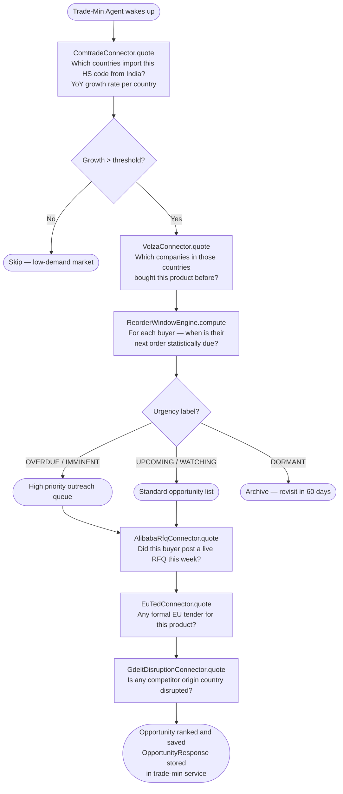
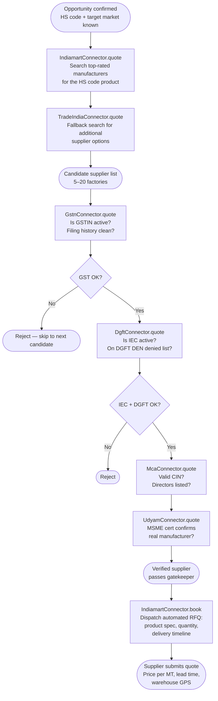
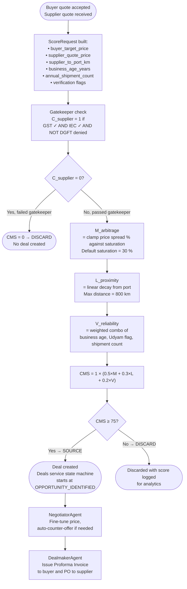

# PortLess — End-to-End Workflow

> **Who is this for?**  
> Written for a first-time reader (layman) who wants to understand *what the
> platform does and why*, while also giving developers the service names,
> connector names, and formula references they need to navigate the codebase.

---

## The One-Line Idea

A merchant exporter in India sits between an **overseas buyer** who wants a
product and an **Indian manufacturer** who makes it.  PortLess finds that pair
automatically, verifies both sides, negotiates the deal, ships the goods, and
pays everyone — without the merchant ever touching the cargo.

```
OVERSEAS BUYER  ──►  PORTLESS  ──►  INDIAN MANUFACTURER
  (Spain)           (Orchestrator)      (Guntur, AP)
   Pays in USD         Earns 8–15 %       Gets paid in INR
                       arbitrage margin    on inspection sign-off
```

---

## Big Picture: Four Phases

```
┌──────────────────────────────────────────────────────────────────────────┐
│  PHASE 1          PHASE 2          PHASE 3          PHASE 4             │
│  Find the         Find the         Match &          Execute the         │
│  Opportunity      Supplier         Score            Deal                │
│  ──────────────   ──────────────   ──────────────   ──────────────      │
│  WHO wants to     WHO in India     Is the pair      Ship, inspect,      │
│  buy, HOW MUCH,   can supply it    viable? What     clear customs,      │
│  and WHEN?        competitively?   is the margin?   pay everyone.       │
└──────────────────────────────────────────────────────────────────────────┘
```

---

## Phase 1 — Finding the Opportunity

### What happens (layman)

The platform continuously watches global trade data for situations where an
overseas country is buying a lot of something that India can supply cheaply.
It also watches for *right now* signals: a buyer who posted a live sourcing
request this week, or a country that suddenly can't get the product from its
usual supplier.

### The four demand signals (weakest → strongest intent)

```
SIGNAL LEVEL       SOURCE                    WHAT IT MEANS
─────────────────────────────────────────────────────────────────────────
Level 1 — History  UN Comtrade               "Spain imported 16 T of HS 090422
                                              from India last year (+40 % YoY)"

Level 2 — Pattern  Volza + ReorderWindow     "Iberia Spices SL bought quarterly;
                   Engine                     next order due in ~25 days"

Level 3 — Active   Alibaba RFQ               "Iberia Spices SL posted a buy offer
                   EU TED Tenders             for 10 MT ground pepper this week"

Level 4 — Forced   GDELT Disruption          "Vietnam export ban on pepper →
                   Monitor                    every EU buyer is emergency-sourcing"
```

### Flow — Opportunity Discovery



### Developer reference — Phase 1

| Step | Service | Connector |
|---|---|---|
| Macro demand scan | `trade_min` | `ComtradeConnector` |
| Buyer company list | `trade_min` | `VolzaConnector` |
| Reorder prediction | `trade_min` (internal) | `ReorderWindowEngine` |
| Live RFQ scan | `trade_min` | `AlibabaRfqConnector` |
| EU institutional tender | `trade_min` | `EuTedConnector` |
| Supply disruption alert | `trade_min` | `GdeltDisruptionConnector` |
| Buyer risk pre-screen | `trade_min` | `TrademoConnector`, `ImportGeniusConnector` |
| Tariff viability check | `trade_min` | `MacmapConnector` |
| EU buyer VAT validation | `trade_min` | `ViesConnector` |
| Buyer credit limit | `trade_min` | `AllianzTradeConnector` |

**Key files:** `services/trade_min/service.py`, `services/trade_min/schemas.py`,
`shared/connectors/trade_intel.py`, `shared/connectors/demand_signals.py`,
`shared/connectors/reorder.py`

---

## Phase 2 — Finding the Indian Supplier

### What happens (layman)

Once the platform knows *someone wants to buy*, it searches Indian wholesale
directories for manufacturers who can supply the exact product.  Before sending
a quote request, it checks three government databases to make sure the factory
is legally allowed to export and has no compliance issues.

### The supplier vetting checklist

```
CHECK               GOVERNMENT DATABASE       WHAT FAILS IT
──────────────────────────────────────────────────────────────────────────
Active GST filing   GSTN (GST Suvidha)        Missing / late filings
Valid export code   DGFT IEC registry         Expired, suspended, or
                                              on the DEN denied list
Registered company  MCA (Ministry of          Shell company / fake CIN
                    Corporate Affairs)
Real factory        Udyam / MSME registry     Broker / trader, not a
(not a broker)                                manufacturer
```

### Flow — Supplier Discovery



### Developer reference — Phase 2

| Step | Service | Connector |
|---|---|---|
| Manufacturer search | `sourcing` | `IndiamartConnector` |
| Fallback search | `sourcing` | `TradeIndiaConnector` |
| GST validation | `sourcing` | `GstnConnector` |
| IEC / export licence | `sourcing` | `DgftConnector` |
| Company registration | `sourcing` | `McaConnector` |
| MSME / real factory | `sourcing` | `UdyamConnector` |
| RFQ dispatch | `sourcing` | `IndiamartConnector.book()` |

**Key files:** `services/sourcing/service.py`, `services/sourcing/schemas.py`,
`shared/connectors/regulatory.py`

---

## Phase 3 — Trade Matching & Scoring

### What happens (layman)

With a verified buyer on one side and a verified supplier on the other, the
Match Engine runs a score from 0 to 100 on the pair.  If the score is 75 or
above, the deal moves forward.  Below 75, it is automatically discarded.

The score has three components:

| Component | Question it answers | Weight |
|---|---|---|
| **Arbitrage (M)** | Is the margin big enough to be worth it? | 50 % |
| **Proximity (L)** | Is the factory close enough to the port? | 30 % |
| **Reliability (V)** | Is the supplier established enough to trust? | 20 % |

There is also a hard **Gatekeeper (C)** that turns the entire score to zero if
the supplier fails any regulatory check — so a factory with a perfect location
and price but an expired IEC scores exactly 0 and is discarded immediately.

### The formula

$$
\text{CMS} = C_{\text{supplier}} \times \bigl(w_1 \cdot M_{\text{arbitrage}} + w_2 \cdot L_{\text{proximity}} + w_3 \cdot V_{\text{reliability}}\bigr)
$$

Where:
- $C_{\text{supplier}} \in \{0, 1\}$ — 0 if GST fails, IEC inactive, or DGFT denied
- $M_{\text{arbitrage}} \in [0, 100]$ — scales with `(buyer_price − supplier_quote) / buyer_price`
- $L_{\text{proximity}} \in [0, 100]$ — linear decay from port (100) to max distance (0)
- $V_{\text{reliability}} \in [0, 100]$ — based on business age, Udyam cert, shipment count
- Default weights: $w_1=0.5$, $w_2=0.3$, $w_3=0.2$
- **Decision:** CMS ≥ 75 → `SOURCE` (proceed)  |  CMS < 75 → `DISCARD`

### Flow — Match Engine



### Developer reference — Phase 3

| Step | Service | Key file |
|---|---|---|
| Score computation | `match_engine` | `services/match_engine/scoring.py` |
| Score request / response | `match_engine` | `services/match_engine/schemas.py` |
| CMS threshold config | `match_engine` | `services/match_engine/config.py` |
| Deal creation on SOURCE | `deals` | `services/deals/service.py` |
| Negotiation loop | `negotiator` | `services/negotiator/service.py` |
| PI / PO generation | `dealmaker` | `services/dealmaker/service.py` |

---

## API Walkthrough — Phase 1 → 2 → Trade Match (Concrete Example)

> **Scenario:** PortLess hunts for an opportunity to export **Ground Red Pepper
> (HS 090422)** from Guntur, Andhra Pradesh, India to a buyer in Spain.  
> Follow every API call, what is sent, what comes back, and how each output
> feeds the next step — all the way to the final match score.

### Data lineage at a glance

```
ComtradeConnector.quote()          → "Spain imports 16 T/yr from India, +40 % YoY"
        │ reporter_code = "724", hs_code = "090422"
        ▼
VolzaConnector.quote()             → "Iberia Spices SL is one active buyer"
        │ volza_buyer_id = "7839201"
        ▼
VolzaConnector.status()            → full buyer KPI profile (12 shipments, $3.8 M/yr)
        │ shipment_dates extracted
        ▼
ReorderWindowEngine.compute()      → "next order due in 25 days — UPCOMING"
        │ urgency_label, avg_reorder_days
        ▼
TrademoConnector.quote()           → buyer risk grade = "A", credit stable
        │ risk_grade, payment_behaviour
        ▼
ViesConnector.quote()              → VAT ESB12345678 valid ✓
        │ vat_verified = true
        ▼
AllianzTradeConnector.quote()      → credit limit $120 000, grade A
        │ credit_limit_usd = 120000
        ▼
MacmapConnector.quote()            → Spain MFN tariff on HS 090422 = 7 %
        │ applied_tariff_pct = 7.0
        ▼
IndiamartConnector.quote()         → 8 Guntur manufacturers found
        │ supplier candidates
        ▼
GstnConnector / DgftConnector /    → Guntur Agri Products Ltd passes all checks
McaConnector / UdyamConnector      │ gst_verified, iec_active, udyam_registered
        ▼
IndiamartConnector.book()          → RFQ dispatched → supplier quote: $2.10 / kg
        │ supplier_quote_price = 2.10
        ▼
MatchEngine.score_match()          → CMS = 86 → decision: SOURCE ✓
```

---

### Step 1 — Macro Demand Scan (`ComtradeConnector.quote`)

**What we ask:**  
"Which countries are importing HS 090422 from India this year, and how much?"

```python
connector = get_connector("comtrade")
result = await connector.quote({
    "hs_code":       "090422",        # Ground red pepper
    "period":        "2023",
    "flow_code":     "M",             # M = imports
    "partner_code":  "356",           # 356 = India (M49 numeric)
    "max_records":   500,
})
```

**What comes back (one row per importing country):**

```json
{
  "hs_code": "090422",
  "period":  "2023",
  "flow":    "M",
  "total_records": 42,
  "records": [
    {
      "reporter_code":     "724",
      "reporter_iso3":     "ESP",
      "reporter_name":     "Spain",
      "period":            "2023",
      "product_desc":      "Pepper, crushed or ground",
      "net_weight_kg":     16000.0,
      "cif_value_usd":     46500.0,
      "primary_value_usd": 46500.0
    },
    { "reporter_name": "Poland",  "net_weight_kg": 9200.0,  "primary_value_usd": 28000.0 },
    { "reporter_name": "Germany", "net_weight_kg": 22000.0, "primary_value_usd": 63000.0 }
  ]
}
```

**What the agent does with it:**  
Calls `ComtradeConnector.status("724:090422")` to fetch the 5-year trend for
Spain.  The returned `yoy_growth_pct = 40.2` clears the threshold, so Spain is
promoted to the buyer-discovery stage.

---

### Step 2 — Buyer Company Discovery (`VolzaConnector.quote`)

**What we ask:**  
"Which companies in Spain have shipped HS 090422 from India in the last year?"

```python
connector = get_connector("volza")
result = await connector.quote({
    "hs_code":          "090422",
    "importer_country": "ES",         # ISO-2 for Spain
    "exporter_country": "IN",         # default India
    "start_date":       "2024-01-01",
    "end_date":         "2024-12-31",
    "page_size":        50,
})
```

**What comes back (one row per shipment):**

```json
{
  "shipments": [
    {
      "shipment_id":         "76456564",
      "shipment_date":       "2024-09-12T00:00:00",
      "buyer_name":          "Iberia Spices SL",
      "buyer_country":       "Spain",
      "supplier_name":       "Guntur Agri Products Ltd",
      "hs_code":             "090422",
      "value_usd":           45000.0,
      "gross_weight_kg":     16000.0,
      "origin_port":         "Chennai",
      "destination_port":    "Valencia",
      "shipment_mode":       "FCL"
    }
  ],
  "pagination": { "total_records": 4, "has_next_page": false }
}
```

**What the agent extracts:**  
`buyer_name = "Iberia Spices SL"`, `volza_buyer_id` (from the next call below).

---

### Step 3 — Full Buyer Profile & Reorder Prediction

**3a. Get buyer KPIs (`VolzaConnector.status`)**

```python
profile = await connector.status("7839201")   # volza_buyer_id from Step 2
```

**Returns:**

```json
{
  "buyer_details":  { "buyer_name": "Iberia Spices SL", "buyer_country": "Spain" },
  "buyer_summary":  { "shipment_count": 420, "total_value_usd": 3800000, "supplier_count": 38 },
  "shipments": [
    { "shipment_date": "2024-09-12T00:00:00", ... },
    { "shipment_date": "2024-06-15T00:00:00", ... },
    { "shipment_date": "2024-03-20T00:00:00", ... }
  ]
}
```

**3b. Predict next order (`ReorderWindowEngine.compute`)**

```python
from shared.connectors.reorder import ReorderWindowEngine
engine = ReorderWindowEngine()
window = engine.compute(profile)
```

**Returns:**

```json
{
  "buyer_name":            "Iberia Spices SL",
  "avg_reorder_days":      89,
  "last_shipment_date":    "2024-09-12",
  "predicted_next_order":  "2024-12-10",
  "days_until_next_order": 25,
  "urgency_label":         "UPCOMING",
  "urgency_score":         0,
  "confidence":            "HIGH"
}
```

**Decision:** `UPCOMING` label → buyer added to the standard opportunity list and
outreach is scheduled 5 days before the predicted order date.

---

### Step 4 — Buyer Risk & Credit Check

**4a. Supply-chain risk profile (`TrademoConnector.quote`)**

```python
connector = get_connector("trademo")
risk = await connector.quote({
    "hs_code":       "090422",
    "buyer_country": "ES",
    "limit":         10,
})
# Returns risk_grade, payment_behaviour, trade_frequency for each company
```

**4b. EU VAT validation (`ViesConnector.quote`)**

```python
connector = get_connector("vies")
vat = await connector.quote({
    "vat_number":   "ESB12345678",
    "country_code": "ES",
})
# Returns: { "valid": true, "company_name": "IBERIA SPICES SL", "address": "..." }
```

**4c. Trade credit insurance limit (`AllianzTradeConnector.quote`)**

```python
connector = get_connector("allianz_trade")
credit = await connector.quote({
    "company_name": "Iberia Spices SL",
    "country":      "ES",
    "vat_number":   "ESB12345678",
})
# Returns: { "risk_grade": "A", "credit_limit_usd": 120000, "recommendation": "standard_terms" }
```

**Decision:** risk grade A + VAT valid + credit limit $120 K → buyer is
approved for standard 30-day payment terms (no 100 % advance escrow required).

---

### Step 5 — Tariff Viability (`MacmapConnector.quote`)

**What we ask:**  
"What is Spain's import duty on HS 090422 from India?"

```python
connector = get_connector("macmap")
tariff = await connector.quote({
    "hs_code":       "090422",
    "reporter_iso2": "ES",    # importing country
    "partner_iso2":  "IN",    # exporting country
})
# Returns: { "applied_tariff_pct": 7.0, "preferential_rate": 0.0, "quota": null }
```

**Viability check:**  
Buyer target CIF price = $3.20 / kg.  
Landed cost estimate = supplier quote + logistics + tariff = `$2.10 + $0.28 + ($3.20 × 7 %) = $2.62`.  
Margin = `$3.20 − $2.62 = $0.58 / kg` (18 %) — viable ✓

---

### Step 6 — Supplier Discovery & Vetting

**6a. Find manufacturers (`IndiamartConnector.quote`)**

```python
connector = get_connector("indiamart")
suppliers = await connector.quote({
    "query":        "ground red pepper chilli Guntur",
    "gst_verified": True,
})
# Returns: list of 8 manufacturer profiles with GSTIN, address, price range
```

**6b. Regulatory vetting (run in parallel for each candidate)**

```python
# All three calls fire concurrently for the shortlisted supplier:
import asyncio

gstn   = get_connector("gstn")
dgft   = get_connector("dgft")
mca    = get_connector("mca")
udyam  = get_connector("udyam")

gstn_result, dgft_result, mca_result, udyam_result = await asyncio.gather(
    gstn.quote({"gstin": "37AAAAA0000A1Z1"}),
    dgft.quote({"iec":   "0312045612"}),
    mca.quote( {"cin":   "U15400AP2005PTC123456"}),
    udyam.quote({"udyam_number": "UDYAM-AP-07-0012345"}),
)

# Gatekeeper flags assembled for match engine:
gst_verified     = gstn_result["status"]  == "ACTIVE"   # True
iec_active       = dgft_result["status"]  == "ACTIVE"   # True
dgft_denied      = dgft_result["den_list"] == True       # False
udyam_registered = udyam_result["certified"]             # True
```

**6c. Dispatch RFQ (`IndiamartConnector.book`)**

```python
rfq = await connector.book({
    "supplier_id": "IND-GNT-008",
    "product":     "Ground Red Pepper (HS 090422), moisture < 12 %, AGMARK Grade 1",
    "quantity":    "16 MT",
    "message":     "Require FOB Chennai quote, delivery within 21 days.",
})
# Supplier responds: { "quote_id": "Q-8812", "price_per_kg_usd": 2.10, "lead_days": 18 }
```

---

### Step 7 — Live Intent Check (optional, boosts confidence)

**7a. Active RFQ on Alibaba? (`AlibabaRfqConnector.quote`)**

```python
connector = get_connector("alibaba_rfq")
rfqs = await connector.quote({
    "query":   "ground pepper spices",
    "country": "ES",
})
# Returns matching live buy-offers posted by Spanish buyers this week
```

**7b. Disruption in Vietnam (competitor)? (`GdeltDisruptionConnector.quote`)**

```python
connector = get_connector("gdelt_disruption")
disruption = await connector.quote({
    "origin_country":  "Vietnam",
    "product_keyword": "pepper",
    "hours_lookback":  72,
})
# Returns: { "disruption_detected": true, "signal_strength": "HIGH", "article_count": 7 }
# → Spain buyers who sourced from Vietnam are now emergency-sourcing → urgency elevated
```

**7c. EU government tender? (`EuTedConnector.quote`)**

```python
connector = get_connector("eu_ted")
tenders = await connector.quote({
    "query":   "pepper spices food supply",
    "country": "ES",
})
# Returns active procurement notices with deadlines and contract values
```

---

### Step 8 — Assemble the Match Score (`match_engine`)

All data collected in Steps 1–7 flows into a single `ScoreRequest`:

```python
from services.match_engine.schemas import ScoreRequest, SupplierVerification

score_req = ScoreRequest(
    deal_id               = "DEAL-2026-IN-ES-0091",
    supplier_id           = "IND-GNT-008",

    # Arbitrage (M) — from Steps 5 + 6c
    buyer_target_price    = 3.20,          # buyer's CIF target price / kg
    supplier_quote_price  = 2.10,          # Guntur Agri's FOB quote / kg
    currency              = "USD",

    # Gatekeeper (C) — from Step 6b
    verification = SupplierVerification(
        gst_verified = True,               # GSTN: ACTIVE
        iec_active   = True,               # DGFT: ACTIVE
        dgft_denied  = False,              # DGFT: not on DEN list
    ),

    # Proximity (L) — Guntur to Chennai port
    supplier_to_port_km   = 320.0,

    # Reliability (V) — from Step 6b + Indiamart profile
    business_age_years    = 7.0,           # MCA registration date
    udyam_registered      = True,          # Udyam certified manufacturer
    annual_shipment_count = 14,            # from Indiamart profile
)
```

**Score computation (inside `scoring.py`):**

```
C_supplier  = 1          (GST ✓, IEC ✓, not denied)

M_arbitrage = clamp( (3.20 − 2.10) / 3.20 × 100 / 30 × 100 ) = clamp(114) = 100
               spread = 34 %, saturates at 30 % → M = 100

L_proximity = clamp( (1 − 320/800) × 100 ) = clamp(60) = 60
               320 km from Chennai, max = 800 km → L = 60

V_reliability = weighted combo(age=7, udyam=True, shipments=14) ≈ 72

CMS = 1 × (0.5 × 100 + 0.3 × 60 + 0.2 × 72)
    = 1 × (50 + 18 + 14.4)
    = 82.4
```

**Decision: CMS = 82.4 ≥ 75 → `SOURCE`**

The `deals` service creates deal `DEAL-2026-IN-ES-0091`, state transitions to
`SUPPLIER_SHORTLISTED`, and the platform moves to Phase 4 execution.

---

### Complete data-flow summary (Phases 1–3)

```
API CALL                          KEY OUTPUT           FEEDS INTO
────────────────────────────────────────────────────────────────────────────
ComtradeConnector.quote()         reporter = "ES"      VolzaConnector.quote
                                  yoy = +40 %          opportunity ranking

VolzaConnector.quote()            buyer_name           VolzaConnector.status
                                  volza_buyer_id       ReorderWindowEngine

VolzaConnector.status()           shipment_dates       ReorderWindowEngine
                                  buyer_summary        TrademoConnector

ReorderWindowEngine.compute()     urgency_label        outreach scheduler
                                  days_until_order     opportunity rank

TrademoConnector.quote()          risk_grade           AllianzTradeConnector
                                                       payment terms decision

ViesConnector.quote()             vat_verified         buyer approval gate

AllianzTradeConnector.quote()     credit_limit_usd     escrow configuration
                                  risk_grade           payment terms

MacmapConnector.quote()           applied_tariff_pct   viability check
                                                       ScoreRequest pricing

IndiamartConnector.quote()        supplier candidates  vetting pipeline

GstnConnector.quote()             gst_verified (bool)  ScoreRequest.verification
DgftConnector.quote()             iec_active (bool)    ScoreRequest.verification
McaConnector.quote()              company valid        ScoreRequest.reliability
UdyamConnector.quote()            udyam_registered     ScoreRequest.reliability

IndiamartConnector.book()         supplier_quote_price ScoreRequest arbitrage

AlibabaRfqConnector.quote()       live_rfq_found       urgency boost (optional)
GdeltDisruptionConnector.quote()  disruption_detected  urgency boost (optional)
EuTedConnector.quote()            tender_found         deal prioritisation

MatchEngine.score_match()         CMS = 82.4           deals service
                                  decision = SOURCE    → Phase 4 execution
```

---

## Phase 4 — Deal Execution (Zero-Touch Shipping)

### What happens (layman)

Once the buyer accepts the Proforma Invoice and wires the payment into escrow,
the platform orchestrates three independent professional services — quality
inspection, freight booking, and customs clearance — without anyone from
PortLess physically doing anything.  Escrow money is only released when each
checkpoint is verified.

### The payment release ladder

```
MILESTONE                       WHO GETS PAID          AMOUNT RELEASED
──────────────────────────────────────────────────────────────────────────
SGS inspection passes (CRF)     Supplier (INR)          Supplier cost
Let Export Order issued         Freight + CHA           Service fees
Bill of Lading confirmed        PortLess account        Arbitrage margin
Goods delivered (buyer ACK)     Final reconciliation    Any holdback buffer
```

### Flow — Execution

```mermaid
flowchart LR
    A([Buyer wires payment]) --> B

    B[EscrowGuard\nLocks funds in multi-currency\nescrow vault\nStripe Treasury / Payoneer] --> C

    C[ShieldLink Agent\nBooks SGS inspection via\nSGS / Bureau Veritas API\nPayload: warehouse GPS,\nHS code, buyer QC specs] --> D

    D{SGS inspection\nresult?}
    D -- FAIL --> E([Logistics pickup cancelled\nDispute ticket raised\nFunds stay locked])
    D -- PASS, CRF signed --> F

    F[EscrowGuard releases\nsupplier payment in INR] --> G

    G[ShieldLink Agent\nBooks container via\nCogoport / Freightos API\nFOB Chennai, FCL/LCL] --> H

    H[DocuGen Agent generates:\n• Commercial Invoice\n• Packing List\n• Certificate of Origin\n• RoDTEP declaration] --> I

    I[DocuGen → ICEGATE\nSubmits Shipping Bill\nvia CHA API\nCaptures Let Export Order] --> J

    J[EscrowGuard releases\nlogistics + CHA payments] --> K

    K[Carrier issues\nSwitch Bill of Lading\nBuyer name: PortLess\nSupplier name: hidden] --> L

    L[EscrowGuard releases\nPortLess arbitrage margin] --> M([Deal CLOSED\nState machine → COMPLETED])
```



### Developer reference — Phase 4

| Step | Service | Connector |
|---|---|---|
| Escrow lock | `escrow_guard` | `StripeTreasuryConnector`, `PayoneerConnector` |
| QC inspection booking | `shield_link` | `SgsConnector` |
| Freight quotation + booking | `shield_link` | `CogoportConnector`, `FreightosConnector` |
| Document generation | `docugen` | — (internal renderer) |
| Customs filing | `docugen` | `IcegateConnector` |
| Human approvals | `hitl_approval` | — (notification + webhook) |
| Exception handling | `exception_resolver` | — |

**Key files:** `services/escrow_guard/service.py`, `services/shield_link/service.py`,
`services/docugen/service.py`, `shared/connectors/shields.py`,
`shared/connectors/payments.py`

---

## Deal State Machine

The `deals` service is the single source of truth.  Every agent transitions the
state; no other service writes the state directly.

```
OPPORTUNITY_IDENTIFIED
        │
        ▼
SUPPLIER_SHORTLISTED  ◄── Match Engine returns SOURCE
        │
        ▼
PI_ISSUED             ◄── DealMaker generates Proforma Invoice
        │
        ▼
ESCROW_FUNDED         ◄── Buyer wires payment, EscrowGuard locks
        │
        ▼
QC_IN_PROGRESS        ◄── SGS inspection triggered
        │
        ├── FAIL ──► QC_FAILED (dispute, funds held)
        │
        ▼
QC_PASSED
        │
        ▼
FREIGHT_BOOKED        ◄── Container booked via Cogoport/Freightos
        │
        ▼
CUSTOMS_IN_PROGRESS   ◄── Shipping Bill submitted to ICEGATE
        │
        ▼
LET_EXPORT_ISSUED     ◄── LEO confirmed
        │
        ▼
IN_TRANSIT            ◄── Switch BoL issued by carrier
        │
        ▼
COMPLETED             ◄── Buyer confirms delivery, final payouts made
```

---

## Complete Connector Inventory

| # | Connector | File | Free? | Signal Level |
|---|---|---|---|---|
| 1 | `ComtradeConnector` | `trade_intel.py` | ✅ Free (500 calls/day) | L1 — Historical |
| 2 | `VolzaConnector` | `trade_intel.py` | 💰 Paid ($0.10/search) | L1 — Historical |
| 3 | `MacmapConnector` | `trade_intel.py` | ✅ Free key | L1 — Tariff check |
| 4 | `TrademoConnector` | `trade_intel.py` | 💰 Paid | L1 — Risk profile |
| 5 | `ImportGeniusConnector` | `trade_intel.py` | 💰 Enterprise | L1 — US manifests |
| 6 | `ReorderWindowEngine` | `reorder.py` | ✅ Internal | L2 — Prediction |
| 7 | `AlibabaRfqConnector` | `demand_signals.py` | 💰 Developer account | L3 — Live RFQ |
| 8 | `EuTedConnector` | `demand_signals.py` | ✅ Open API | L3 — EU tender |
| 9 | `GdeltDisruptionConnector` | `demand_signals.py` | ✅ Open API | L4 — Disruption |
| 10 | `GstnConnector` | `regulatory.py` | 💰 GSP licence | Vetting |
| 11 | `DgftConnector` | `regulatory.py` | 💰 API access | Vetting |
| 12 | `McaConnector` | `regulatory.py` | 💰 API Setu | Vetting |
| 13 | `UdyamConnector` | `regulatory.py` | 💰 Signzy/Zoop | Vetting |
| 14 | `ViesConnector` | `regulatory.py` | ✅ Free SOAP/REST | Buyer vetting |
| 15 | `AllianzTradeConnector` | `regulatory.py` | 💰 Commercial | Credit risk |
| 16 | `SgsConnector` | `shields.py` | 💰 Commercial | QC inspection |
| 17 | `CogoportConnector` | `shields.py` | 💰 Commercial | Freight |
| 18 | `FreightosConnector` | `shields.py` | 💰 Developer sandbox | Freight |
| 19 | `IcegateConnector` | `shields.py` | 🏛️ CHA access | Customs |
| 20 | `StripeTreasuryConnector` | `payments.py` | 💰 Commercial | Escrow |
| 21 | `PayoneerConnector` | `payments.py` | 💰 Commercial | Settlement |

---

## Developer Quick-Start Reference

### Where to find each logical layer

```
shared/connectors/          ← all external API adapters (add new ones here)
  trade_intel.py            ← demand discovery: Comtrade, Volza, MacMap, Trademo, ImportGenius
  demand_signals.py         ← live intent: Alibaba RFQ, EU TED, GDELT disruption
  reorder.py                ← ReorderWindowEngine (pure computation, no API)
  regulatory.py             ← vetting: GSTN, DGFT, MCA, Udyam, VIES, Allianz Trade
  shields.py                ← execution: SGS, Cogoport, Freightos, ICEGATE
  payments.py               ← money: Stripe Treasury, Payoneer
  registry.py               ← CONNECTOR_REGISTRY — one line to add a new adapter

services/trade_min/         ← Phase 1 logic (opportunity discovery, scoring)
services/sourcing/          ← Phase 2 logic (RFQ dispatch, quote intake)
services/match_engine/      ← Phase 3 logic (CMS formula, SOURCE/DISCARD decision)
services/deals/             ← state machine (single source of truth for deal lifecycle)
services/negotiator/        ← price negotiation loop
services/dealmaker/         ← PI / PO document creation
services/shield_link/       ← QC + freight + CHA booking
services/docugen/           ← document generation + ICEGATE filing
services/escrow_guard/      ← milestone-based payout release
services/hitl_approval/     ← human-in-the-loop gate (HITL)
services/exception_resolver/← automatic remediation for failed steps
```

### How to add a new connector in 3 steps

```python
# 1. Create the adapter in the appropriate connectors file:
class MyNewConnector(Connector):
    name = "my_new_source"
    ...

# 2. Register it in shared/connectors/registry.py:
MyNewConnector.name: MyNewConnector,

# 3. Add the env var to .env.example and shared/config.py:
my_new_api_key: str = ""
```

### Running the match engine locally

```bash
cd backend
uvicorn app:app --reload --port 8081

# Score a buyer-supplier pair:
curl -X POST http://localhost:8081/match-engine/score \
  -H "Content-Type: application/json" \
  -d '{
    "deal_id": "DEAL-TEST-001",
    "supplier_id": "SUP-001",
    "buyer_target_price": 3.20,
    "supplier_quote_price": 2.10,
    "currency": "USD",
    "verification": {"gst_verified": true, "iec_active": true, "dgft_denied": false},
    "supplier_to_port_km": 320,
    "business_age_years": 7,
    "udyam_registered": true,
    "annual_shipment_count": 14
  }'

# Expected: CMS ≈ 86 → decision: "SOURCE"
```
