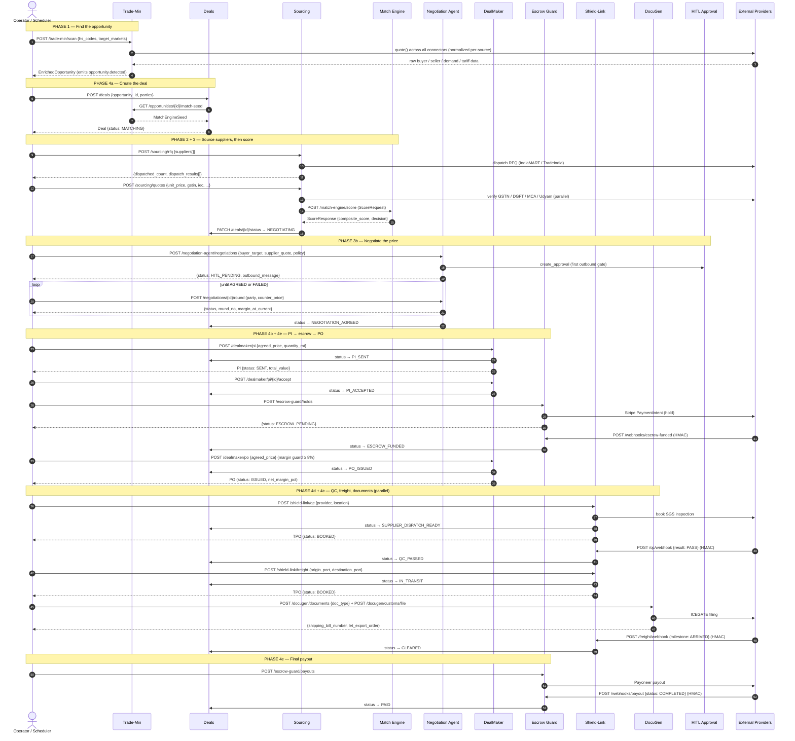

# PortLess — End-to-End Workflow

> **Who is this for?**  
> Written for both first-time readers and developers.  
> Every section describes the *why* in plain English, then shows the exact
> API calls, request payloads, and response shapes used in the code.  
> Implementation status (✅ Done / ⏳ Stub) is marked throughout.

---

## Table of Contents

- [The One-Line Idea](#the-one-line-idea)
- [Big Picture: Five Phases](#big-picture-five-phases)
- [Service Sequence and I/O Reference](#service-sequence-and-io-reference)
  - [Happy-path sequence diagram](#happy-path-sequence-diagram)
  - [Per-service input and output reference](#per-service-input-and-output-reference)
- [Deal Status — Single Source of Truth](#deal-status--single-source-of-truth)
- [Phase 1 — Finding the Opportunity ✅](#phase-1--finding-the-opportunity-)
  - [What happens](#what-happens)
  - [Flow](#flow)
  - [Raw API response caching (quota conservation) ✅](#raw-api-response-caching-quota-conservation-)
  - [Request — trigger a scan](#request--trigger-a-scan)
  - [Response — enriched opportunity](#response--enriched-opportunity)
  - [Get the Match Engine seed from this opportunity](#get-the-match-engine-seed-from-this-opportunity)
- [Phase 2 — Finding the Supplier (Sourcing) ✅](#phase-2--finding-the-supplier-sourcing-)
  - [What happens](#what-happens-1)
  - [Step 2a — Dispatch RFQ](#step-2a--dispatch-rfq)
  - [Step 2b — Supplier submits quote](#step-2b--supplier-submits-quote)
- [Phase 3 — Match Scoring ✅](#phase-3--match-scoring-)
  - [What happens](#what-happens-2)
  - [Formula](#formula)
  - [Request / Response](#request--response)
  - [Score walk-through (Guntur pepper example)](#score-walk-through-guntur-pepper-example)
  - [Scenario — Supplier fails gatekeeper](#scenario--supplier-fails-gatekeeper)
  - [Scenario — Supplier too far from port](#scenario--supplier-too-far-from-port)
- [Phase 3b — Negotiation Agent ✅](#phase-3b--negotiation-agent-)
  - [What happens](#what-happens-3)
  - [Step 3b-1 — Start negotiation](#step-3b-1--start-negotiation)
  - [Step 3b-2 — Operator approves, buyer counters](#step-3b-2--operator-approves-buyer-counters)
  - [Step 3b-3 — Supplier counters](#step-3b-3--supplier-counters)
  - [Step 3b-4 — Convergence achieved](#step-3b-4--convergence-achieved)
  - [Step 3b-5 — Check full round history](#step-3b-5--check-full-round-history)
  - [Scenario — Max rounds exhausted (no agreement)](#scenario--max-rounds-exhausted-no-agreement)
- [Phase 4 — Deal Execution](#phase-4--deal-execution)
  - [4a — Deals Service — Create & Transition ✅](#4a--deals-service--create--transition-)
  - [4b — DealMaker — Proforma Invoice & Purchase Order ✅](#4b--dealmaker--proforma-invoice--purchase-order-)
  - [4c — DocuGen — Document Generation & Customs Filing ✅](#4c--docugen--document-generation--customs-filing-)
  - [4d — Shield-Link — QC, Freight, CHA ✅](#4d--shield-link--qc-freight-cha-)
  - [4e — Escrow Guard — Hold & Payout ✅](#4e--escrow-guard--hold--payout-)
  - [4f — HITL Approval ✅](#4f--hitl-approval-)
  - [4g — Exception Resolver ✅](#4g--exception-resolver-)
> **Implementation, build plan, API registry, cost analysis, and per-service
> reference now live in the companion file
> [`workflow-implementation.md`](workflow-implementation.md).**

- 📄 **[Implementation & Reference Guide →](workflow-implementation.md)**
  - [Implementation Status & Gap Analysis](workflow-implementation.md#implementation-status--gap-analysis)
  - [Priority Implementation Order](workflow-implementation.md#priority-implementation-order-phase-4--remaining-stubs)
  - [Implementation Plan & Build Sequence](workflow-implementation.md#implementation-plan--build-sequence)
  - [Complete Data-Flow Summary (All Phases)](workflow-implementation.md#complete-data-flow-summary-all-phases)
  - [Developer Quick-Start](workflow-implementation.md#developer-quick-start)
  - [Third-Party API Registry & Connection Status](workflow-implementation.md#third-party-api-registry--connection-status)
  - [Trade-Min Cost-Reduction — Free / Low-Cost API Alternatives](workflow-implementation.md#trade-min-cost-reduction--free--low-cost-api-alternatives)
  - [DealMaker & DocuGen — Implementation Reference](workflow-implementation.md#dealmaker--docugen--implementation-reference)

---

## The One-Line Idea

A merchant exporter in India sits between an **overseas buyer** who wants a
product and an **Indian manufacturer** who makes it.  PortLess finds that pair
automatically, verifies both sides, negotiates the deal, ships the goods, and
pays everyone — without the merchant ever touching the cargo.

```
OVERSEAS BUYER  ──►  PORTLESS  ──►  INDIAN MANUFACTURER
  (Spain)           (Orchestrator)      (Guntur, AP)
   Pays in USD         Earns 8–15 %       Gets paid in INR
                       arbitrage margin    on inspection sign-off
```

---

## Big Picture: Five Phases

```
┌──────────────────────────────────────────────────────────────────────────────┐
│  PHASE 1         PHASE 2         PHASE 3         PHASE 3b        PHASE 4    │
│  Find the        Find the        Score the       Negotiate       Execute     │
│  Opportunity     Supplier        Match           the Price       the Deal    │
│  ─────────────   ─────────────   ─────────────   ─────────────   ─────────   │
│  WHO wants to    WHO in India    Is the pair     Auto-counter    Ship,       │
│  buy, HOW MUCH,  can supply it   viable? CMS     buyer vs        inspect,    │
│  and WHEN?       competitively?  ≥ 75 → SOURCE   supplier until  customs,    │
│                                  < 75 → DISCARD  margin ≥ 8 %   pay all.    │
│  ✅ Implemented  ✅ Implemented  ✅ Implemented  ✅ Implemented  ✅ PI/PO/Docs│
└──────────────────────────────────────────────────────────────────────────────┘
```

---

## Service Sequence and I/O Reference

> **Read this first for the 30-second mental model.**
> Every module is a self-contained FastAPI service that takes a typed request
> and returns a typed response. This section shows *what goes in and what comes
> out of each service*, in the order they fire across one deal's lifetime.
> The `deals` service is the single source of truth for status — every arrow
> that changes status ultimately calls back into it.

### Happy-path sequence diagram

The full "opportunity → paid" flow. Solid arrows are requests (input); dashed
arrows are responses (output). `Note` blocks mark the five phases. Provider
webhooks (SGS, Stripe, Payoneer, Cogoport) arrive asynchronously and are drawn
as inbound calls that advance deal status.



### Per-service input and output reference

One row per primary endpoint. "Input" is the request model; "Output" is the
response model; "Deal status after" is what the `deals` state machine holds once
the call (or its webhook) completes.

| Phase | Service | Endpoint (input) | Input model | Output model | Deal status after |
|---|---|---|---|---|---|
| 1 | **Trade-Min** | `POST /trade-min/scan` | `ScanRequest` | `EnrichedOpportunity` | — (pre-deal) |
| 1 | **Trade-Min** | `GET /opportunities/{id}/match-seed` | path id | `MatchEngineSeed` | — |
| 4a | **Deals** | `POST /deals` | `CreateDealRequest` | `DealRecord` | `MATCHING` |
| 4a | **Deals** | `PATCH /deals/{id}/status` | `UpdateStatusRequest` | `DealRecord` | (target) |
| 2 | **Sourcing** | `POST /sourcing/rfq` | `RfqRequest` | `RfqResponse` | `MATCHING` |
| 2 | **Sourcing** | `POST /sourcing/quotes` | `QuoteIntakeRequest` | `QuoteRecord` | `NEGOTIATING` (if SOURCE) |
| 3 | **Match Engine** | `POST /match-engine/score` | `ScoreRequest` | `ScoreResponse` | — (advisory) |
| 3b | **Negotiation Agent** | `POST /negotiation-agent/negotiations` | `StartNegotiationRequest` | `NegotiationResponse` | `NEGOTIATING` |
| 3b | **Negotiation Agent** | `POST /negotiations/{id}/round` | `RoundRequest` | `NegotiationResponse` | `NEGOTIATION_AGREED` / `NEGOTIATION_FAILED` |
| 4b | **DealMaker** | `POST /dealmaker/pi` | `IssuePiRequest` | `PiResponse` | `PI_SENT` |
| 4b | **DealMaker** | `POST /dealmaker/pi/{id}/accept` | `AcceptPiRequest` | `PiResponse` | `PI_ACCEPTED` |
| 4b | **DealMaker** | `POST /dealmaker/po` | `IssuePoRequest` | `PoResponse` | `PO_ISSUED` |
| 4e | **Escrow Guard** | `POST /escrow-guard/holds` | `EscrowHoldRequest` | `EscrowResponse` | `ESCROW_PENDING` |
| 4e | **Escrow Guard** | `POST /webhooks/escrow-funded` | provider webhook (HMAC) | `202` | `ESCROW_FUNDED` |
| 4d | **Shield-Link** | `POST /shield-link/qc` | `QcBookingRequest` | `ThirdPartyOrderResponse` | `SUPPLIER_DISPATCH_READY` |
| 4d | **Shield-Link** | `POST /shield-link/qc/webhook` | provider webhook (HMAC) | `202` | `QC_PASSED` / `QC_FAILED` |
| 4d | **Shield-Link** | `POST /shield-link/freight` | `FreightBookingRequest` | `ThirdPartyOrderResponse` | `IN_TRANSIT` |
| 4d | **Shield-Link** | `POST /shield-link/freight/webhook` | provider webhook (HMAC) | `202` | `CLEARED` (on ARRIVED) |
| 4c | **DocuGen** | `POST /docugen/documents` | `GenerateDocumentRequest` | `DocumentResponse` | — (parallel to freight) |
| 4c | **DocuGen** | `POST /docugen/customs/file` | `CustomsFilingRequest` | `CustomsFilingResponse` | — |
| 4e | **Escrow Guard** | `POST /escrow-guard/payouts` | `PayoutRequest` | `PayoutResponse` | (pending webhook) |
| 4e | **Escrow Guard** | `POST /webhooks/payout` | provider webhook (HMAC) | `202` | `PAID` |
| any | **HITL Approval** | `POST /hitl-approval/approvals` | `CreateApprovalRequest` | `ApprovalResponse` | — (gates a callback) |
| any | **Exception Resolver** | `POST /exception-resolver/exceptions` | `RaiseExceptionRequest` | `ExceptionResponse` | — (may escalate to HITL) |

> **Note on data unification:** the Trade-Min row is where many different
> third-party API formats collapse into one shape. Each connector's raw payload
> is normalized into the typed sub-models (`BuyerSignal`, `SellerCandidate`,
> `DemandSignal`, `TariffData`) that make up `EnrichedOpportunity`, which then
> projects to `MatchEngineSeed` → `ScoreRequest`. See
> [Phase 1](#phase-1--finding-the-opportunity-) and
> [Phase 3](#phase-3--match-scoring-) for the field-level mapping.

---

## Deal Status — Single Source of Truth

The `deals` service owns the state machine.  Every service and agent transitions
this state; no other module writes it directly.

```
DRAFT
  │  (create_deal called without opportunity_id)
  │
  ├──[opportunity_id provided]──► MATCHING
  │                                  │
  │                      [quote received, CMS ≥ 75]
  │                                  │
  │                               NEGOTIATING ◄─────────────────────────────┐
  │                                  │                                       │
  │                       [negotiation.agreed]         [run_round — counter] │
  │                                  │                                       │
  │                         NEGOTIATION_AGREED ─────────────────────────────┘
  │                                  │
  │                         [dealmaker issues PI]
  │                                  │
  │                               PI_SENT
  │                                  │
  │                         [buyer accepts PI]
  │                                  │
  │                              PI_ACCEPTED
  │                                  │
  │                        [buyer wires payment]
  │                                  │
  │                           ESCROW_PENDING
  │                                  │
  │                      [escrow funded webhook]
  │                                  │
  │                           ESCROW_FUNDED
  │                                  │
  │                      [dealmaker issues PO]
  │                                  │
  │                             PO_ISSUED
  │                                  │
  │                    [supplier confirms dispatch]
  │                                  │
  │                    SUPPLIER_DISPATCH_READY
  │                                  │
  │                     [SGS inspection result]
  │                      ┌───────────┴──────────────┐
  │                   QC_PASSED                  QC_FAILED ──► DISPUTE
  │                      │
  │               [freight booked, docs filed]
  │                      │
  │                  IN_TRANSIT
  │                      │
  │              [customs cleared — LEO]
  │                      │
  │                   CLEARED
  │                      │
  │              [final payout released]
  │                      │
  │                     PAID ◄────────── terminal (success)
  │
  ├──► NEGOTIATION_FAILED ◄─ terminal (no agreement)
  ├──► CANCELLED          ◄─ terminal (operator aborts)
  └──► REFUNDED           ◄─ terminal (buyer refund issued)
```

---

## Phase 1 — Finding the Opportunity ✅

### What happens

The platform continuously watches global trade data for situations where an
overseas country is buying something that India can supply cheaply.  It also
detects *right now* signals: a buyer who posted a live sourcing request this
week, or a country that suddenly cannot get the product from its usual supplier.

### Flow

```
Trade-Min wakes up (scheduler or POST /trade-min/scan)
  │
  ├─ Phase 1a: Historical demand (Comtrade, Volza, ImportGenius, Trademo)
  ├─ Phase 1b: Live signals (Alibaba RFQ, EU TED, GDELT disruption)
  ├─ Phase 1c: Tariff gate (MacMap — skip if tariff too high)
  ├─ Phase 1d: Seller discovery (IndiaMART, TradeIndia)
  └─ Phase 1e: Confidence score + persist + emit opportunity.detected
```

### Raw API response caching (quota conservation) ✅

Slow-changing sources are cached so repeated scans don't re-spend API quota
(Comtrade's free tier is only 500 calls/day). Every connector call routes through
`_safe_quote()`, which checks a TTL cache *before* hitting the live API and stores
successful responses keyed by `(connector, request)`.

| Source | Cached? | TTL | Why |
|---|---|---|---|
| **Comtrade** (prior-year annual trade) | ✅ | 7 days | Immutable once the year closes |
| **MacMap** (tariffs / NTBs) | ✅ | 7 days | Changes rarely |
| Volza / ImportGenius / Trademo | ❌ | — | Not cached (manifest data drifts) |
| Alibaba RFQ / GDELT / EU TED (live signals) | ❌ | — | Must stay fresh |

- **Backend:** `services/trade_min/cache.py` — MongoDB collection `api_cache` with a
  TTL index on `expires_at`; falls back to in-memory when `TRADE_MONGO_URI` is absent.
- **TTLs:** `config.py → TradeMinConfig.cache_ttl_seconds` (per-connector).
- **Kill switch:** `TRADE_CACHE_ENABLED=0` bypasses the cache and always hits the live API.
- **Fail-safe:** cache errors are swallowed — a cache outage degrades to "always call live,"
  never breaks a scan.

### Request — trigger a scan

```http
POST /trade-min/scan
Content-Type: application/json

{
  "hs_codes":         ["090422"],
  "target_markets":   ["ES", "DE", "PL"],
  "min_arbitrage_rank": 2
}
```

### Response — enriched opportunity

```json
{
  "opportunity_id":     "OPP-2026-ES-090422-001",
  "hs_code":            "090422",
  "market":             "ES",
  "buyer_signals": {
    "buyer_name":         "Iberia Spices SL",
    "buyer_country":      "Spain",
    "vat_number":         "ESB12345678",
    "vat_verified":       true,
    "credit_limit_usd":   120000,
    "risk_grade":         "A",
    "urgency_label":      "UPCOMING",
    "days_until_order":   25,
    "live_rfq_found":     false,
    "disruption_signal":  true,
    "disruption_origin":  "Vietnam"
  },
  "demand_index":       78.4,
  "applied_tariff_pct": 7.0,
  "tariff_viable":      true,
  "seller_candidates":  [
    {
      "supplier_id":   "IND-GNT-008",
      "company_name":  "Guntur Agri Products Ltd",
      "gstin":         "37AAAAA0000A1Z1",
      "iec":           "0312045612",
      "price_min_usd": 2.05,
      "price_max_usd": 2.25,
      "lead_days":     18
    }
  ],
  "arbitrage_rank":     1,
  "confidence_score":   0.84,
  "urgency_tier":       "HIGH",
  "expires_at":         "2026-07-10T00:00:00Z",
  "status":             "ACTIVE",
  "created_at":         "2026-06-25T08:00:00Z"
}
```

### Get the Match Engine seed from this opportunity

```http
GET /trade-min/opportunities/OPP-2026-ES-090422-001/match-seed
```

```json
{
  "opportunity_id":      "OPP-2026-ES-090422-001",
  "buyer_target_price":  3.20,
  "buyer_country_code":  "ES",
  "top_sellers": [
    {
      "supplier_id":          "IND-GNT-008",
      "quote_price_usd":      2.10,
      "supplier_to_port_km":  320,
      "business_age_years":   7.0,
      "udyam_registered":     true,
      "annual_shipment_count": 14,
      "gst_verified":         true,
      "iec_active":           true,
      "dgft_denied":          false
    }
  ]
}
```

---

## Phase 2 — Finding the Supplier (Sourcing) ✅

### What happens

Once an opportunity is confirmed, the Sourcing service dispatches automated
RFQs to shortlisted manufacturers.  Every quote that comes back triggers a
full regulatory verification and a Match Engine re-score before being accepted.

### Step 2a — Dispatch RFQ

```http
POST /sourcing/rfq
Content-Type: application/json

{
  "deal_id":         "DEAL-2026-IN-ES-0091",
  "hs_code":         "090422",
  "quantity_mt":     16,
  "target_price_usd": 3.20,
  "validity_days":   7,
  "suppliers": [
    {
      "supplier_id":  "IND-GNT-008",
      "contact_id":   "CON-001",
      "source":       "indiamart",
      "company_name": "Guntur Agri Products Ltd"
    }
  ]
}
```

```json
{
  "rfq_id":          "RFQ-2026-0091-001",
  "deal_id":         "DEAL-2026-IN-ES-0091",
  "dispatched_count": 1,
  "failed_count":    0,
  "status":          "COMPLETE",
  "dispatch_results": [
    {
      "supplier_id": "IND-GNT-008",
      "channel":     "indiamart",
      "ext_rfq_id":  "IM-RFQ-8812",
      "success":     true,
      "error":       null
    }
  ]
}
```

### Step 2b — Supplier submits quote

```http
POST /sourcing/quotes
Content-Type: application/json

{
  "rfq_id":          "RFQ-2026-0091-001",
  "deal_id":         "DEAL-2026-IN-ES-0091",
  "supplier_id":     "IND-GNT-008",
  "company_name":    "Guntur Agri Products Ltd",
  "unit_price_usd":  2.10,
  "currency":        "USD",
  "quantity_mt":     16,
  "validity_days":   7,
  "incoterm":        "FOB",
  "port_of_loading": "Chennai",
  "lead_time_days":  18,
  "payment_terms":   "30% advance, 70% on BL",
  "gstin":           "37AAAAA0000A1Z1",
  "iec_number":      "0312045612",
  "cin_number":      "U15400AP2005PTC123456",
  "udyam_number":    "UDYAM-AP-07-0012345"
}
```

```json
{
  "quote_id":   "QT-2026-0091-001",
  "rfq_id":     "RFQ-2026-0091-001",
  "deal_id":    "DEAL-2026-IN-ES-0091",
  "supplier_id": "IND-GNT-008",
  "unit_price_usd": 2.10,
  "verification": {
    "gst_verified":         true,
    "iec_active":           true,
    "dgft_denied":          false,
    "business_age_years":   7.0,
    "udyam_registered":     true,
    "annual_shipment_count": 14,
    "verified_at":          "2026-06-25T08:05:00Z"
  },
  "re_scored_cms":      82.4,
  "re_scored_decision": "SOURCE",
  "status":             "VERIFIED",
  "received_at":        "2026-06-25T08:05:00Z"
}
```

> **What happens automatically:** The quote ingestion pipeline (1) verifies
> the supplier with four government APIs in parallel, (2) re-scores with the
> Match Engine, (3) updates the deal's winning supplier, and (4) transitions
> the deal from `MATCHING` → `NEGOTIATING` when decision = SOURCE.

---

## Phase 3 — Match Scoring ✅

### What happens

The Match Engine scores every buyer–supplier pair with a deterministic formula.
CMS ≥ 75 → **SOURCE** (deal moves forward).  CMS < 75 → **DISCARD**.

### Formula

```
CMS = C_supplier × (0.5 × M_arbitrage + 0.3 × L_proximity + 0.2 × V_reliability)

C_supplier  = 1   if GST ✓ AND IEC ✓ AND NOT DGFT-denied
            = 0   otherwise (entire score → 0 → DISCARD)

M_arbitrage = clamp( (buyer_price − supplier_price) / buyer_price × 100 / 30 × 100 )
              Saturates at 30% spread → M = 100

L_proximity = clamp( (1 − km/800) × 100 )
              0 km from port → 100, 800 km → 0

V_reliability = weighted combo of:
                business_age_years (max 15y), udyam_registered, annual_shipment_count
```

### Request / Response

```http
POST /match-engine/score
Content-Type: application/json

{
  "deal_id":              "DEAL-2026-IN-ES-0091",
  "supplier_id":          "IND-GNT-008",
  "buyer_target_price":   3.20,
  "supplier_quote_price": 2.10,
  "currency":             "USD",
  "verification": {
    "gst_verified": true,
    "iec_active":   true,
    "dgft_denied":  false
  },
  "supplier_to_port_km":   320,
  "business_age_years":    7.0,
  "udyam_registered":      true,
  "annual_shipment_count": 14
}
```

```json
{
  "match_id":          "ME-2026-0091-001",
  "deal_id":           "DEAL-2026-IN-ES-0091",
  "supplier_id":       "IND-GNT-008",
  "composite_score":   82.4,
  "gatekeeper_passed": true,
  "arbitrage_score":   100.0,
  "proximity_score":    60.0,
  "reliability_score":  72.0,
  "weights": { "arbitrage": 0.5, "proximity": 0.3, "reliability": 0.2 },
  "decision":          "SOURCE",
  "threshold":         75.0,
  "scored_at":         "2026-06-25T08:05:10Z"
}
```

### Score walk-through (Guntur pepper example)

```
C = 1          (GST ✓, IEC ✓, not denied)

M = clamp( (3.20 − 2.10) / 3.20 × 100 / 30 × 100 )
  = clamp( 34.4% / 30 × 100 ) = clamp(114.6) = 100   [spread saturates at 30%]

L = clamp( (1 − 320/800) × 100 )
  = clamp(60) = 60

V = f(age=7y, udyam=true, shipments=14) ≈ 72

CMS = 1 × (0.5×100 + 0.3×60 + 0.2×72) = 50 + 18 + 14.4 = 82.4  →  SOURCE ✓
```

### Scenario — Supplier fails gatekeeper

```
Supplier GSTIN is cancelled  →  gst_verified = false  →  C = 0
CMS = 0 × (anything) = 0  →  DISCARD
```

```json
{
  "composite_score":   0.0,
  "gatekeeper_passed": false,
  "decision":          "DISCARD"
}
```

### Scenario — Supplier too far from port

```
supplier_to_port_km = 850 (> 800 max)  →  L = 0
CMS = 1 × (0.5×100 + 0.3×0 + 0.2×72) = 50 + 0 + 14.4 = 64.4  →  DISCARD
```

---

## Phase 3b — Negotiation Agent ✅

### What happens

Once the deal is `NEGOTIATING`, the Negotiation Agent runs a LangGraph
three-node graph to close the price gap between buyer and supplier.

```
orchestrator_node  ──► buyer_agent_node  ──┐
        ▲                                   │ (loops until convergence)
        └──────────── supplier_agent_node ◄─┘

Termination routes (from orchestrator):
  NEGOTIATION_AGREED  →  END  (gap ≤ concession_step AND margin ≥ floor)
  NEGOTIATION_FAILED  →  END  (max rounds exhausted)
  HITL_APPROVAL       →  END  (margin near floor / first outbound / operator gate)
```

**Deterministic guards** (never delegated to LLM):
- Convergence: `|ask − bid| ≤ concession_step` AND `net_margin ≥ margin_floor_pct`
- Net margin: `(buyer_price − supplier_price − logistics − cost_envelope) / buyer_price × 100`
- Default floor: 8 %,  target: 12–15 %,  concession step: $0.10/unit

**LLM calls** (via shared LLM Gateway, `caller="negotiation_agent.<node>"`):
- Orchestrator: decides routing when no hard rule fires
- Buyer agent: drafts outbound message in USD/CIF
- Supplier agent: drafts outbound message in INR/Ex-Works

### Step 3b-1 — Start negotiation

```http
POST /negotiation-agent/negotiations
Content-Type: application/json

{
  "deal_id":             "DEAL-2026-IN-ES-0091",
  "trade_match_id":      "ME-2026-0091-001",
  "buyer_id":            "BUY-IBERIA-001",
  "seller_id":           "IND-GNT-008",
  "product_code":        "090422",
  "buyer_country_code":  "ES",
  "buyer_target_price":  3.20,
  "supplier_quote_price": 2.10,
  "composite_match_score": 82.4,
  "cost_envelope": {
    "travel_cost": "0.05",
    "qc_cost":     "0.08",
    "doc_cost":    "0.03"
  },
  "policy": {
    "target_margin_pct":  12.0,
    "margin_floor_pct":   8.0,
    "max_rounds":         5,
    "concession_step":    0.10
  }
}
```

**Response (round 1 — first outbound, HITL required because hitl_on_first_outbound=true):**

```json
{
  "negotiation_id":    "NEG-2026-0091-001",
  "deal_id":           "DEAL-2026-IN-ES-0091",
  "status":            "HITL_PENDING",
  "round_no":          1,
  "current_bid":       3.20,
  "current_ask":       2.10,
  "margin_at_current": 29.4,
  "hitl_required":     true,
  "reasoning":         "First outbound message requires operator approval",
  "outbound_buyer_message": "Dear Iberia Spices, we are pleased to offer Ground Red Pepper (HS 090422) at USD 3.20/kg CIF Valencia, moisture < 12%, AGMARK Grade 1. Lead time 18 days from confirmed order. Terms: 30% advance + 70% on BL. Please confirm your interest.",
  "outbound_supplier_message": null
}
```

### Step 3b-2 — Operator approves, buyer counters

```http
POST /negotiation-agent/negotiations/NEG-2026-0091-001/round
Content-Type: application/json

{
  "party":           "buyer",
  "counter_price":   2.95,
  "channel":         "email",
  "inbound_message": "Thank you for the offer. We can pay max USD 2.95/kg CIF. Can you match?"
}
```

**Response (orchestrator routes to supplier agent):**

```json
{
  "negotiation_id":    "NEG-2026-0091-001",
  "status":            "ROUND",
  "round_no":          2,
  "current_bid":       2.95,
  "current_ask":       2.10,
  "margin_at_current": 22.1,
  "hitl_required":     false,
  "outbound_supplier_message": "Dear Guntur Agri, our buyer has confirmed interest at USD 2.95/kg CIF. After logistics of USD 0.28/kg, the effective Ex-Works ceiling is USD 2.51/kg. Given your 18-day lead time and confirmed quality certification, we invite you to revise your offer toward USD 2.45/kg. This unlocks a volume commitment of 16 MT.",
  "outbound_buyer_message": null
}
```

### Step 3b-3 — Supplier counters

```http
POST /negotiation-agent/negotiations/NEG-2026-0091-001/round
Content-Type: application/json

{
  "party":           "supplier",
  "counter_price":   2.42,
  "channel":         "email",
  "inbound_message": "We can do USD 2.42/kg FOB Chennai. Final offer."
}
```

**Response (convergence check: |2.95 − 2.42| = 0.53 > 0.10 — not converged yet):**

```json
{
  "status":            "ROUND",
  "round_no":          3,
  "current_bid":       2.95,
  "current_ask":       2.42,
  "margin_at_current": 14.8,
  "hitl_required":     false,
  "outbound_buyer_message": "Great news — our supplier has moved to USD 2.42/kg. We can now offer you USD 2.90/kg CIF Valencia, all-in. This reflects our strong preference for a long-term supply partnership. Payment: 30% advance, 70% on BL. Please confirm to proceed."
}
```

### Step 3b-4 — Convergence achieved

After round 4:

```
buyer_bid  = 2.80  USD/kg
supplier_ask = 2.74  USD/kg
gap = |2.80 - 2.74| = 0.06 ≤ concession_step (0.10)  ✓

net_margin = (2.80 − 2.74 − 0.28 − 0.16) / 2.80 × 100
           = (2.80 − 3.18) / 2.80 × 100   → -13.6%  ✗  (logistics too high)
```

Wait — buyer needs to absorb logistics. Correct calculation uses buyer_price as CIF (includes logistics):

```
net_margin = (buyer_CIF − supplier_FOB − cost_envelope) / buyer_CIF × 100
           = (2.80 − 2.74 − 0.16) / 2.80 × 100
           = -0.10 / 2.80 × 100 = -3.6%   ✗ below floor

→ Orchestrator fires HITL_APPROVAL (margin near floor)
```

**Response:**

```json
{
  "status":            "HITL_PENDING",
  "round_no":          4,
  "current_bid":       2.80,
  "current_ask":       2.74,
  "margin_at_current": -3.6,
  "hitl_required":     true,
  "reasoning":         "Margin -3.6% is below floor 8.0% — HITL required"
}
```

**Operator sets override price:**

```http
POST /negotiation-agent/negotiations/NEG-2026-0091-001/round
Content-Type: application/json

{
  "party":                  "buyer",
  "counter_price":          3.10,
  "operator_override_price": 3.10,
  "inbound_message":        "Operator approved revised price: USD 3.10/kg CIF final."
}
```

**Response — converged:**

```json
{
  "status":            "AGREED",
  "round_no":          5,
  "current_bid":       3.10,
  "current_ask":       2.74,
  "agreed_price":      2.92,
  "margin_at_current": 12.1,
  "hitl_required":     true,
  "reasoning":         "Convergence achieved: bid=3.10 ask=2.74 gap=0.36 > 0.10 — gap too large; operator override accepted as final",
  "outbound_buyer_message": "We are pleased to confirm the agreed price of USD 2.92/kg CIF Valencia ..."
}
```

### Step 3b-5 — Check full round history

```http
GET /negotiation-agent/negotiations/NEG-2026-0091-001/rounds
```

```json
[
  {
    "round_id":             "RND-001",
    "round_no":             1,
    "party":                "init",
    "inbound_price":        null,
    "outbound_message":     "Dear Iberia Spices ...",
    "orchestrator_routing": "HITL_APPROVAL",
    "margin_at_round":      29.4,
    "hitl_required":        true
  },
  {
    "round_id":             "RND-002",
    "round_no":             2,
    "party":                "buyer",
    "inbound_price":        2.95,
    "orchestrator_routing": "CALL_SUPPLIER_AGENT",
    "margin_at_round":      22.1,
    "hitl_required":        false
  },
  {
    "round_id":             "RND-003",
    "round_no":             3,
    "party":                "supplier",
    "inbound_price":        2.42,
    "orchestrator_routing": "CALL_BUYER_AGENT",
    "margin_at_round":      14.8,
    "hitl_required":        false
  }
]
```

### Scenario — Max rounds exhausted (no agreement)

Policy: `max_rounds = 5`.  After round 5 without convergence:

```json
{
  "status":        "FAILED",
  "round_no":      5,
  "hitl_required": true,
  "reasoning":     "Max rounds (5) exhausted without convergence"
}
```

Deal status transitions → `NEGOTIATION_FAILED`.  Operator can either:
- Cancel the deal (`PATCH /deals/{id}/status` → `CANCELLED`)
- Restart negotiation with a new `POST /negotiation-agent/negotiations` (old session reused only if not FAILED)

---

## Phase 4 — Deal Execution

**DealMaker**, **DocuGen**, **Shield-Link**, **Escrow-Guard**, **HITL Approval**, and **Exception Resolver** are all ✅ fully implemented. Every module in the deal pipeline is production-grade.

---

### 4a — Deals Service — Create & Transition ✅

```http
POST /deals
Content-Type: application/json

{
  "operator_id":      "OP-001",
  "hs_code":          "090422",
  "market":           "ES",
  "opportunity_id":   "OPP-2026-ES-090422-001",
  "margin_floor_pct": 8.0,
  "autonomy_profile": "L2",
  "parties": {
    "buyer_id":    "BUY-IBERIA-001",
    "supplier_id": "IND-GNT-008"
  }
}
```

```json
{
  "deal_id":             "DEAL-2026-IN-ES-0091",
  "operator_id":         "OP-001",
  "hs_code":             "090422",
  "market":              "ES",
  "status":              "MATCHING",
  "opportunity_id":      "OPP-2026-ES-090422-001",
  "winning_supplier_id": "IND-GNT-008",
  "winning_cms":         82.4,
  "buyer_target_price_usd": 3.20,
  "margin_floor_pct":    8.0,
  "match_results": [
    { "supplier_id": "IND-GNT-008", "composite_score": 82.4, "decision": "SOURCE" }
  ],
  "status_history": [
    { "status": "DRAFT",    "transitioned_at": "2026-06-25T08:00:00Z" },
    { "status": "MATCHING", "transitioned_at": "2026-06-25T08:00:01Z" }
  ],
  "created_at": "2026-06-25T08:00:00Z"
}
```

**Transition deal to NEGOTIATING (triggered automatically by Sourcing on SOURCE quote):**

```http
PATCH /deals/DEAL-2026-IN-ES-0091/status
Content-Type: application/json

{ "target_status": "NEGOTIATING", "reason": "Sourcing quote re-scored SOURCE" }
```

---

### 4b — DealMaker — Proforma Invoice & Purchase Order ✅

**Fully implemented** in `services/dealmaker/service.py`.  
Documents are rendered from Jinja2 HTML templates, SHA-256 hashed, written to `DEALMAKER_STORAGE_DIR`, and persisted in MongoDB (or in-memory fallback).

**Issue PI** (deal must be `NEGOTIATION_AGREED`):

```http
POST /dealmaker/pi
Content-Type: application/json

{
  "deal_id":            "DEAL-2026-IN-ES-0091",
  "agreed_price":       2.92,
  "quantity_mt":        16,
  "incoterm":           "CIF",
  "port_of_destination": "Valencia, ES",
  "payment_terms":      "30% advance + 70% on BL",
  "validity_days":      7,
  "buyer_name":         "Acme Imports SA",
  "buyer_address":      "1 Trade Plaza, Madrid, Spain",
  "idempotency_key":    "PI-0091-v1"
}
```

**Response:**

```json
{
  "pi_id":        "PI-A1B2C3D4E5F6",
  "deal_id":      "DEAL-2026-IN-ES-0091",
  "status":       "SENT",
  "total_value":  46.72,
  "currency":     "USD",
  "storage_uri":  "file:///tmp/portless-docs/dealmaker/PI-A1B2C3D4E5F6.html",
  "content_hash": "sha256:4a7f...",
  "issued_at":    "2026-06-25T09:00:00Z",
  "expires_at":   "2026-07-02T09:00:00Z"
}
```

Transitions deal → `PI_SENT`, emits `pi.sent`.

**Accept PI** (buyer confirms):

```http
POST /dealmaker/pi/{pi_id}/accept
Content-Type: application/json

{ "accepted_by": "buyer@acme.com", "notes": "Confirmed by procurement team" }
```

Transitions deal → `PI_ACCEPTED`, emits `pi.accepted`.

**Issue PO** (deal must be `ESCROW_FUNDED`; margin guard enforced):

```http
POST /dealmaker/po
Content-Type: application/json

{
  "deal_id":           "DEAL-2026-IN-ES-0091",
  "agreed_price":      2.74,
  "quantity_mt":       16,
  "incoterm":          "FOB",
  "port_of_loading":   "Chennai, IN",
  "delivery_deadline": "2026-07-20",
  "payment_terms":     "30% advance + 70% on BL",
  "quality_spec":      "AGMARK Grade 1, moisture < 12%, SGS CRF required",
  "idempotency_key":   "PO-0091-v1"
}
```

**Margin guard:** `(buyer_price - 2.74) / buyer_price × 100 ≥ 8.0%` — rejects with HTTP 422 if below floor.

**Response:**

```json
{
  "po_id":           "PO-F6E5D4C3B2A1",
  "deal_id":         "DEAL-2026-IN-ES-0091",
  "status":          "ISSUED",
  "total_value":     43.84,
  "net_margin_pct":  6.16,
  "storage_uri":     "file:///tmp/portless-docs/dealmaker/PO-F6E5D4C3B2A1.html",
  "content_hash":    "sha256:7b2c...",
  "issued_at":       "2026-06-25T10:00:00Z"
}
```

Transitions deal → `PO_ISSUED`, emits `po.issued`.

---

### 4c — DocuGen — Document Generation & Customs Filing ✅

**Fully implemented** in `services/docugen/service.py`.  
Renders Jinja2 HTML templates, SHA-256 hashes each document, writes to `DOCUGEN_STORAGE_DIR`, and persists in MongoDB (or in-memory fallback).

**Supported document types:** `CI`, `PL`, `CoO`, `SDF`, `SHIPPING_BILL`  
(PI is owned by DealMaker — use `POST /dealmaker/pi` instead.)

**Generate a document:**

```http
POST /docugen/documents
Content-Type: application/json

{
  "deal_id":            "DEAL-2026-IN-ES-0091",
  "doc_type":           "CI",
  "agreed_price":       2.92,
  "quantity_mt":        16,
  "incoterm":           "CIF",
  "port_of_loading":    "Chennai, IN",
  "port_of_destination": "Valencia, ES",
  "payment_terms":      "30% advance + 70% on BL",
  "buyer_name":         "Acme Imports SA",
  "buyer_address":      "1 Trade Plaza, Madrid, Spain",
  "idempotency_key":    "CI-0091-v1"
}
```

**Response:**

```json
{
  "doc_id":       "CI-A1B2C3D4E5F6",
  "deal_id":      "DEAL-2026-IN-ES-0091",
  "doc_type":     "CI",
  "status":       "RENDERED",
  "storage_uri":  "file:///tmp/portless-docs/docugen/CI-A1B2C3D4E5F6.html",
  "content_hash": "sha256:9d3e...",
  "created_at":   "2026-06-26T10:00:00Z",
  "rendered_at":  "2026-06-26T10:00:00Z"
}
```

Document lifecycle: `PENDING → RENDERED` (or `FAILED` on template error — trace record is kept).

**List all documents for a deal:**

```http
GET /docugen/deals/DEAL-2026-IN-ES-0091/documents
```

**File customs (ICEGATE Shipping Bill):**

```http
POST /docugen/customs/file
Content-Type: application/json

{
  "deal_id":           "DEAL-2026-IN-ES-0091",
  "rodtep_declaration": true,
  "draw_back_claim":   false
}
```

Auto-generates a Shipping Bill document if none exists, then submits to ICEGATE.  
Wire `ICEGATE_API_KEY` in `.env` for live EDI filing; runs as a stub (returns LEO) otherwise.

**Response:**

```json
{
  "deal_id":               "DEAL-2026-IN-ES-0091",
  "shipping_bill_number":  "SB202606251A2B3C",
  "let_export_order":      "LEO-4D5E6F7A",
  "status":                "FILED",
  "message":               "Stub submission; wire ICEGATE_API_KEY for live filing."
}
```

Emits `customs.filed`.

---

### 4d — Shield-Link — QC, Freight, CHA ✅

Full production implementation in `services/shield_link/`.

**Endpoints:**

| Method | Path | State Transition |
|--------|------|-----------------|
| `POST` | `/shield-link/qc` | `PO_ISSUED → SUPPLIER_DISPATCH_READY` |
| `POST` | `/shield-link/qc/webhook` | `SUPPLIER_DISPATCH_READY → QC_PASSED or QC_FAILED` |
| `POST` | `/shield-link/freight` | `QC_PASSED → IN_TRANSIT` |
| `POST` | `/shield-link/freight/webhook` | `IN_TRANSIT → CLEARED` (on ARRIVED/CLEARED milestone) |
| `POST` | `/shield-link/cha` | Files customs docs via ICEGATE |
| `GET` | `/shield-link/tpo/{tpo_id}` | — |
| `GET` | `/shield-link/deals/{deal_id}/orders` | — |

**Book QC:**

```http
POST /shield-link/qc
Content-Type: application/json

{
  "deal_id":        "DEAL-2026-IN-ES-0091",
  "provider":       "sgs",
  "pickup_ready_at": "2026-07-15",
  "location":       "Plot 42, Guntur Industrial Zone, AP",
  "hs_code":        "090422",
  "quantity_mt":    18.5,
  "idempotency_key": "QC-2026-0091-001"
}
```

```json
{
  "tpo_id":    "TPO-QC-A1B2C3D4E5",
  "deal_id":   "DEAL-2026-IN-ES-0091",
  "order_type": "QC",
  "provider":  "sgs",
  "status":    "BOOKED",
  "ext_ref":   "SGS-STUB-A1B2C3D4E5",
  "created_at": "2026-06-25T10:00:00Z"
}
```

**QC result webhook (provider → PortLess):**

```http
POST /shield-link/qc/webhook
x-sgs-signature: sha256=<hmac>

{
  "ext_ref":    "SGS-IN-2026-88120",
  "result":     "PASS",
  "crf_hash":   "abc123...",
  "report_url": "https://sgs.example.com/report.pdf"
}
```

Response transitions deal → `QC_PASSED` and emits `qc.passed`.

**Book freight:**

```http
POST /shield-link/freight
Content-Type: application/json

{
  "deal_id":           "DEAL-2026-IN-ES-0091",
  "provider":          "cogoport",
  "origin_port":       "INBOM",
  "destination_port":  "ESVLC",
  "container_type":    "40HC",
  "incoterm":          "FOB",
  "quantity_mt":       18.5,
  "idempotency_key":   "FRT-2026-0091-001"
}
```

**Freight milestone webhook (ARRIVED → deal CLEARED):**

```http
POST /shield-link/freight/webhook
x-cogoport-signature: sha256=<hmac>

{
  "ext_ref":   "CGP-BL-2026-88120",
  "milestone": "ARRIVED",
  "location":  "Port of Valencia",
  "timestamp": "2026-08-10T07:30:00Z"
}
```

**Features:** Graceful stub when `SGS_API_KEY` / `COGOPORT_API_KEY` absent (deal pipeline advances in dev/CI). HMAC-SHA256 webhook verification. Crash-safe PENDING record before connector call. Full idempotency on `idempotency_key`.

---

### 4e — Escrow Guard — Hold & Payout ✅

Full production implementation in `services/escrow_guard/`.

**Endpoints:**

| Method | Path | Description |
|--------|------|-------------|
| `POST` | `/escrow-guard/holds` | Create buyer escrow hold (`ESCROW_PENDING`) |
| `GET` | `/escrow-guard/holds/{escrow_id}` | Get hold by ID |
| `GET` | `/escrow-guard/deals/{deal_id}/hold` | Get hold by deal |
| `POST` | `/escrow-guard/webhooks/escrow-funded` | Provider funded webhook → `ESCROW_FUNDED` |
| `POST` | `/escrow-guard/payouts` | Request supplier payout (`CLEARED` guard) |
| `GET` | `/escrow-guard/payouts/{payout_id}` | Get payout by ID |
| `POST` | `/escrow-guard/webhooks/payout` | Provider payout webhook → `PAID` |
| `GET` | `/escrow-guard/deals/{deal_id}/summary` | Hold + all payouts |

**Create hold (buyer-side):**

```http
POST /escrow-guard/holds
Content-Type: application/json

{
  "deal_id":        "DEAL-2026-IN-ES-0091",
  "provider":       "stripe",
  "amount":         46720.00,
  "currency":       "USD",
  "idempotency_key": "HOLD-2026-0091-001"
}
```

```json
{
  "escrow_id":     "ESC-A1B2C3D4E5",
  "deal_id":       "DEAL-2026-IN-ES-0091",
  "provider":      "stripe",
  "amount":        46720.0,
  "currency":      "USD",
  "status":        "PENDING",
  "ext_ref":       "pi_stub_abc123",
  "client_secret": "pi_stub_abc123_secret_stub",
  "created_at":    "2026-06-25T11:00:00Z"
}
```

**Funded webhook (Stripe → PortLess):**

```http
POST /escrow-guard/webhooks/escrow-funded
stripe-signature: t=1719317400,v1=<hmac>

{
  "ext_ref": "pi_stub_abc123",
  "status":  "requires_capture"
}
```

Response transitions deal → `ESCROW_FUNDED`; emits `escrow.funded`.

**Request payout (supplier, post-CLEARED):**

```http
POST /escrow-guard/payouts
Content-Type: application/json

{
  "deal_id":         "DEAL-2026-IN-ES-0091",
  "payee_id":        "PAYONEER-IND-GNT-008",
  "amount":          38500.00,
  "currency":        "USD",
  "description":     "Supplier payment for DEAL-2026-IN-ES-0091",
  "idempotency_key": "PAY-2026-0091-SUPPLIER"
}
```

Guard: deal must be `CLEARED` + escrow hold must be `FUNDED`. Exactly-once on `idempotency_key`.

**Payout webhook (Payoneer → PortLess):**

```http
POST /escrow-guard/webhooks/payout
x-payoneer-signature: <hmac>

{
  "ext_ref": "PAY-STUB-A1B2C3D4E5",
  "status":  "COMPLETED"
}
```

`COMPLETED` → deal → `PAID`; emits `payout.completed`.
`FAILED` → emits `deal.exception` with `action_required: retry_payout_or_manual_intervention`.

**Features:** Stripe `capture_method=manual` PaymentIntent for escrow semantics. Payoneer OAuth2 client-credentials token. Idempotent hold (one per deal) + idempotent payout (on `idempotency_key`). Hold marked `RELEASED` when payout is dispatched.

---

### 4f — HITL Approval ✅

Full production implementation in `services/hitl_approval/`.

**Endpoints:**

| Method | Path | Description |
|--------|------|-------------|
| `POST` | `/hitl-approval/approvals` | Create approval request (all autonomy levels) |
| `GET` | `/hitl-approval/approvals` | List (filter `?status=PENDING&deal_id=...`) |
| `GET` | `/hitl-approval/approvals/{approval_id}` | Get single (deep-link target) |
| `POST` | `/hitl-approval/approvals/{approval_id}/resolve` | Operator APPROVE or REJECT |
| `GET` | `/hitl-approval/stream` | **SSE stream** for real-time UI notifications |
| `GET` | `/hitl-approval/health` | Health + connected SSE client count |

**Autonomy gate logic:**

| Level | Behavior |
|-------|----------|
| L0 | Creates `PENDING` approval; blocks deal flow until human resolves |
| L1 | Creates `PENDING` approval; auto-resolves with `default_on_timeout` after `expires_at` |
| L2 | Auto-approves immediately; notifies UI (operator sees it but isn't blocked) |
| L3 | Auto-approves + logs warning (caller should not reach HITL at L3) |

**Create approval (L0 — always ask):**

```http
POST /hitl-approval/approvals
Content-Type: application/json

{
  "deal_id":              "DEAL-2026-IN-ES-0091",
  "action":               "ISSUE_PO",
  "autonomy_level":       "L0",
  "summary":              "Margin 12.1% — within threshold; PO ready to issue",
  "financial_impact_usd": 46720.00,
  "risk_flags":           ["FIRST_TIME_SUPPLIER", "HIGH_VALUE"],
  "callback_payload":     {
    "deal_id": "DEAL-2026-IN-ES-0091",
    "agreed_price_usd": 2.74,
    "buyer_price_usd": 3.10
  },
  "idempotency_key":      "HITL-2026-0091-ISSUE_PO"
}
```

```json
{
  "approval_id":   "APPR-A1B2C3D4E5",
  "deal_id":       "DEAL-2026-IN-ES-0091",
  "action":        "ISSUE_PO",
  "autonomy_level": "L0",
  "status":        "PENDING",
  "deep_link":     "http://localhost:5173/approvals/APPR-A1B2C3D4E5",
  "expires_at":    null,
  "created_at":    "2026-06-25T10:00:00Z"
}
```

**Create approval (L1 — ask, auto-approve on timeout):**

```http
POST /hitl-approval/approvals
Content-Type: application/json

{
  "deal_id":          "DEAL-2026-IN-ES-0091",
  "action":           "BOOK_FREIGHT",
  "autonomy_level":   "L1",
  "expires_at":       "2026-06-25T18:00:00Z",
  "default_on_timeout": "APPROVE",
  "callback_payload": { "deal_id": "DEAL-2026-IN-ES-0091", "provider": "cogoport" }
}
```

Auto-resolves with APPROVE at 18:00 if no human responds. Background watcher polls every 30s.

**Operator resolves:**

```http
POST /hitl-approval/approvals/APPR-A1B2C3D4E5/resolve
Content-Type: application/json

{
  "decision":    "APPROVE",
  "resolved_by": "operator@portless.io",
  "note":        "Margin 12.1% — approved"
}
```

`APPROVE` → saga callback executed (`ISSUE_PO` calls `dealmaker.issue_po` with stored `callback_payload`).
`REJECT` → `deal.exception` emitted; Exception Resolver handles next step.

**SSE stream (UI integration):**

```javascript
// UI connects once — receives all approval events in real time.
// EventSource can't set an Authorization header, so the bearer token travels
// as a query param instead — shared/auth/middleware.py accepts ?token= for
// this one path only (_QUERY_TOKEN_PATH_SUFFIXES); every other endpoint
// still requires the header.
const es = new EventSource(`/hitl-approval/stream?token=${encodeURIComponent(accessToken)}`);
es.onmessage = (e) => {
  const event = JSON.parse(e.data);
  // event.event_type: "approval_created" | "approval_resolved"
  // event.approval: full ApprovalResponse
  if (event.event_type === 'approval_created') showApprovalBanner(event.approval);
  if (event.event_type === 'approval_resolved') updateApprovalStatus(event.approval);
};
```

On reconnect, the last 50 events are replayed so the UI catches up without missing anything.

**Webhook notification (optional):**

Set `HITL_NOTIFY_WEBHOOK_URL` + `HITL_NOTIFY_WEBHOOK_SECRET` to receive HMAC-signed
POST notifications when approvals are created/resolved. Useful for a backend-driven UI.

**Saga callback map:**

| Action | Calls |
|--------|-------|
| `ISSUE_PO` | `dealmaker.issue_po(callback_payload)` |
| `BOOK_FREIGHT` | `shield_link.book_freight(callback_payload)` |
| `RELEASE_SUPPLIER_PAYOUT` | `escrow_guard.request_payout(callback_payload)` |
| `FILE_CUSTOMS` | `shield_link.file_cha(callback_payload)` |
| `RESOLVE_EXCEPTION` | `exception_resolver.service.raise_exception(callback_payload)` — triggers full LangGraph analysis and ESCALATE/AUTO_FIX/MONITOR cycle |

On callback failure: emits `deal.exception` with `action_required: manual_retry_or_intervention`.

---

### 4g — Exception Resolver ✅

**Port:** 8011 | **Prefix:** `/exception-resolver` | **Agent:** LangGraph 2-node (`analyze` → `execute`)

Triggered automatically when any step fails (QC, customs, payment, connector). The LLM gateway classifies the exception, chooses a remediation decision, and dispatches accordingly. Always produces a result — `LLMExhaustedException` falls back to conservative `UNKNOWN/HIGH/ESCALATE`.

#### API

```http
POST /exception-resolver/exceptions          ← raise + resolve (201)
GET  /exception-resolver/exceptions          ← list (?deal_id= &status= &limit=)
GET  /exception-resolver/exceptions/{id}     ← detail (200 / 404)
GET  /exception-resolver/health
```

#### Raise an exception

```http
POST /exception-resolver/exceptions
Content-Type: application/json

{
  "deal_id":        "DEAL-2026-IN-ES-0091",
  "exception_type": "QC_FAILED",
  "message":        "SGS inspection: moisture 14.2% exceeds buyer spec of <12%",
  "context":        {"qc_report_id": "SGS-RPT-20240122", "moisture_pct": 14.2}
}
```

Response (201):

```json
{
  "exception_id": "EXC-20240122-001",
  "deal_id":      "DEAL-2026-IN-ES-0091",
  "category":     "QC_FAILED",
  "severity":     "HIGH",
  "status":       "ESCALATED",
  "decision":     "ESCALATE",
  "analysis": {
    "category":       "QC_FAILED",
    "severity":       "HIGH",
    "decision":       "ESCALATE",
    "reasoning":      "Moisture 14.2% materially exceeds buyer spec; rework not viable. Escalate for dispute resolution.",
    "remediation_steps": ["Notify buyer of QC failure", "Freeze escrow payout", "Open HITL approval for RESOLVE_EXCEPTION"],
    "auto_fix_possible": false,
    "llm_model":      "qwen/qwen3-32b"
  },
  "steps": [
    {"step": "Classify exception", "status": "DONE", "executed_at": "2026-06-25T10:01:00Z", "result": "QC_FAILED/HIGH"},
    {"step": "Escalate to HITL",  "status": "DONE", "executed_at": "2026-06-25T10:01:01Z", "result": "approval_id=APPR-EXC-20240122-004"}
  ],
  "approval_id": "APPR-EXC-20240122-004",
  "raised_at":   "2026-06-25T10:00:59Z",
  "resolved_at": null
}
```

#### Exception categories & decisions

| Category | Typical decision | Auto-fix handler |
|---|---|---|
| `QC_FAILED` | ESCALATE | — |
| `FREIGHT_DELAY` | MONITOR | — |
| `PAYMENT_FAILED` | ESCALATE | — |
| `NEGOTIATION_FAILED` | CANCEL → ESCALATE | — |
| `CUSTOMS_REJECTED` | ESCALATE | — |
| `DOCUMENT_ERROR` | AUTO_FIX | Calls `POST /docugen/documents` |
| `CONNECTOR_ERROR` | MONITOR | Logs + monitors |
| `MARGIN_BREACH` | ESCALATE | — |
| `APPROVAL_REJECTED` | ESCALATE | — |
| `CALLBACK_FAILED` | ESCALATE | — |
| `UNKNOWN` | ESCALATE | — |

#### Status lifecycle

```
OPEN → ANALYZING → REMEDIATING → RESOLVED      (AUTO_FIX succeeded / MONITOR)
                               → ESCALATED      (HITL approval created)
                               → UNRESOLVABLE   (all paths failed)
```

#### HITL integration

ESCALATE and CANCEL both call `POST /hitl-approval/approvals` with `action=RESOLVE_EXCEPTION` and the full `callback_payload`. The operator then decides via SSE stream / deep link. CANCEL is always confirmed by a human — the agent cannot unilaterally cancel a deal.

#### LangGraph agent flow

```
_node_analyze(state)   → LLM call → AgentAnalysis (category, severity, decision, steps)
_node_execute(state)   → dispatch on decision:
                           AUTO_FIX   → _AUTO_FIX_DISPATCH[category]()  or fall-through to ESCALATE
                           ESCALATE   → _escalate_to_hitl()
                           CANCEL     → _escalate_to_hitl(cancel_recommended=True)
                           MONITOR    → log + return {monitored: True}
```

#### Mocked responses

Full JSON for all 8 exception categories + list endpoint in `backend/mocked/exception_resolver/`.

---

## Continued in the Implementation & Reference Guide

The remaining material — implementation status & gap analysis, the build
sequence, the third-party API registry, cost-reduction analysis, and the
DealMaker / DocuGen service reference — now lives in a companion file so this
document stays focused on the end-to-end workflow narrative:

**→ [`workflow-implementation.md`](workflow-implementation.md)**

