# PortLess — Master Specification

> **Zero-Inventory Autonomous Merchant Exporter Platform**
> Unified specification combining business concept, high-level design, low-level design, workflows, and architecture.
>
> *Consolidates: `merchant_exporter_orchestrator_app.md`, `merchant_exporter_hld.md`, `portless_web_application_blueprint.md`.*

---

## Table of Contents
1. [Requirements](#1-requirements)
2. [Goals](#2-goals)
3. [High-Level Design (HLD)](#3-high-level-design-hld)
4. [Low-Level Design (LLD)](#4-low-level-design-lld)
5. [Workflow](#5-workflow)
6. [Architecture Diagram](#6-architecture-diagram)
7. [Flowchart](#7-flowchart)
8. [Appendices](#8-appendices)

---

## 1. Requirements

### 1.1 Problem Statement
Traditional merchant exporters face massive friction: sourcing reliable suppliers, validating international buyers, managing regulatory export documentation, checking cargo quality, and coordinating freight forwarders. PortLess is an **agentic orchestration platform** that runs this entire cycle with minimal human involvement using a **pure matching-and-service model** (zero inventory, distributed trust).

### 1.2 Functional Requirements
| # | Requirement | Description |
|---|---|---|
| FR-1 | **Opportunity Discovery** | Detect global demand surges per HS code and rank arbitrage opportunities (UN Comtrade, Volza, MacMap). |
| FR-2 | **Buyer/Supplier Matching** | Auto-match buyers and suppliers with a deterministic Composite Match Score (CMS). |
| FR-2a | **Autonomous Negotiation Agent** | After a match clears (CMS ≥ 75), the Negotiation Agent is triggered with match parameters (scores, costs, party details). It conducts intelligent multi-round negotiation with both buyer and seller via email/monitored inboxes/portal, leveraging RAG knowledge (trade rules, product specs, country factors) and real-time internet data. The agent persists negotiation flow in memory, extracts quotes from attachments, and escalates to human-in-the-loop for approval at key decision points. Intermediate cycles use local Python guards for margin verification. |
| FR-3 | **Credential Verification** | Verify supplier GST/IEC/MCA/Udyam and buyer VAT/credit before committing. |
| FR-4 | **Automated RFQ & Negotiation** | Dispatch RFQs and run quote/counter-quote rounds via IndiaMART/TradeIndia + Twilio/email. |
| FR-5 | **Document Generation** | Auto-generate PI, CI, Packing List, CoO, SDF, Shipping Bill. |
| FR-6 | **Escrow & Payments** | Hold buyer funds in multi-currency escrow; release payouts on validated milestones. |
| FR-7 | **Quality Control** | Trigger 3rd-party inspection (SGS/Bureau Veritas) and gate dispatch on a signed CRF. |
| FR-8 | **Logistics Booking** | Book freight (Cogoport/Freightos), generate Switch BoL, track milestones. |
| FR-9 | **Customs Clearance** | File Shipping Bill via ICEGATE/CHA; capture LEO + RoDTEP. |
| FR-10 | **HITL Approvals** | Typed approval requests with deep links, expiry, and safe timeout defaults. |
| FR-11 | **Exception Handling** | Auto-remediate or escalate stuck deals (QC fail, truck no-show, disputes). |
| FR-12 | **Real-time Ops Console** | Live view of every deal, agent action, and pending approval. |
| FR-13 | **Compliance & Tax** | LUT/IGST, FEMA/FIRC realization, RoDTEP harvesting, audit trail. |

### 1.3 Non-Functional Requirements
| Category | Requirement |
|---|---|
| **Reliability** | No double payout/booking (idempotency + outbox + sagas). Replayable event log. |
| **Autonomy** | Configurable autonomy levels (L0–L3) per action class. |
| **Security** | Tokenized buyer/supplier portals, signed webhooks, encrypted secrets, RBAC. |
| **Auditability** | Every agent decision (prompt, tools, output) and state transition logged. |
| **Scalability** | Event-driven decoupling; single operator runs dozens of concurrent deals. |
| **Compliance** | Compliance Guard blocks value/HS/origin falsification before customs filing. |
| **Observability** | OpenTelemetry tracing + LLM tracing (Langfuse) + DLQ runbooks. |

### 1.4 Personas
| Persona | Goal | Surface |
|---|---|---|
| **Operator** (you) | Supervise by exception, approve, override | Ops Console (web) + mobile push |
| **Supplier** (factory) | Receive RFQ, accept PO, mark ready-to-dispatch | Tokenized mini-portal |
| **Buyer** (importer) | Accept PI, fund escrow, track shipment | Tokenized mini-portal |
| **3rd-party services** | QC / freight / CHA / escrow callbacks | Webhook endpoints (M2M) |

---

## 2. Goals

### 2.1 Primary Goal
Run a profitable merchant-export business end-to-end (**opportunity → payout**) with **minimal manual intervention** — agents do the work, the operator supervises by exception.

### 2.2 Business Objectives
- **Zero Warehouse Overhead:** Goods move directly factory → port → buyer.
- **High Net Margin:** Capture 8%–15% net arbitrage per deal.
- **Freight Cost Reduction:** Real-time multi-platform spot-rate bidding.
- **Incentive Harvesting:** Auto-capture RoDTEP credits (0.5%–4.5% of FOB).
- **Information Protection:** Lawful merchant-of-record + Switch BoL prevents disintermediation.

### 2.3 Capital Preservation Guardrails
1. **Profit Margin Guardrail:** Freeze deal if net margin < 8%; system auto-generates a renegotiation ticket to the operator.
2. **Credit Guardrail:** No credit-term PO unless buyer is credit-insured (Euler Hermes/Allianz Trade); else 100% cash-in-escrow before sourcing. No factory PO can be sent under credit terms.
3. **Emergency Kill Switch:** A global WebSocket connection links the Ops Console to active LangGraph execution loops. Pressing "Stop All Deals" instantly halts transport orders, locks escrow releases, and pauses customs filings.
4. **Dual-Document Verification:** Azure Document Intelligence OCR cross-checks weight, description, and exporter details on the SGS Quality Report against the Carrier BoL and Commercial Invoice; >0.1% mismatch in cargo net weight or HS description suspends supplier payout and initiates manual dispute review.

### 2.4 Definition of "Minimal Manual Intervention"
After maturity, the operator's only recurring jobs:
1. Glance at the **Approvals Inbox** (mostly auto-clears at L1).
2. Resolve genuine **Exceptions**.
3. Tune **autonomy + guardrail thresholds**.

---

## 3. High-Level Design (HLD)

### 3.1 Core Concept
- **Zero Inventory:** The platform never holds goods.
- **Distributed Trust:** Independent 3rd parties handle QC, transport, customs (CHA), and escrow.
- **Minimal Human Involvement:** AI agents process leads, validate credentials, generate documents, and book logistics.

### 3.2 System Context
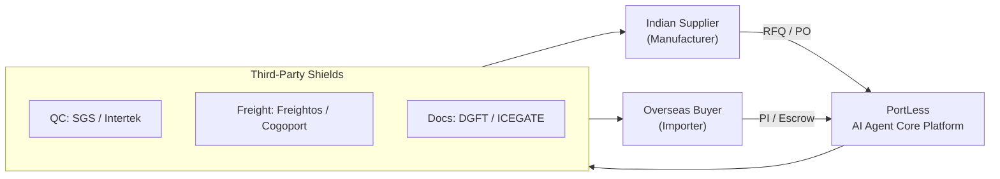

### 3.3 Orchestration Architecture (Agents + Services)

The platform uses a **hybrid architecture**: AI agents handle tasks requiring reasoning/language/ambiguity, while deterministic services handle exact, auditable operations (money, compliance, documents). Both are coordinated via the event bus.

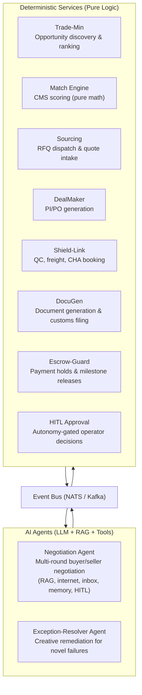

| Category | Modules | Why This Category |
|---|---|---|
| **AI Agents** | Negotiation Agent, Exception-Resolver | Require LLM reasoning, natural language, strategy, ambiguity handling |
| **Deterministic Services** | Trade-Min, Match Engine, Sourcing, DealMaker, Shield-Link, DocuGen, Escrow-Guard, HITL Approval | Execute exact logic — math, API calls, templates, state transitions. LLM adds risk, not value. |

> **Key principle:** Agents *propose*, services *validate and execute*. No LLM can bypass a deterministic guard (margin check, escrow precondition, dual-doc match).

### 3.4 Implementation Phases
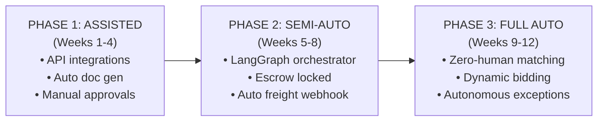

| Phase | Focus | Key Rule |
|---|---|---|
| **1 — Assisted** | Core pipelines + manual compliance | Every doc/booking needs one-click operator approval. |
| **2 — Semi-Auto** | Inter-agent orchestration + financial security | App runs pipeline but halts for approval before payout & freight booking. |
| **3 — Full Auto** | Full automation + dynamic profit harvesting | Autonomous exception resolution unless margin impact > 5%. |

**Phase Details:**
- **Phase 1:** Establish secure API connections to ICEGATE, DGFT, IndiaMART, and Cogoport sandbox environments. Deploy DocuGen for auto-drafting invoices, packing lists, and CoO. Run real-world sandbox test cycles.
- **Phase 2:** Initialize LangGraph orchestrator. Integrate Stripe/Payoneer escrow (block dispatch until buyer funds secured). Deploy Negotiation Agent (RAG + internet + inbox monitoring + memory + HITL). Activate Compliance Guard (merchant-of-record + Switch BoL).
- **Phase 3:** Launch Automated Freight Bidding Engine for real-time container rate negotiation. Integrate automated ICEGATE Shipping Bill submission with RoDTEP harvesting. Implement Autonomous Exception Resolution (e.g., if a truck fails pickup, system auto-rebooks via alternative carrier without operator notification unless margin impact > 5%).

### 3.5 Third-Party Integration Framework
| Stage | Provider Examples | Integration | Agent Action |
|---|---|---|---|
| **QC Check** | SGS, Bureau Veritas, Intertek | SGS Co-care API | Book inspection on "Ready for Dispatch"; hold payment until signed CRF. |
| **Logistics** | Freightos, Cogoport, Flexport | Freightos / Cogoport API | Fetch spot rates, auto-book container, generate tracking webhooks. |
| **Customs** | Registered CHAs | ICEGATE EDI / API | Submit docs, generate Shipping Bill + LEO, track clearance. |
| **Escrow** | Stripe Treasury, Payoneer | B2B APIs | Hold funds, release on validated milestones. |

### 3.6 Technical Stack (HLD-level)
| Layer | Technology | Rationale |
|---|---|---|
| Agent Framework | **LangGraph** | Stateful, cyclical multi-agent loops. |
| LLM Core | **Claude / GPT-class** (routed via LiteLLM) | Reasoning/negotiation: frontier model. Bulk extraction: smaller/cheaper model. |
| RAG | **pgvector** | Negotiation playbooks, trade rules, product specs, country factors, deal history. |
| Database | **PostgreSQL + pgvector** | Supplier coords, HS classifications, price history, embeddings. |
| Backend | **Python / FastAPI** | High-performance async, native AI integration. |
| Escrow/FinTech | **Stripe Treasury / Payoneer** | Secure global SWIFT/SEPA, multi-currency. |
| Doc Parsing | **Azure Document Intelligence** | High-accuracy OCR for lab tests & BoLs (not an LLM). |

### 3.7 Compliance & Anti-Bypass (Corrected)
> **Correction:** The earlier "double-invoice mask" wording implied unlawful concealment. Replaced with lawful practice.

- **Merchant-of-record model:** PortLess is the contractual exporter/importer-of-record; all invoices and POs are genuine.
- **Switch Bill of Lading:** Recognized carrier service; shipper changed to PortLess (buyer never sees factory identity).
- **Compliance Guard:** Blocks any action that under-declares value, falsifies HS/origin, or hides a sanctioned party — runs before customs filing.
- **Trust Lock (Escrow):** Pays supplier on CRF sign-off; secures buyer funds until delivery — neither party can safely bypass.

#### 3.7.1 Switch Bill of Lading Mechanism
The Bill of Lading is the primary title document in international shipping. Normally, it lists the original shipper (factory) and consignee (buyer).
- **First BoL (Set 1):** Lists the Indian Manufacturer as *Shipper* and **PortLess** as *Consignee*. Kept confidential by PortLess and the CHA.
- **Second BoL (Set 2 / Switched):** Lists **PortLess** as *Shipper* and the International Importer as *Consignee*. This is the document delivered to the buyer.
- **Result:** The overseas buyer never sees the name or factory address of the Indian supplier on maritime transit documents.

#### 3.7.2 Financial Shield (Trust Lock)
Why can’t buyer and seller bypass PortLess even if they suspect each other’s existence?
1. **Credit & Cash Flow Disconnect:** Small manufacturers cannot afford to wait 45 days for international credit payments — they want payment upon factory dispatch.
2. **Risk Aversion:** The overseas buyer will not wire 100% advance payment directly to an unverified factory’s bank account due to high scam risk.
3. **PortLess Solution:** PortLess pays the manufacturer immediately when the SGS inspector signs the CRF (mitigating supplier cashflow risk), while securing buyer funds in multi-currency escrow (mitigating buyer delivery risk). Bypassing PortLess forces both parties to assume 100% of trade and payment default risk.

#### 3.7.3 Merchant-of-Record Documentation (Compliance Guard)
The DocuGen Agent generates documentation under the merchant-of-record model:
- **Supplier-Facing Pack:** Local POs and GST Tax Invoices. All references to the overseas importer are replaced with PortLess’s local entity details.
- **Buyer-Facing Pack:** Export Commercial Invoices, Packing Lists, and CoO. Origin listed as “Port of Loading: Chennai, India”; manufacturer’s name replaced with PortLess’s export license branding.

#### 3.7.4 Platform Discovery Mitigation (Operational Moats)
Since PortLess gathers contacts from public directories (IndiaMART, Volza), four operational moats prevent disintermediation:
1. **High Subscription & Technical Barriers:** Overseas buyers are importers, not sourcing agents — navigating Indian wholesale portals is chaotic. Indian manufacturers (especially tier-2/3 factories) don’t pay for global manifest databases like Volza ($thousands/year) and lack international sales agents.
2. **The “Export Readiness” Chasm:** Over 90% of IndiaMART suppliers cannot handle international logistics, Shipping Bills, customs clearance, or container booking. A direct contact results in an Ex-Works offer the buyer cannot execute.
3. **Information Asymmetry (Blind Sourcing):** The Sourcing Agent instructs the manufacturer that cargo is for a “PortLess Domestic Consolidation Hub”. The Logistics Agent switches the shipping bills — buyer sees only “PortLess” as supplier.
4. **The Ultimate Trust Bridge:** Even if they identified each other, the buyer won’t wire $40K to an unverified rural factory, and the factory won’t ship without guaranteed domestic currency payment upon dispatch. PortLess’s escrow protocol is the glue.

### 3.8 India Regulatory & Tax Automation
- **GST Zero-Rated Supply (Sec 16 IGST):** Export of goods qualifies as Zero-Rated Supply under Section 16 IGST Act. Two paths:
  1. **LUT (Letter of Undertaking):** Export without paying IGST, then claim ITC. Highly recommended for zero-inventory model — PortLess auto-attaches LUT reference number (from GST profile) to all generated shipping invoices.
  2. **IGST Refund:** Pay tax at export time, claim refund later.
- **FEMA / FIRC:** Under FEMA, all export proceeds must be realized in India within 9 months from date of export. PortLess matches incoming bank wire files (via corporate bank API, e.g., ICICI) to corresponding shipping bills, flagging missing FIRCs automatically to keep the corporate account audit-clean.
- **RoDTEP (0.5%–4.5% of FOB):** DocuGen stamps RoDTEP declaration on Shipping Bills filed to ICEGATE for auto duty-credit scrips in the customs ledger.

---

## 4. Low-Level Design (LLD)

### 4.1 Runtime Tiers
| Tier | Role | Tech |
|---|---|---|
| **API Gateway** | Sync edge: auth, validation, webhook ingest, idempotency, command publishing | FastAPI, Pydantic v2, JWT |
| **Agent Runtime** | Long-running reasoning loops ("brain") | LangGraph, LiteLLM router |
| **Workers** | Deterministic integration + saga steps ("hands"); idempotent, retryable | Python consumers, httpx adapters |
| **Outbox Relay** | Publishes DB outbox → bus | Python relay |

### 4.2 Deal State Machine
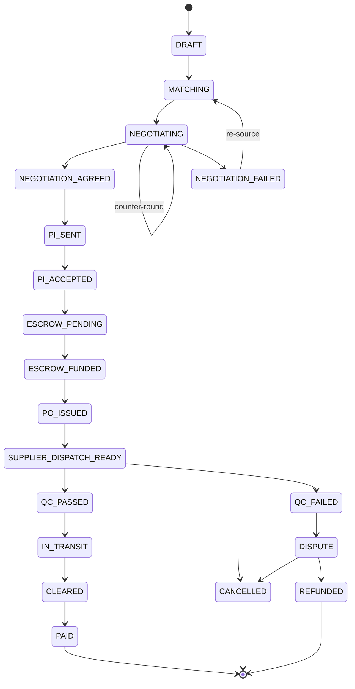

**Guard conditions (enforced in code, never by LLM):**
- `NEGOTIATION_AGREED` requires the converged terms to satisfy `net_margin ≥ margin_floor` (the LLM proposes, the pure-function guard decides).
- `ESCROW_FUNDED` requires verified escrow webhook.
- `PO_ISSUED` requires `net_margin ≥ margin_floor` AND (buyer credit-cleared OR fully prepaid).
- Payout requires `QC_PASSED` + dual-doc match pass.

### 4.3 Composite Match Score (Matching Engine)
$$\text{CMS} = C_{\text{supplier}} \times \left( w_1 \cdot M_{\text{arbitrage}} + w_2 \cdot L_{\text{proximity}} + w_3 \cdot V_{\text{reliability}} \right)$$

| Symbol | Meaning |
|---|---|
| $C_{\text{supplier}}$ | Gatekeeper multiplier (0/1): 0 if GST fail / inactive IEC / DGFT denied list. |
| $M_{\text{arbitrage}}$ | Arbitrage score 0–100: spread between buyer target price and supplier quote. |
| $L_{\text{proximity}}$ | Logistics proximity 0–100: supplier warehouse → nearest exit port distance. |
| $V_{\text{reliability}}$ | Verification/capacity 0–100: business age (MCA), Udyam, shipment frequency. |
| $w_1,w_2,w_3$ | Weights, $\sum w_i = 1.0$ (default 0.5 / 0.3 / 0.2). |

**Profitability:**
$$\text{Net Margin} = \text{Buyer Price (CIF)} - (\text{Sourcing} + \text{QC} + \text{Logistics} + \text{Customs} + \text{Buffer})$$

Decision: CMS ≥ 75 → trigger Negotiation Agent (with match parameters + cost envelope); CMS < 75 → auto-discard.

**Execution Pipeline:**
```
  [UN Comtrade / Volza] ──► Global Demand Trend Spotted (HS code)
                                    │
                                    ▼
  [IndiaMART / TradeIndia] ─► Extract Supplier Candidates (Filter: Active GST/IEC)
                                    │
                                    ▼
  [PortLess Match Engine] ──► Run CMS Calculation for top 20 pairs
                                    │
             ┌──────────────────────┴──────────────────────┐
             ▼ (CMS < 75%)                                 ▼ (CMS >= 75%)
       [Auto-Discard]                              [Trigger Negotiation Agent]
                                                           │
                                                           ▼
                                                   Load RAG + Costs + Live Data
                                                           │
                                                           ▼
                                                   Multi-round Negotiation
                                                   (email/inbox/portal + HITL)
```

**Match State Example:**
```json
{
  "match_id": "MATCH-2026-SPICE-004",
  "hsn_code": "091030",
  "composite_score": 86.5,
  "factors": {
    "gatekeeper_passed": true,
    "arbitrage_score": 92.0,
    "logistics_proximity_score": 85.0,
    "reliability_score": 75.0
  },
  "candidate_buyer": {
    "buyer_id": "BUYER-EUR-441",
    "target_fob_price_usd": 4.20
  },
  "candidate_supplier": {
    "supplier_id": "SUPPLIER-IND-9012",
    "wholesale_quote_usd_equiv": 2.90,
    "inland_port_distance_km": 310
  },
  "cost_envelope": {
    "travel_cost_usd": 150.00,
    "qc_cost_usd": 450.00,
    "doc_cost_usd": 200.00
  }
}
```

### 4.3.1 Negotiation Agent (Buyer ⇄ Seller)

The **Negotiation Agent** is an intelligent, autonomous agent triggered directly after the Match Engine produces a qualifying match (CMS ≥ 75). The Match Engine passes key parameters — `trade_match_id`, `buyer_id`, `seller_id`, `product_code`, `buyer_country_code`, `date_of_expectation`, `date_of_packaging`, composite scores, and cost breakdown (travel cost, quality check cost, documentation cost) — which seed the agent's negotiation context.

The agent conducts bounded, auditable multi-round bargaining with **both buyer and seller** on behalf of the merchant exporter, using email, monitored inboxes, or the portal as communication channels.

#### Agent Capabilities

| Capability | Description |
|---|---|
| **RAG Knowledge** | Before negotiation starts, the agent is loaded with ingested knowledge: negotiation playbooks, product specifications, country-specific trade rules, HS-code regulations, quality standards, and historical deal patterns (pgvector). |
| **Real-time Internet Access** | The agent accesses live data — shipping rates, currency exchange rates, commodity price indices, geopolitical news, trade sanctions — to inform negotiation decisions contextually. |
| **Score & Profit Loading** | The agent is pre-loaded with the CMS score breakdown, estimated costs (travel + QC + documentation), and target/floor profit margins before any communication begins. |
| **Monitored Inboxes** | Supports configured merchant exporter email inbox (API key integrated); auto-reads incoming messages from buyer/seller, extracts quotes and counter-offers from email body and attachments (PDF, Excel). |
| **Negotiation Memory** | The entire negotiation flow (rounds, counter-offers, concessions, reasoning) is persisted in memory, enabling the agent to reference prior context, maintain consistency, and resume after interruptions. |
| **Human-in-the-Loop (HITL)** | The agent escalates to the operator for approval at key decision points: marginal margins, first-time parties, large concessions, round exhaustion, or any decision outside autonomy bounds. |
| **Multi-channel Communication** | Sends and receives counter-offers via Twilio (SMS/WhatsApp), email (SMTP/IMAP), or the tokenized buyer/supplier portal. |

#### Input Parameters (from Match Engine)
| Parameter | Source | Purpose |
|---|---|---|
| `trade_match_id` | Match Engine | Links negotiation to the scored match |
| `buyer_id` / `seller_id` | Match Engine | Identifies the negotiating parties |
| `product_code` (HS code) | Match Engine | Loads product-specific RAG knowledge |
| `buyer_country_code` | Match Engine | Loads country rules, restrictions, duties |
| `composite_match_score` | Match Engine | Informs agent confidence and strategy |
| `buyer_target_price` | Match Engine / Buyer | Starting bid reference |
| `supplier_quote_price` | Match Engine / Sourcing | Starting ask reference |
| `travel_cost` | Match Engine | Factored into margin calculation |
| `qc_cost` | Match Engine | Factored into margin calculation |
| `doc_cost` | Match Engine | Factored into margin calculation |
| `date_of_expectation` | Buyer | Deadline pressure for negotiation |
| `date_of_packaging` | Supplier | Feasibility constraint |

> 💡 **Match Engine & Guardrail Interaction Pattern:**
> 1. **Intermediate Negotiation Cycles:** The Negotiation Agent **does not** call the Match Engine on each round. Static scores (port proximity $L$, reliability $V$) and costs (travel, QC, docs) are cached at initialization. The agent relies on local Python guardrails (`verify_payout_and_margin()`) to verify dynamic profit margins in real-time.
> 2. **Post-Negotiation Sign-Off:** Once terms converge (`negotiation.agreed`), the system invokes the Match Engine **one final time** to compute and persist the final **Realized CMS** against the finalized pricing, logging the result for analytics.

#### Negotiation Policy (per deal)
| Parameter | Meaning |
|---|---|
| `target_margin_pct` | Desired net margin the agent aims for (considers travel + QC + doc costs). |
| `margin_floor_pct` | Hard walk-away threshold (deal frozen below this). |
| `max_rounds` | Max counter-offer rounds before escalation (default 5). |
| `concession_step` | Max price movement allowed per round (anti-overshoot). |
| `batna` | Best Alternative — the next-best matched supplier/buyer to fall back on. |
| `deadline` | Time box; on expiry → escalate or fail per autonomy level. |
| `rag_context` | Pre-loaded negotiation knowledge for product/country/factors. |
| `cost_envelope` | Total non-negotiable costs (travel + QC + docs) from Match Engine. |

**Convergence rule (pure function, outside the LLM):** an offer/counter pair is accepted only if
$$\text{net\_margin}(P_{\text{buyer}}, P_{\text{supplier}}) \ge \text{margin\_floor} \quad\text{and}\quad |P_{\text{ask}} - P_{\text{bid}}| \le \text{concession\_step}.$$

**Loop outcomes:** `NEGOTIATION_AGREED` (terms locked → PI), `NEGOTIATION_FAILED` (re-source via BATNA or cancel), or `approval.requested` (margin marginal / first-time party / rounds exhausted).

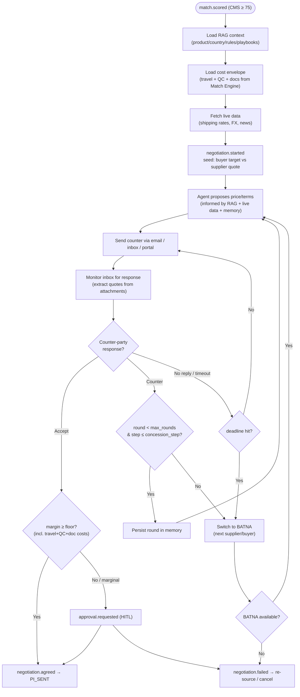

### 4.4 Event-Driven Backbone
**Bus:** NATS JetStream (dev) → Kafka/Redpanda (scale).

**Core Event Catalog:**
| Topic | Producer | Key Consumers |
|---|---|---|
| `opportunity.detected` | Trade-Min Agent | UI, Operator |
| `deal.created` | API | Agent Runtime |
| `match.scored` | Match Engine | Agent Runtime, UI |
| `quote.requested` / `quote.received` | Sourcing Agent | Worker (IndiaMART), Negotiation Agent |
| `negotiation.started` | Negotiation Agent | UI, Operator |
| `negotiation.round` | Negotiation Agent | UI (live bargaining log), Memory store |
| `negotiation.agreed` / `negotiation.failed` | Negotiation Agent | DealMaker, UI |
| `pi.sent` / `pi.accepted` | DealMaker / Buyer portal | Escrow Worker |
| `escrow.funded` | Stripe webhook → API | Saga |
| `po.issued` | DealMaker Agent | Supplier portal |
| `qc.booked` / `qc.passed` / `qc.failed` | Shield-Link / SGS webhook | Saga, DocuGen |
| `freight.booked` / `freight.milestone` | Logistics Worker / carrier | UI |
| `customs.filed` / `customs.cleared` | DocuGen / ICEGATE | Payout Saga |
| `payout.requested` / `payout.completed` | Payout Saga | Ledger, UI |
| `approval.requested` / `approval.resolved` | Any agent | HITL Service, UI |
| `deal.exception` | Any | Exception workflow |

**Reliability patterns:**
- **Transactional Outbox** — atomic DB write + publish; no lost events.
- **Idempotency keys** — dedupe commands/webhooks; no double payouts.
- **Saga orchestration** — compensating actions on failure (e.g., freight fail → `po.cancel`).
- **Dead-letter queue** — poison messages surface as UI Exceptions.

### 4.5 Agent Runtime (Planner / Executor / Critic)
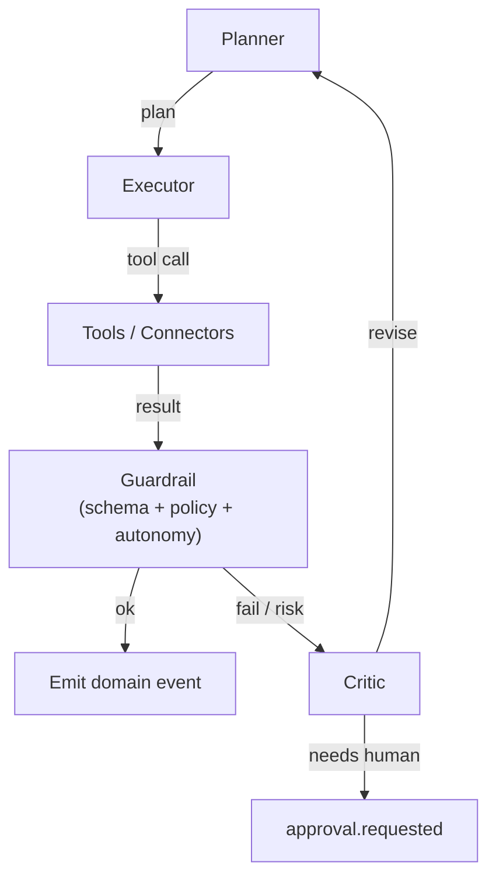

**Agent roster (as services):**
| Agent | Trigger | Tools | Output events |
|---|---|---|---|
| Trade-Min | cron / `scan.tick` | Comtrade, Volza, MacMap | `opportunity.detected` |
| Match Engine | `deal.created` | GSTN, DGFT, MCA, geo | `match.scored` |
| Sourcing | `match.scored(cms≥75)` | IndiaMART, TradeIndia, Twilio | `quote.requested/received` |
| Negotiation Agent | `match.scored(cms≥75)` | RAG (pgvector: trade playbooks, product specs, country rules), Internet (shipping rates, FX, news APIs), Monitored inbox (IMAP/API), Pricing calc, BATNA model, Negotiation memory, Twilio/email/portal, HITL escalation | `negotiation.started/round/agreed/failed` |
| DealMaker | `negotiation.agreed` | Pricing calc, PI/PO gen | `pi.sent`, `po.issued` |
| Shield-Link | `escrow.funded` | SGS, Cogoport/Freightos, CHA | `qc.booked`, `freight.booked` |
| DocuGen | `qc.passed` | Doc templates, DGFT CoO, ICEGATE | `customs.filed` |
| Escrow-Guard | `pi.accepted`, `qc.passed` | Stripe/Payoneer, Ledger | `payout.requested` |
| Exception-Resolver | `deal.exception` | All tools + HITL | remediation events |

**Hard guardrails (deterministic, outside LLM):** schema-validated output; money/booking tools require state precondition + policy check + autonomy-level check; margin floor / credit check / dual-doc match are pure functions an LLM cannot override.

### 4.6 HITL Approval Service
```json
{
  "approval_id": "APR-2026-0091",
  "deal_id": "DEAL-2026-IN-ES-0091",
  "action": "RELEASE_SUPPLIER_PAYOUT",
  "summary": "Pay ₹29,40,000 to Guntur Agri after SGS pass",
  "financial_impact_usd": 35400,
  "risk_flags": ["large_payout"],
  "expires_at": "2026-06-20T10:00:00Z",
  "default_on_timeout": "REJECT",
  "deep_link": "https://app/approvals/APR-2026-0091"
}
```

**Autonomy Levels (per action class, configurable):**
| Level | Meaning | Default mapping |
|---|---|---|
| **L0** | Always ask | First-time supplier, payout > $50k |
| **L1** | Ask, auto-approve on timeout | Freight booking within quote |
| **L2** | Auto, notify after | Doc generation, RFQ dispatch |
| **L3** | Fully autonomous, log only | Opportunity scanning, QC booking |

### 4.7 Data Model (PostgreSQL)
```sql
deals(deal_id PK, operator_id, hs_code, status, autonomy_profile,
      margin_floor_pct, est_margin_usd, realized_margin_usd, created_at, updated_at)

parties(party_id PK, deal_id FK, role ENUM('buyer','supplier'),
        legal_name, country, gstin, iec, vat_number,
        verification_status, credit_status, risk_score)

quotes(quote_id PK, deal_id FK, supplier_id, unit_price, currency, valid_until)

match_scores(match_id PK, deal_id FK, composite_score, gatekeeper_passed BOOL,
             arbitrage_score, proximity_score, reliability_score)

negotiation_sessions(session_id PK, deal_id FK, trade_match_id FK,
                     buyer_id FK, seller_id FK, product_code, buyer_country_code,
                     status ENUM('active','agreed','failed','escalated'),
                     cost_envelope JSONB, rag_context_ref TEXT,
                     current_round INT, max_rounds INT,
                     target_margin_pct DECIMAL, margin_floor_pct DECIMAL,
                     concession_step DECIMAL, batna JSONB,
                     created_at, updated_at)

negotiation_rounds(round_id PK, session_id FK, round_number INT,
                   direction ENUM('to_buyer','to_seller','from_buyer','from_seller'),
                   channel ENUM('email','portal','sms','whatsapp'),
                   offer_price DECIMAL, currency, terms JSONB,
                   attachment_refs JSONB, reasoning TEXT,
                   margin_at_offer DECIMAL, hitl_required BOOL,
                   created_at)

escrow(escrow_id PK, deal_id FK, provider, amount, currency, status, ext_ref)

third_party_orders(tpo_id PK, deal_id FK, type ENUM('qc','freight','cha'),
                   provider, ext_ref, status, crf_hash, eta, payload JSONB)

documents(doc_id PK, deal_id FK, type, storage_uri, hash, generated_by, signed BOOL)

ledger(entry_id PK, deal_id FK, payee, amount, currency, direction, status,
       idempotency_key UNIQUE)

approvals(approval_id PK, deal_id FK, action, impact_usd, status, expires_at,
          default_on_timeout, resolved_by, resolved_at)

events(event_id PK, deal_id FK, topic, payload JSONB, occurred_at, seq)
outbox(id PK, topic, payload JSONB, published BOOL, created_at)
embeddings(id PK, owner_type, owner_id, embedding VECTOR(1536), metadata JSONB)
agent_runs(run_id PK, deal_id FK, agent, prompt, tools_called JSONB,
           output JSONB, cost_usd, created_at)
```
Indexes: `deals(status)`, `events(deal_id, seq)`, `ledger(idempotency_key)`, `embeddings USING ivfflat`.

### 4.8 Deal Context (shared state object)
```json
{
  "deal_id": "DEAL-2026-IN-ES-0091",
  "operator_id": "OP-901",
  "hs_code": "090422",
  "deal_status": "QC_IN_PROGRESS",
  "arbitrage_metrics": {
    "estimated_revenue_usd": 45000.00,
    "supplier_payable_inr": 2940000.00,
    "logistics_payable_usd": 3200.00,
    "qc_payable_usd": 450.00,
    "net_margin_usd": 6350.00
  },
  "parties": {
    "buyer": { "company_name": "Iberia Spices SL", "country": "Spain", "verified_vat_number": "ESB12345678" },
    "supplier": { "company_name": "Guntur Agri Products Ltd", "gstin": "37AAAAA0000A1Z1", "iec": "0312045612" }
  },
  "third_party_orders": {
    "quality_check": { "provider": "SGS India", "inspection_status": "SCHEDULED", "certificate_hash_ipfs": null },
    "freight_booking": { "provider": "Freightos", "incoterm": "FOB-Chennai", "carrier": "Maersk Line" },
    "customs_house_agent": { "shipping_bill_number": null, "customs_status": "PENDING_INSPECTION_CRF" }
  }
}
```

### 4.9 Tech Stack & Repo Layout
| Layer | Technology |
|---|---|
| Frontend | Next.js 14, TypeScript, Tailwind, shadcn/ui, TanStack Query, Socket.IO |
| API Gateway | FastAPI (async), Pydantic v2, JWT, Webhook router |
| Agent Runtime | LangGraph, LiteLLM model router, Pydantic tool schemas |
| Workers | Python consumers, httpx adapters |
| Event Bus | NATS JetStream → Kafka/Redpanda |
| Database | PostgreSQL 16 + pgvector |
| Cache/locks | MongoDB TTL cache (idempotency, rate-limit, agent memory) |
| Object store | S3-compatible (MinIO in dev) |
| Payments | Stripe Treasury / Payoneer B2B |
| OCR | Azure Document Intelligence |
| Observability | OpenTelemetry + Grafana/Tempo + Langfuse |
| Deploy | Docker → Azure Container Apps / AWS ECS; IaC via Bicep/Terraform |

```
portless/
├─ apps/
│  ├─ web/                 # Next.js Ops Console + mini-portals
│  └─ api/                 # FastAPI gateway (REST + webhooks + WS)
├─ agents/                 # AI agent modules (LLM + RAG + tools + memory)
│  └─ negotiation_agent/   # intelligent multi-round buyer/seller negotiation
├─ services/               # deterministic service modules
│  ├─ trade_min/           # opportunity discovery & ranking
│  ├─ match_engine/        # composite match scoring
│  ├─ sourcing/            # RFQ dispatch & quote intake
│  ├─ dealmaker/           # PI / PO generation
│  ├─ shield_link/         # QC / freight / CHA booking
│  ├─ docugen/             # document generation + customs filing
│  ├─ escrow_guard/        # escrow holds & milestone payouts
│  ├─ hitl_approval/       # human-in-the-loop approval service
│  └─ exception_resolver/  # exception classification & remediation
├─ shared/                 # cross-cutting: domain, clients, bus, connectors
├─ packages/
│  ├─ domain/              # shared types, state machine, event schemas
│  └─ connectors/          # adapters: comtrade, gstn, dgft, sgs, cogoport...
├─ infra/                  # docker-compose, bicep/terraform
└─ docs/                   # specs
```

---

## 5. Workflow

### 5.1 End-to-End Transact Cycle (4 Phases)
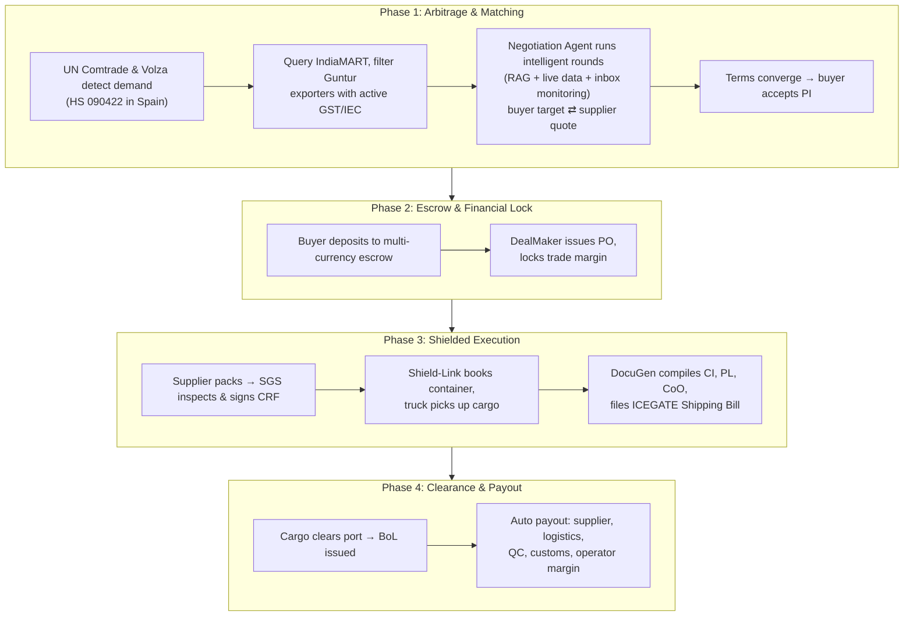

### 5.2 Sourcing & Validation Loop
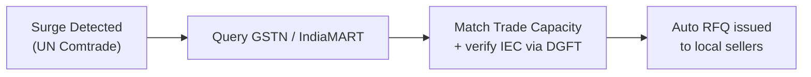

### 5.2.1 Negotiation Phase (after match)
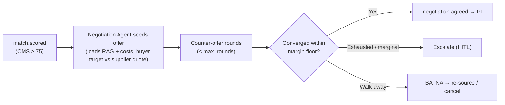

### 5.3 Exception & Dispute Sub-Workflow
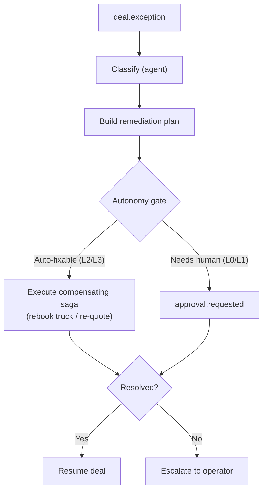

### 5.4 Build Roadmap
| Sprint | Deliverable | HLD Phase |
|---|---|---|
| S1 | Monorepo, docker stack, state machine, schema, event bus, outbox | 1 |
| S2 | Trade-Min + Match Engine, Opportunity Radar UI, GSTN/DGFT connectors | 1 |
| S3 | DealMaker + DocuGen, PI/PO/Invoice gen, mini-portals | 1 |
| S4 | Escrow (sandbox), HITL Approval Service, Autonomy Levels | 2 |
| S5 | Shield-Link (QC + freight), sagas, dual-doc verification | 2 |
| S6 | ICEGATE/CHA filing, RoDTEP/FIRC tracking, Compliance Guard | 2→3 |
| S7 | Exception-Resolver, freight bidding, autonomy promotion, observability | 3 |
| S8 | Hardening: load test, DLQ runbooks, security review, go-live | 3 |

> **Go-live safety rule:** launch money-movement actions at **L0** (always ask); promote to L2/L3 only after N successful supervised deals.

---

## 6. Architecture Diagram

### 6.1 System Topology
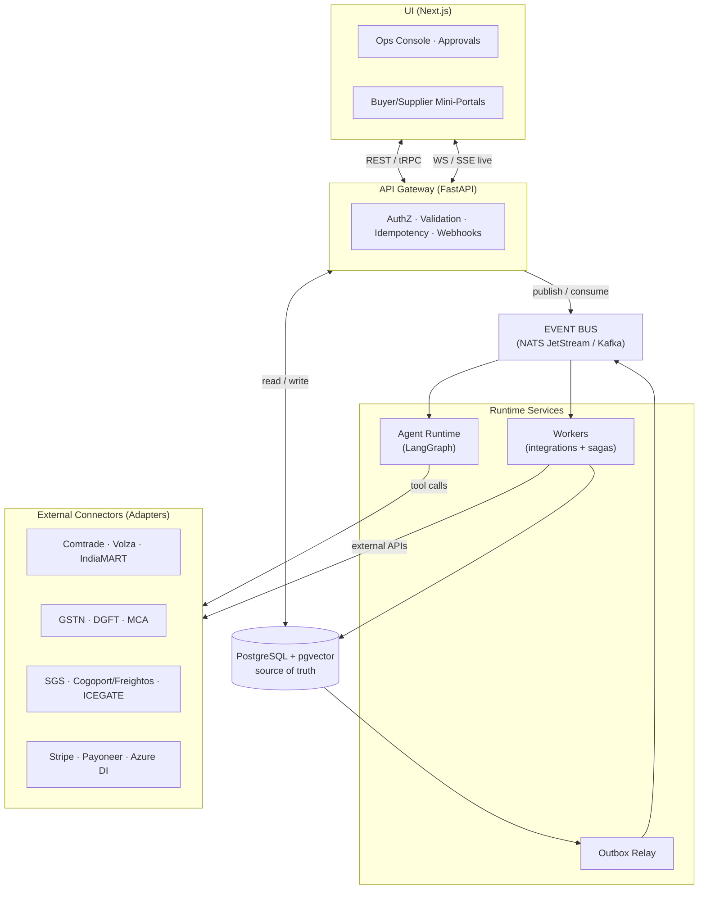

### 6.2 Tier Responsibilities
| Tier | Responsibility |
|---|---|
| **UI** | Operator supervision, approvals, tokenized party actions, live stream. |
| **API Gateway** | Sync edge, webhook ingest, idempotency, command publishing. |
| **Event Bus** | Decouples all tiers; replayable, resilient. |
| **Agent Runtime** | Reasoning over messy data (matching, parsing, negotiation, exceptions). |
| **Workers** | Deterministic money/booking sagas; idempotent + retryable. |
| **Database** | Source of truth; events derive via outbox. |

### 6.3 UI Layer Specification

#### Stack
| Concern | Choice | Rationale |
|---|---|---|
| Framework | Next.js 14 (App Router) + React + TypeScript | SSR for fast dashboards, API routes for BFF |
| UI kit | Tailwind CSS + shadcn/ui | Fast, consistent, accessible components |
| State/data | TanStack Query + Zustand | Server cache + light client state |
| Realtime | WebSocket (Socket.IO) or SSE | Live deal + agent activity stream |
| Charts | Recharts | Margin / pipeline visualization |
| Auth | Auth.js (NextAuth) + passkeys/TOTP | Operator login; tokenized links for buyer/supplier |

#### Key Screens
1. **Opportunity Radar** — Ranked HS-code arbitrage cards (demand surge, est. margin, confidence). One-click "Start Deal".
2. **Deal Board (Kanban)** — Columns = state-machine stages (`MATCHING → NEGOTIATING → PI_SENT → ESCROW_FUNDED → QC → IN_TRANSIT → CLEARED → PAID`). Each card streams live agent actions.
3. **Deal Detail** — Timeline of events, documents, party info, agent reasoning log, and the **Approve / Reject / Override** action bar.
4. **Approvals Inbox** — Every pending HITL decision with deadline countdown and exact financial impact.
5. **Money & Margin** — Escrow balances, scheduled payouts, realized vs. projected margin, FIRC/RoDTEP tracking.
6. **Exceptions** — Disputes, failed QC, stuck shipments, with suggested agent remediation.
7. **Autonomy Settings** — Per-action-class autonomy level (L0–L3) and guardrail thresholds.
8. **Kill Switch** — Global "Pause All Deals" with confirmation (WebSocket → LangGraph execution halt).

#### Mini-Portals (tokenized, no account)
- Buyer/supplier receive a **signed, expiring magic-link** (JWT, single-deal scope).
- Actions are intentionally tiny: *Accept Quote*, *Upload Doc*, *Mark Ready*, *Fund Escrow*.
- Every action emits a domain event into the bus.

### 6.4 Local Development

```bash
# 1. Start infra: Postgres+pgvector, NATS, MongoDB, MinIO
docker compose -f infra/docker-compose.dev.yml up -d

# 2. Migrate + seed sandbox data (fake suppliers/buyers, sandbox API keys)
make migrate && make seed

# 3. Start services (each in its own process)
make api          # FastAPI on :8000
make agents       # LangGraph runtime (includes negotiation_agent)
make workers      # saga/integration consumers
make web          # Next.js on :3000

# 4. SANDBOX MODE = all external calls hit local mock connectors,
#    so you can run a full deal cycle end-to-end with no real money.
```

A **Sandbox Mode** flag swaps every external connector for a deterministic mock, enabling a full `opportunity → negotiation → payout` cycle on a laptop.

---

## 7. Flowchart

### 7.1 Happy-Path Deal (Sequence)
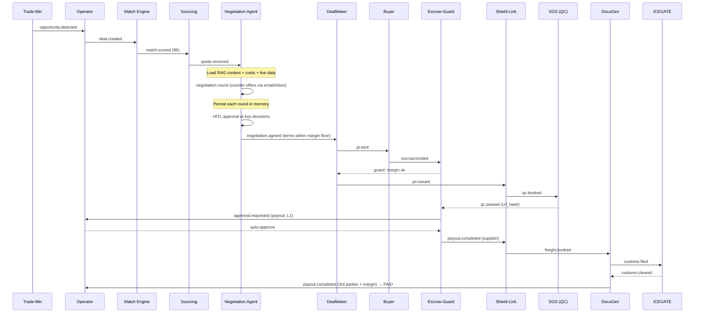

### 7.2 Decision Flowchart (Deal Gatekeeping)


---

## 8. Appendices

### 8.1 Trade Intelligence API Landscape

#### A. Global Opportunity Discovery (Trade-Min Agent)
| Provider | Portal / API | Intelligence | Agent Usage |
|---|---|---|---|
| **UN Comtrade** | `comtradeplus.un.org` / `comtradeapi.un.org` | Global trade volumes, HS code flow, YoY demand growth | Detects surging import demands (e.g., “Turmeric import in Poland grew 40%”) |
| **ITC MacMap** | `macmap.org` / `macmap.org/api` | Import tariffs, trade barriers, rules of origin per country | Calculates target country tariffs: CIF Cost + Tariff competitiveness |
| **Volza** | `volza.com` / Proprietary API | BoL and customs manifests for 80+ countries | Extracts active buyer names importing specific HS codes from India |
| **Trademo** | `trademo.com` / `docs.trademo.com` | Supply chain records, buyer risk profiling, trade frequencies | Identifies high-volume Western buyers seeking stable supply partners |
| **ImportGenius / Panjiva** | Enterprise REST APIs | US Customs and Latin American marine shipping manifests | Spotlights high-volume importers who repeatedly buy bulk categories |

#### B. Buyer Verification
| Provider | Portal / API | Intelligence | Agent Usage |
|---|---|---|---|
| **VIES (EU Commission)** | `ec.europa.eu/taxation_customs/vies` / REST/SOAP | European buyer VAT validation, company registration, address | Free instant validation — prevents onboarding fake/unregistered EU entities |
| **Allianz Trade / Euler Hermes** | `allianz-trade.com` / Credit APIs | Corporate risk scores, payment defaults, credit underwriting limits | Auto-underwritten trade credit insurance; flags if 100% advance escrow mandatory |

#### C. Domestic Supplier Discovery (Sourcing Agent)
| Provider | Portal / API | Intelligence | Agent Usage |
|---|---|---|---|
| **IndiaMART** | `indiamart.com` / `partner.indiamart.com` | Indian manufacturers, wholesale pricing, factory addresses | Automates RFQ dispatch to verified manufacturers, aggregates quotes |
| **TradeIndia** | `tradeindia.com` / Inquiry API | Supplier profiles, competitor wholesale listings, product catalogs | Fallback RFQ dispatch for alternative wholesale suppliers |

#### D. Indian Regulatory Verification
| Provider | Portal / API | Intelligence | Agent Usage |
|---|---|---|---|
| **GSTN** | `gst.gov.in` / Authorized GSPs | Active GSTIN status, filing histories, legal name | Validates supplier is active with no compliance filing blocks |
| **DGFT** | `dgft.gov.in` / Developer Portal | IEC status, active licenses (EPCG, LUT, Advance Auth) | Verifies active export status, checks DGFT Denied Entity List (DEN) |
| **MCA** | `api.setu.co` / API Setu | CIN, director listings, active LLP/Pvt Ltd status | Verifies corporate legitimacy via government-signed records |
| **Udyam** | `udyamregistration.gov.in` / Signzy/Zoop | Micro, small, and medium enterprise certifications | Filters out retail brokers — ensures sourcing from real factories |

Each becomes an adapter in `packages/connectors/` with a uniform interface: `quote()`, `book()`, `status()`, `webhook_verify()`.

### 8.2 Risk Management Matrix
| Risk Event | Impact | Mitigation |
|---|---|---|
| Supplier cargo fails QC | High | QC flags before cargo leaves; payment locked in escrow; logistics pickup auto-cancelled. |
| Demurrage / port delays | Medium | Dynamic buffer rates factored into quotations; carrier webhook milestones notify buyer of scheduling updates. |
| Incorrect HS code | High | Specialized LLM-RAG classifier matches buyer descriptions to exact, validated HS codes from Harmonized System database. |
| FX volatility | Medium | Multi-currency escrow buffers locked via treasury spot contracts at PI signing, mitigating INR-USD risk. |
| Buyer/seller disintermediation | Medium | Switch BoL + merchant-of-record docs + escrow trust lock + blind sourcing (see §3.7). |
| SGS batch inspection failure | High | System auto-pauses logistics pickup, raises dispute ticket, drafts corrective actions for supplier, locks escrow to protect both parties. |

### 8.3 Future Roadmap — Web3 Trust Layer (Nice-to-Have)
- **Stablecoin Escrow (USDC/USDT):** Layer-2 smart contracts release funds on validated Switch BoL + CRF.
- **Immutable Cargo Provenance:** CRF hash stamped on-chain (IPFS/Arweave).
- **Tokenized BoL (eBoL):** ERC-721/1155 title transfer on final escrow payment.
- **Decentralized Notary (SBTs):** Soulbound reputation tokens for buyers/sellers.
- **Schema hooks:** optional `onchain_transaction_hash`, `buyer_wallet_address` on Deal Context.

### 8.4 Developer Portals
- ICEGATE: https://www.icegate.gov.in
- DGFT: https://www.dgft.gov.in
- GSTN Developer: https://developer.gst.gov.in
- UN Comtrade: https://comtradeplus.un.org
- VIES: https://ec.europa.eu/taxation_customs/vies

---

## 9. LLM Cost, Quality & Selection Guide

This section covers the expected API pricing for language models and embeddings used in PortLess, compares open-source vs cloud LLMs across quality dimensions relevant to this platform, and provides a specific LLM recommendation for the Negotiation Agent.

---

### 9.1 LLM & Embedding Cost Analysis

#### 9.1.1 LLM API Pricing (per 1 Million Tokens)

| Provider | Model | Input $/1M | Output $/1M | Context Window | Strengths |
|---|---|---|---|---|---|
| **Anthropic** | Claude Fable 5 | $10.00 | $50.00 | 1M | Best overall reasoning, long-horizon agents |
| **Anthropic** | Claude Opus 4.8 | $5.00 | $25.00 | 1M | Advanced reasoning, agentic tasks, tool use |
| **Anthropic** | Claude Sonnet 4.6 | $3.00 | $15.00 | 1M | Balanced speed + intelligence |
| **Anthropic** | Claude Haiku 4.5 | $1.00 | $5.00 | 200K | Fastest, cheapest, bulk extraction |
| **OpenAI** | GPT-4o | $2.50 | $10.00 | 128K | Strong reasoning, broad ecosystem |
| **OpenAI** | GPT-4o mini | $0.15 | $0.60 | 128K | Low cost, fast turnaround |
| **OpenAI** | o3 mini | $1.10 | $4.40 | 128K | Structured reasoning tasks |
| **Google** | Gemini 2.0 Flash | $0.075 | $0.30 | 1M | Cheapest at scale, good extraction |
| **Google** | Gemini 1.5 Pro | $1.25 | $5.00 | 2M | Very large context, multimodal |
| **Mistral** | Mistral Large 2 | $2.00 | $6.00 | 128K | European data-residency option |
| **Mistral** | Mistral Small | $0.20 | $0.60 | 128K | Budget EU-hosted option |
| **DeepSeek** | DeepSeek V3 (API) | $0.27 | $1.10 | 128K | Strong code + instruction following |
| **Meta (via API)** | Llama 3.1 70B | ~$0.90 | ~$0.90 | 128K | Open weights, via Fireworks/Together |
| **Self-hosted** | Llama 3.1 70B (AWS g5.12xlarge) | ~$0.005 | ~$0.005 | 128K | Near-zero token cost; GPU server ~$16/hr |
| **Self-hosted** | Mistral Large / Qwen 2.5 72B | ~$0.008 | ~$0.008 | 128K | High throughput on A100/H100 clusters |

> **Prompt caching** (Claude, GPT-4o): repeated RAG context blocks are cached at ~10% of input cost. A Negotiation Agent re-using the same trade policy RAG context across rounds reduces per-round cost by up to 90% for the cached portion.

#### 9.1.2 Embedding Model Pricing

The PortLess data model stores embeddings as `VECTOR(1536)` — the standard OpenAI dimension. Embedding costs are incurred when indexing trade policies, supplier catalogs, buyer profiles, and past deal context.

| Provider | Model | Cost $/1M Tokens | Output Dimensions | Notes |
|---|---|---|---|---|
| **OpenAI** | text-embedding-3-small | $0.02 | 1536 | Default match for `VECTOR(1536)` |
| **OpenAI** | text-embedding-3-large | $0.13 | 3072 | Higher accuracy; requires schema change to `VECTOR(3072)` |
| **Cohere** | Embed v3 English | $0.10 | 1024 | Strong retrieval accuracy; multilingual variant available |
| **VoyageAI** | voyage-3 | $0.06 | 1024 | Best-in-class retrieval for domain-specific docs |
| **Self-hosted** | nomic-embed-text (768-dim) | ~$0 | 768 | Strong open model; requires dim change |
| **Self-hosted** | bge-large-en-v1.5 (1024-dim) | ~$0 | 1024 | MTEB-leading open source; GPU inference needed |

> **Recommendation:** Use `text-embedding-3-small` at $0.02/1M as the default — it matches `VECTOR(1536)` in the schema with no migration needed. Switch to `voyage-3` or `bge-large` for RAG-heavy workloads where retrieval precision matters more than cost.

#### 9.1.3 Estimated Monthly Cost — PortLess Workload

**Assumptions per deal:**
- Negotiation Agent: 5 rounds × (30K input + 10K output) = 150K input + 50K output tokens
- Supporting agents (Trade-Min, QC, Exception-Resolver, Sourcing): 5 agents × (20K input + 5K output) = 100K input + 25K output tokens (routed via Claude Haiku 4.5)
- Embeddings: ~10M tokens indexed per 50 deals (trade docs, policies, supplier catalogs)

| Scale | Negotiation (Sonnet 4.6) | Supporting Agents (Haiku 4.5) | Embeddings (3-small) | Total/month |
|---|---|---|---|---|
| **50 deals/month** | $60 | $7 | $0.20 | **~$67** |
| **200 deals/month** | $240 | $28 | $0.80 | **~$269** |
| **500 deals/month** | $600 | $69 | $2.00 | **~$671** |
| **50 deals (Opus 4.8 for all)** | $100 | $7 | $0.20 | **~$107** |
| **500 deals (Opus 4.8 for all)** | $1,000 | $69 | $2.00 | **~$1,071** |

> **Cost optimisation levers:**
> 1. **LiteLLM routing** (already in §3.6) — route bulk/extraction tasks to Haiku 4.5 and only escalate to Sonnet/Opus for negotiation rounds.
> 2. **Claude Prompt Caching** — cache shared RAG context (trade policies, HS codes, buyer profile) across negotiation rounds; saves ~80–90% on repeated context.
> 3. **Tiered model escalation** — start negotiations on Sonnet 4.6; escalate to Opus 4.8 only when deal value > ₹50L or BATNA floor is at risk.
> 4. **Self-hosted embeddings** — replace `text-embedding-3-small` with `bge-large-en-v1.5` on a shared GPU server; embedding cost drops to near zero at scale.

---

### 9.2 Open Source vs Cloud LLM — Quality Comparison

The following table compares open-source LLMs (self-hosted or via API) against top cloud/commercial LLMs across every quality dimension relevant to PortLess agents.

| Quality Dimension | Cloud LLM (Claude Sonnet 4.6 / Opus 4.8) | Open Source (Llama 3.1 70B / Qwen 2.5 72B / Mistral Large) | Winner |
|---|---|---|---|
| **Multi-step reasoning** | Excellent — adaptive thinking, chain-of-thought, long-horizon planning | Good at 70B; gaps in complex nested logic vs frontier models | Cloud |
| **Instruction following** | Near-perfect; reliably follows complex, multi-constraint prompts | Strong at 70B+; can drift on deeply nested instructions | Cloud |
| **Tool / function calling** | Native, first-class; reliable JSON schema validation and retry | 70B models support tool use; JSON reliability lower than frontier | Cloud |
| **RAG coherence** | Excellent — synthesizes retrieved chunks without hallucination | Moderate; higher hallucination rate on domain-specific retrieval | Cloud |
| **JSON output consistency** | Highly reliable structured output; schema-constrained generation | Variable; requires tighter prompting and output validation layers | Cloud |
| **Multi-round context retention** | Excellent up to 1M tokens; remembers deal history across rounds | 70B models limited to 128K; context drift seen beyond 32K active tokens | Cloud |
| **Attachment / PDF parsing** | Native via Files API (Claude) and vision models | Requires external preprocessing pipeline (unstructured.io, pdfminer) | Cloud |
| **Negotiation reasoning (BATNA, margin)** | Excellent — trained on complex reasoning, financial trade-offs | Llama 3.1 70B and Qwen 2.5 72B competitive; DeepSeek V3 very strong | Cloud (slight edge) |
| **Multilingual support (Hindi/Tamil/Marathi)** | Strong (Claude, GPT-4o); handles Indian regional languages | Qwen 2.5 and Llama 3.1 have good multilingual support | Tie |
| **Latency (time-to-first-token)** | 1–3 seconds (varies by model tier) | Self-hosted A10G: ~0.5–1s; API providers (Groq): ~0.3s | Open Source (self-hosted/Groq) |
| **Data privacy / residency** | Data sent to Anthropic/OpenAI cloud; DPA and BAA available | Full on-premise; zero data egress | Open Source |
| **Self-hosting complexity** | None — API call only | High — GPU provisioning, model serving (vLLM/Ollama), scaling, monitoring | Cloud |
| **Fine-tuning for domain** | Limited (Claude); GPT-4o fine-tuning available | Full fine-tuning possible on Llama 3.1 / Mistral | Open Source |
| **Output reliability under load** | Guaranteed SLAs with auto-scaling | Depends on self-hosted infrastructure; single-node bottlenecks | Cloud |
| **Cost at scale (>5K deals/month)** | $3–5/1M tokens — grows linearly | ~$0.005–0.01/1M (GPU amortised) — far cheaper at high volume | Open Source |
| **API ecosystem & integrations** | Full LangGraph / LangChain / LiteLLM support; MCP tools | Growing — LiteLLM supports Llama, Mistral, DeepSeek via OpenAI-compat API | Cloud (maturity edge) |
| **Compliance (SOC2, HIPAA)** | Anthropic SOC2 Type II; enterprise agreements available | Self-hosted = you own compliance; no third-party audit required | Open Source (strict compliance) |

**Summary verdict by scenario:**

| Scenario | Recommended Approach |
|---|---|
| MVP and early traction (0–200 deals/month) | Cloud LLM (Claude Sonnet 4.6 via LiteLLM) — fastest to ship, lowest ops burden |
| Data-residency-critical enterprise client | Self-hosted Llama 3.1 70B / Mistral Large 2 on private cloud |
| Scale (500+ deals/month) cost-sensitive | Hybrid: open-source for extraction/classification; cloud for negotiation reasoning |
| Maximum deal quality (high-value shipments) | Cloud — Claude Opus 4.8 for negotiation; no open-source model matches its BATNA reasoning |
| EU buyer requirement | Mistral Large 2 (EU-hosted) or self-hosted with GDPR-compliant infra |

---

### 9.3 LLM Recommendation for the Negotiation Agent

#### 9.3.1 Negotiation Agent Requirements Recap (§4.3.1)

The Negotiation Agent must:
- Conduct multi-round, stateful negotiations with overseas buyers via email/WhatsApp
- Apply BATNA logic — know its margin floor and walk away from bad deals
- Synthesise RAG context (trade policies, past deal prices, commodity benchmarks)
- Parse buyer attachments (PDFs, spreadsheets, L/Cs)
- Integrate real-time internet data (commodity spot rates, forex)
- Maintain conversation memory across rounds (sometimes days apart)
- Draft legally coherent commercial documents (PI, contracts, LoI)
- Escalate to HITL when the deal is ambiguous or above a value threshold
- Route through LiteLLM for model switching without code change (§3.6)

#### 9.3.2 Detailed Model Comparison for Negotiation Agent

| Evaluation Criterion | Claude Sonnet 4.6 | Claude Opus 4.8 | GPT-4o | Llama 3.1 70B (self-hosted) | DeepSeek V3 | Gemini 2.0 Flash |
|---|---|---|---|---|---|---|
| Multi-round negotiation reasoning | ★★★★☆ | ★★★★★ | ★★★★☆ | ★★★☆☆ | ★★★★☆ | ★★★☆☆ |
| BATNA & margin-floor logic | ★★★★☆ | ★★★★★ | ★★★★☆ | ★★★☆☆ | ★★★★☆ | ★★★☆☆ |
| RAG synthesis quality | ★★★★☆ | ★★★★★ | ★★★★☆ | ★★★☆☆ | ★★★★☆ | ★★★☆☆ |
| JSON / structured output | ★★★★★ | ★★★★★ | ★★★★★ | ★★★★☆ | ★★★★☆ | ★★★★☆ |
| Tool use / function calling | ★★★★★ | ★★★★★ | ★★★★★ | ★★★★☆ | ★★★★☆ | ★★★★☆ |
| Long-context retention (1M) | ★★★★★ | ★★★★★ | ★★★☆☆ (128K) | ★★★☆☆ (128K) | ★★★☆☆ (128K) | ★★★★★ (1M) |
| PDF / attachment parsing | ★★★★★ | ★★★★★ | ★★★★★ | ★★☆☆☆ (needs pipeline) | ★★☆☆☆ | ★★★★☆ |
| Commercial document drafting | ★★★★★ | ★★★★★ | ★★★★★ | ★★★☆☆ | ★★★★☆ | ★★★☆☆ |
| Instruction following under constraints | ★★★★★ | ★★★★★ | ★★★★☆ | ★★★★☆ | ★★★★☆ | ★★★☆☆ |
| Latency (per round, TTFT) | ~1.5s | ~3–5s | ~1–2s | ~0.5–1s (Groq) | ~1s (API) | ~0.5s |
| Cost per full deal (5 rounds) | ~$1.20 | ~$2.00 | ~$0.85 | ~$0.04 | ~$0.10 | ~$0.02 |
| Data privacy | Anthropic DPA | Anthropic DPA | OpenAI DPA | Full on-prem | DeepSeek DPA | Google DPA |
| LiteLLM integration | Native | Native | Native | Via OpenAI-compat | Via OpenAI-compat | Native |
| HITL escalation support | ★★★★★ | ★★★★★ | ★★★★☆ | ★★★☆☆ | ★★★★☆ | ★★★☆☆ |

#### 9.3.3 Recommended Configuration

**Primary Negotiation Agent: Claude Sonnet 4.6**
- Handles the majority of deals (standard commodity negotiations, routine pricing rounds)
- Best balance of intelligence and cost for this workload
- Native LiteLLM routing: `model: "anthropic/claude-sonnet-4-6"`
- Use adaptive thinking for BATNA-sensitive rounds

**Escalation tier: Claude Opus 4.8**
- Triggered automatically when:
  - Deal value > ₹50 lakh (configurable threshold)
  - More than 3 rounds without agreement (negotiation is stalling)
  - BATNA floor pressure detected (buyer asking below margin floor)
  - HITL override requested
- LiteLLM routing: `model: "anthropic/claude-opus-4-8"` with fallback to Sonnet 4.6

**Bulk / extraction agents (Trade-Min, Exception-Resolver): Claude Haiku 4.5**
- All document parsing, HS code classification, compliance checks, status extraction
- 5× cheaper than Sonnet; 25× cheaper than Opus for non-reasoning tasks
- LiteLLM routing: `model: "anthropic/claude-haiku-4-5-20251001"`

**LiteLLM router configuration (packages/ai/litellm_config.yaml):**
```yaml
model_list:
  - model_name: negotiation-primary
    litellm_params:
      model: anthropic/claude-sonnet-4-6
      api_key: os.environ/ANTHROPIC_API_KEY

  - model_name: negotiation-escalation
    litellm_params:
      model: anthropic/claude-opus-4-8
      api_key: os.environ/ANTHROPIC_API_KEY

  - model_name: bulk-extraction
    litellm_params:
      model: anthropic/claude-haiku-4-5-20251001
      api_key: os.environ/ANTHROPIC_API_KEY

router_settings:
  fallbacks:
    - negotiation-escalation: ["negotiation-primary"]
  enable_pre_call_checks: true
  cache_responses: true
```

#### 9.3.4 Why Not Open Source for the Negotiation Agent?

| Concern | Detail |
|---|---|
| BATNA reasoning depth | No 70B open source model consistently matches Claude Sonnet 4.6 on long-horizon financial trade-off reasoning. Llama 3.1 70B and Qwen 2.5 72B both drift on nested margin-floor logic beyond round 3. |
| JSON output reliability | Negotiation state machine requires `NegotiationState` JSON at every step. Open source models need aggressive system-prompt engineering + output parsing guards; Claude generates valid structured output natively. |
| Attachment parsing | Buyer PDFs (L/Cs, inspection reports) require vision + file parsing. Claude Files API handles this natively; open source requires an external unstructured.io pipeline adding latency and cost. |
| Cost difference is marginal | At 50–500 deals/month, the cost difference between Claude Sonnet 4.6 (~$60–$600/month) and a self-hosted 70B model (~$2–$20/month token cost) is outweighed by GPU server costs (~$800–$2,000/month), DevOps overhead, and the revenue at stake per deal. |
| Data privacy escalation path | If a future enterprise client requires full on-prem, LiteLLM allows switching to a self-hosted Mistral Large or Llama 3.1 70B with a single config change — no application code change needed. |

#### 9.3.5 Open Source Fallback Strategy (Future / Enterprise Tier)

If data residency or volume economics demand self-hosted models:

| Use Case | Recommended Model | Hardware | Notes |
|---|---|---|---|
| Negotiation (primary) | Mistral Large 2 (123B) | 2× A100 80GB | Best open-weight negotiation quality; EU-origin model |
| Negotiation (budget) | Qwen 2.5 72B Instruct | 1× A100 80GB | Strong instruction-following; multilingual (Hindi support) |
| Bulk extraction | Llama 3.1 8B / Mistral 7B | 1× A10G 24GB | Ultra-cheap; handles structured extraction well |
| Embeddings | bge-large-en-v1.5 (1024-dim) | Shared CPU/GPU | Requires `ALTER COLUMN embedding TYPE VECTOR(1024)` migration |

> Switch models with zero application code change — update `litellm_config.yaml` and restart the LiteLLM proxy. All Negotiation Agent, LangGraph node, and RAG code remain unchanged.

---

**Section 9 Summary:**

| Decision | Recommendation |
|---|---|
| Negotiation Agent primary model | **Claude Sonnet 4.6** via LiteLLM |
| High-stakes deal escalation | **Claude Opus 4.8** auto-triggered by deal value / BATNA pressure |
| Bulk extraction agents | **Claude Haiku 4.5** for cost efficiency |
| Embedding model | **text-embedding-3-small** ($0.02/1M) — matches `VECTOR(1536)` schema |
| Expected cost at 50 deals/month | **~$67/month** (Sonnet 4.6 + Haiku 4.5 + embeddings) |
| Expected cost at 500 deals/month | **~$671/month** |
| Open source recommendation | Mistral Large 2 or Qwen 2.5 72B if on-prem required (switch via LiteLLM config only) |

---

## 10. Trade-Min — Global Opportunity Discovery (Revised Architecture)

This section replaces the skeletal Trade-Min design in §4.5 with a complete, production-ready specification covering all third-party connectors, enriched data models, the five-phase pipeline, what the Match Engine consumes, scheduling strategy, persistence, and implementation sequence.

---

### 10.1 Current State & Known Bugs

The existing `backend/services/trade_min/` implementation has four critical defects that must be fixed before any live connector work proceeds.

| # | Location | Bug | Impact |
|---|---|---|---|
| B-1 | `service.py:69` | `sources[0]` only — only the first requested source is queried; all others are silently ignored | Demand signals from Volza, ImportGenius, Trademo are never used |
| B-2 | `service.py` | No tariff gate — `MacmapConnector` is never called, so opportunities destroyed by destination-country import duties are not filtered out | Margin projections are wrong; Match Engine is seeded with unviable deals |
| B-3 | `repository.py` | In-memory `_store: dict` — all opportunities are lost on process restart; no cross-instance sharing | Cannot run multiple workers; no restart resilience |
| B-4 | `schemas.py` | `OpportunityResponse` exposes only `demand_index`, `price_gap_pct`, `arbitrage_rank`, `source` — the Match Engine has no buyer names, tariff data, seller candidates, or urgency signal | CMS calculation cannot be seeded with real buyer/supplier pairs |

---

### 10.2 Enriched Data Model

The following Pydantic models replace the thin `OpportunityResponse`. Every field the Match Engine, Sourcing Agent, and Negotiation Agent needs is present at the point `opportunity.detected` is published.

#### 10.2.1 `BuyerSignal`
Represents a single named overseas buyer who has demonstrably purchased or is actively seeking this HS code in this market.

```python
class BuyerSignal(BaseModel):
    buyer_name: str                 # "Iberia Spices SL"
    buyer_country: str              # ISO-2: "ES"
    company_id: str | None          # Volza/Trademo internal ID for dedup
    last_import_date: str | None    # ISO date: "2026-03-15"
    annual_volume_mt: float | None  # metric tons/year from manifests
    risk_score: float | None        # 0–100 from Trademo/Allianz; lower = safer
    signal_type: Literal[
        "manifest",    # Volza/ImportGenius/Trademo historical shipment
        "rfq",         # Alibaba RFQ — buyer is sourcing RIGHT NOW
        "tender",      # EU TED — formal procurement notice, defined budget
        "disruption",  # GDELT — buyer's usual supplier is disrupted
    ]
    source: str                     # "volza" | "trademo" | "import_genius" | "alibaba_rfq" | "eu_ted"
    urgency_tier: int               # 1=manifest 2=manifest+reorder 3=rfq/tender 4=disruption
    estimated_order_value_usd: float | None
    contact_url: str | None         # Alibaba RFQ link or EU TED notice URL
```

#### 10.2.2 `TariffData`
MacMap-sourced duty and barrier data. Used by the tariff gate (§10.4.3) to discard commercially unviable opportunities before they enter the deal pipeline.

```python
class TariffData(BaseModel):
    hs_code: str
    origin_country: str = "IN"
    destination_country: str
    applied_duty_pct: float         # MFN or preferential rate (whichever applies India→dest)
    gst_vat_pct: float | None       # destination country VAT/GST on imports
    ntb_flags: list[str]            # ["SPS_CERTIFICATE", "LABELLING_EN", "QUOTA_ACTIVE"]
    rules_of_origin: str | None     # e.g., "CTH at 6-digit HS level"
    total_landed_cost_add_pct: float  # applied_duty_pct + gst_vat_pct (conservative estimate)
    source: str = "macmap"
    fetched_at: datetime
```

#### 10.2.3 `DemandSignal`
A single normalised signal contribution from one connector. The array of these on `EnrichedOpportunity` gives the Match Engine and operator a full provenance chain.

```python
class DemandSignal(BaseModel):
    source: str                     # "comtrade" | "volza" | "alibaba_rfq" | "eu_ted" | "gdelt"
    signal_type: Literal["historical", "manifest", "rfq", "tender", "disruption"]
    urgency_tier: int               # 1–4 (see §10.3 urgency model)
    normalized_value: float         # 0–100 contribution to demand_index
    weight: float                   # weight applied in composite (weights sum to 1.0)
    raw_summary: str                # human-readable: "7 GDELT HIGH articles on Vietnam pepper ban"
    fetched_at: datetime
```

#### 10.2.4 `SellerCandidate`
A pre-vetted Indian manufacturer for this HS code, ready for RFQ dispatch by the Sourcing Agent. Passing this list in the opportunity avoids a redundant IndiaMART query when the deal is created.

```python
class SellerCandidate(BaseModel):
    candidate_id: str               # "IND-INDIAMART-9012345"
    company_name: str               # "Guntur Agri Products Ltd"
    location_city: str
    location_state: str
    hs_code: str
    estimated_fob_price_usd: float | None  # wholesale quote / catalogue price
    annual_capacity_mt: float | None
    source: str                     # "indiamart" | "tradeindia"
    listing_url: str | None
    contact_id: str | None          # IndiaMART lead ID for automated RFQ
    supplier_to_port_km: float | None  # pre-populated for Match Engine proximity score
```

#### 10.2.5 `EnrichedOpportunity` — Full Schema
Replaces `OpportunityResponse`. Backwards-compatible: all original fields are retained.

```python
class EnrichedOpportunity(BaseModel):
    # ── original fields (unchanged) ──────────────────────────────────────────
    opportunity_id: str             # "OPP-{12hex}"
    hs_code: str                    # 6-digit
    market: str                     # ISO-2 destination
    demand_index: float             # 0–100 composite across all demand signals
    price_gap_pct: float            # India FOB vs destination CIF, gross
    arbitrage_rank: float           # sqrt(demand_index x price_gap_score), net-of-tariff
    source: str                     # primary/highest-confidence source
    currency: str = "USD"
    status: Literal["ACTIVE", "MARGINAL", "EXPIRED", "CONVERTED"] = "ACTIVE"
    scanned_at: datetime

    # ── demand provenance ─────────────────────────────────────────────────────
    demand_signals: list[DemandSignal]     # one entry per connector that contributed
    urgency_tier: int                      # max(signal.urgency_tier) across all signals
    confidence_score: float                # 0–100 weighted composite reliability score

    # ── buyer side ────────────────────────────────────────────────────────────
    buyer_signals: list[BuyerSignal]       # named buyers from manifests + live signals
    active_rfq_count: int = 0             # Alibaba RFQs matching this HS/keyword
    active_tender_count: int = 0          # EU TED tenders matching this HS

    # ── tariff/cost gate ─────────────────────────────────────────────────────
    tariff_data: TariffData | None        # MacMap result for hs_code → market
    net_price_gap_pct: float              # price_gap_pct - tariff_data.total_landed_cost_add_pct
    tariff_viable: bool                   # True if net_price_gap_pct >= viability_floor

    # ── seller side (for Match Engine seed) ──────────────────────────────────
    seller_candidates: list[SellerCandidate]  # IndiaMART + TradeIndia results

    # ── lifecycle ────────────────────────────────────────────────────────────
    expires_at: datetime | None            # scanned_at + TTL (tier-1: 7d, tier-4: 24h)
    scan_version: int = 1
```

---

### 10.3 Urgency Tier Model

Urgency tier drives TTL, UI priority, scheduling frequency, and the Sourcing Agent's response speed.

| Tier | Name | Signal | Source | TTL | Deal Priority |
|---|---|---|---|---|---|
| **1** | Historical | Trade volumes growing YoY; no active intent | Comtrade | 7 days | Normal |
| **2** | Active Buyer | Named buyer with past imports; reorder window open | Volza, ImportGenius, Trademo | 3 days | Elevated |
| **3** | Live Intent | Buyer posted RFQ or formal tender RIGHT NOW | Alibaba RFQ, EU TED | 48 hours | High |
| **4** | Emergency | Competitor origin country faces export ban / disruption | GDELT | 24 hours | Urgent — fast-track sourcing |

When multiple signals are present, `urgency_tier = max(all signal tiers)`. A Comtrade tier-1 baseline boosted by a GDELT tier-4 disruption produces a tier-4 opportunity.

---

### 10.4 Five-Phase Enrichment Pipeline

Each scan invocation for an `(hs_code, market)` pair runs five sequential phases. Phases 1 and 2 run concurrently within themselves via `asyncio.gather`. Phases 3, 4, and 5 run after their predecessor completes.

```
┌─────────────────────────────────────────────────────────────────────┐
│  PHASE 1 — Historical Demand (concurrent)                           │
│  Comtrade  →  YoY demand trend  (tier 1)                            │
│  Volza     →  named buyer manifests (tier 2)                        │
│  ImportGenius → US/LatAm importer manifests (tier 2)                │
│  Trademo   →  buyer risk + trade frequency (tier 2)                 │
└────────────────────────┬────────────────────────────────────────────┘
                         ▼
┌─────────────────────────────────────────────────────────────────────┐
│  PHASE 2 — Live Demand Signals (concurrent)                         │
│  AlibabaRFQ  →  active buyer RFQs (tier 3)                         │
│  EuTED       →  active EU tenders (tier 3)                          │
│  GDELT       →  competitor disruption news (tier 4)                 │
└────────────────────────┬────────────────────────────────────────────┘
                         ▼
┌─────────────────────────────────────────────────────────────────────┐
│  PHASE 3 — Tariff Gate                                              │
│  MacMap → applied_duty_pct + NTBs + rules_of_origin                │
│  GATE: if net_price_gap_pct < VIABILITY_FLOOR → discard            │
└────────────────────────┬────────────────────────────────────────────┘
                         ▼  (only viable opportunities proceed)
┌─────────────────────────────────────────────────────────────────────┐
│  PHASE 4 — Seller Discovery (concurrent)                            │
│  IndiaMART  →  manufacturer listings + FOB price estimates          │
│  TradeIndia →  fallback manufacturer listings                       │
└────────────────────────┬────────────────────────────────────────────┘
                         ▼
┌─────────────────────────────────────────────────────────────────────┐
│  PHASE 5 — Score, Rank & Publish                                    │
│  Build EnrichedOpportunity → persist MongoDB → publish              │
│  opportunity.detected (with full enriched payload)                  │
└─────────────────────────────────────────────────────────────────────┘
```

#### 10.4.1 Phase 1 — Historical Demand (fix for Bug B-1)

All four connectors are called **concurrently** with `asyncio.gather`. Each result is normalised into a `DemandSignal` and a list of `BuyerSignal` entries.

```python
results = await asyncio.gather(
    comtrade.quote({"hs_code": hs_code, "market": market}),
    volza.quote({"hs_code": hs_code, "market": market}),
    import_genius.quote({"hs_code": hs_code, "market": market}),
    trademo.quote({"hs_code": hs_code, "market": market}),
    return_exceptions=True,   # connector failure != scan failure
)
```

**Demand index composition (Phase 1):**

| Connector | Weight | Contribution |
|---|---|---|
| Comtrade YoY trend | 0.40 | `demand_index_comtrade` (0–100) |
| Volza manifest volume | 0.25 | normalised by `max(annual_volume_mt, 100MT)` |
| ImportGenius manifest volume | 0.15 | same normalisation as Volza |
| Trademo trade frequency | 0.20 | `min(trade_frequency_score, 100)` |

If a connector raises an exception, its weight is redistributed proportionally among the connectors that succeeded. An opportunity is **not created** if fewer than 2 connectors succeed in Phase 1.

#### 10.4.2 Phase 2 — Live Demand Signals (concurrent)

Three connectors detect real-time intent. Each is called independently; failure of one does not block the others.

**AlibabaRFQ** — maps the HS code to a product keyword via a static lookup table (or Claude Haiku 4.5 extraction, ≤100 tokens) and searches active RFQs filtered by `buyer_country`.

**EuTED** — maps HS code CPV codes and queries the TED REST endpoint for active procurement notices in the destination country.

**GDELT** — identifies competitor origin countries for the HS code (e.g., Vietnam for pepper, China for glycerol) from a static lookup or Comtrade Phase 1 result, then scans for disruption news.

Phase 2 signals **upgrade the urgency tier** of an existing Phase 1 result but cannot create a standalone opportunity (Phase 1 must contribute at least one signal).

**Urgency tier escalation rules:**

```
base_tier = 1 if comtrade only
base_tier = 2 if volza OR trademo OR import_genius returned named buyers
base_tier = 3 if alibaba_rfq OR eu_ted returned active signals
base_tier = 4 if gdelt returned signal_strength "MEDIUM" or "HIGH"
urgency_tier = max(base_tier, phase2_tier)
```

#### 10.4.3 Phase 3 — Tariff Gate (fix for Bug B-2)

MacMap is called for every opportunity that survives Phase 1+2 scoring.

```python
tariff_result = await macmap.quote({
    "hs_code": hs_code,
    "reporter": "356",   # India ISO-3166 numeric
    "partner":  market,
})
net_price_gap = gross_price_gap_pct - tariff_result["total_landed_cost_add_pct"]
tariff_viable = net_price_gap >= TARIFF_VIABILITY_FLOOR  # default: 5.0%
```

**Gate logic:**

| Condition | Action |
|---|---|
| `net_price_gap_pct >= 5.0%` | Proceed to Phase 4 |
| `1.0% <= net_price_gap_pct < 5.0%` | Flag `tariff_viable = False`; include at reduced rank with `status = "MARGINAL"` |
| `net_price_gap_pct < 1.0%` | Hard discard — arbitrage wiped out by duty |
| MacMap call fails | Log warning; set `tariff_data = None`, `tariff_viable = True` (optimistic) and add `"tariff_unverified"` NTB flag |

The `arbitrage_rank` formula is updated to use `net_price_gap_pct` instead of gross:

```
arbitrage_rank = sqrt(demand_index * price_gap_score(net_price_gap_pct))
```

#### 10.4.4 Phase 4 — Seller Discovery (concurrent)

IndiaMART and TradeIndia are queried concurrently for manufacturers who can supply the HS code. Results are deduplicated by company name (Levenshtein distance < 3) and normalised to `SellerCandidate` objects.

```python
sellers = await asyncio.gather(
    indiamart.quote({"hs_code": hs_code, "max_results": 10}),
    tradeindia.quote({"hs_code": hs_code, "max_results": 10}),
    return_exceptions=True,
)
```

Each `SellerCandidate` is pre-populated with `supplier_to_port_km` via a static state→nearest-seaport lookup table so the Match Engine can compute the proximity score `L` without a geocoding call.

If both connectors fail (stubs not yet live), `seller_candidates = []` and the Sourcing Agent handles seller discovery at deal-creation time — no regression in deal flow.

#### 10.4.5 Phase 5 — Score, Rank, Persist, Publish

```python
opportunity = EnrichedOpportunity(
    demand_index       = composite_demand_index,
    price_gap_pct      = gross_price_gap_pct,
    net_price_gap_pct  = net_price_gap_pct,
    arbitrage_rank     = ranking.arbitrage_rank(demand_index, net_price_gap_pct),
    demand_signals     = demand_signals,
    urgency_tier       = urgency_tier,
    confidence_score   = confidence_score,
    buyer_signals      = buyer_signals,
    tariff_data        = tariff_data,
    tariff_viable      = tariff_viable,
    seller_candidates  = seller_candidates,
    expires_at         = scanned_at + TTL_BY_TIER[urgency_tier],
    ...
)
await repository.save(opportunity)          # MongoDB (§10.6)
await publisher.publish(DomainEvent(
    topic   = EventTopic.OPPORTUNITY_DETECTED,
    payload = opportunity.model_dump(),     # full enriched payload
))
```

**Confidence score formula:**

```
confidence_score = (
    (n_phase1_connectors_succeeded / 4) * 50   +  # max 50 pts from Phase 1
    (n_phase2_signals_found > 0)        * 25   +  # max 25 pts for live signals
    (tariff_data is not None)           * 15   +  # 15 pts for verified tariff
    (len(seller_candidates) > 0)        * 10      # 10 pts for known sellers
)
```

---

### 10.5 What the Match Engine Consumes

The Match Engine (`services/match_engine/`) receives `deal.created` which references an `opportunity_id`. It fetches the `EnrichedOpportunity` and seeds the `ScoreRequest` with pre-computed values, avoiding redundant API calls.

| `ScoreRequest` field | Source in `EnrichedOpportunity` | Notes |
|---|---|---|
| `buyer_target_price` | Derived from `buyer_signals[i].estimated_order_value_usd / volume`, or operator input | Operator can override before deal creation |
| `supplier_quote_price` | `seller_candidates[i].estimated_fob_price_usd` | Pre-populated from IndiaMART catalogue |
| `supplier_to_port_km` | `seller_candidates[i].supplier_to_port_km` | Pre-computed via state→port lookup |
| `verification.*` | Fetched live by Match Engine from GSTN/DGFT/MCA | Still live-checked at deal time |
| `business_age_years` | Fetched live from MCA at deal time | Not cached in opportunity |
| `annual_shipment_count` | Derived from Trademo `buyer_signals` if available | Hint; Match Engine may override |

**Data flow (opportunity → deal → match):**

```
EnrichedOpportunity (opportunity.detected)
    │
    │  Operator clicks "Start Deal" on Opportunity Radar UI
    ▼
deal.created {
    opportunity_id,
    selected_buyer_signal_index,    ← operator picks which buyer to target
    selected_seller_candidate_index ← operator picks preferred supplier
}
    │
    ▼
Match Engine fetches EnrichedOpportunity
    │  extracts buyer_target_price, supplier_quote_price, supplier_to_port_km
    ▼
ScoreRequest → CMS calculation → match.scored
    │
    ▼
Negotiation Agent seeded with:
    - tariff_data (landed cost context for BATNA reasoning)
    - buyer_signals[i].risk_score (counterparty risk)
    - urgency_tier (negotiation deadline pressure)
    - buyer_signals[i].last_import_date (reorder context)
```

**New fields on `match.scored` event payload:**
```json
{
  "match_id": "MATCH-2026-SPICE-004",
  "opportunity_id": "OPP-a3f8c2d19e4b",
  "urgency_tier": 3,
  "tariff_viable": true,
  "applied_duty_pct": 12.5,
  "net_price_gap_pct": 18.3,
  "buyer_risk_score": 22.0,
  "seller_to_port_km": 310,
  "...existing CMS fields...": "..."
}
```

The Negotiation Agent uses `urgency_tier` to set `deadline` (tier-4 → 6h negotiation window vs tier-1 → 48h), `applied_duty_pct` to validate CIF price claims from the buyer, and `buyer_risk_score` to decide whether Allianz Trade credit insurance is mandatory before issuing PI.

---

### 10.6 Persistence — MongoDB Migration (fix for Bug B-3)

Replace `InMemoryOpportunityRepository` with a MongoDB-backed repository reusing the same Motor connection pool used by the RAG module.

**Collection:** `trade.opportunities` (same Atlas cluster, separate DB `trade`).

**Indexes:**
```python
await col.create_index([("status", 1), ("urgency_tier", -1), ("arbitrage_rank", -1)])
await col.create_index("hs_code")
await col.create_index("market")
await col.create_index([("hs_code", 1), ("market", 1), ("scanned_at", -1)])
await col.create_index("expires_at", expireAfterSeconds=0)  # auto-TTL
```

The TTL index on `expires_at` automatically removes expired opportunities from the collection. Status transitions (`ACTIVE → MARGINAL → EXPIRED → CONVERTED`) are managed by the service layer and event consumers. The `CONVERTED` status is set when `deal.created` references the opportunity, preventing the same opportunity from generating duplicate deals.

---

### 10.7 Scheduling & Trigger Strategy

| Mode | Trigger | Scope | Frequency |
|---|---|---|---|
| **Full Scan** | APScheduler cron `0 2 * * *` (02:00 UTC) | All default HS codes × markets | Nightly |
| **Targeted Rescan** | Event: `deal.converted` (hs_code, market) | Single HS code × all default markets | On conversion, within 5 min |
| **Emergency Scan** | Event: `gdelt.disruption_detected` | Single HS code × all markets where disrupted competitor exports | Immediately on event |
| **Reorder Window** | APScheduler cron `0 */6 * * *` | Buyer signals where reorder probability > 0.7 | Every 6 hours |

**Reorder Window Engine:**

For every `BuyerSignal` with `last_import_date` and estimated annual order frequency, the reorder window engine predicts when the buyer is next due to purchase:

```
avg_days_between_imports = 365 / estimated_annual_order_count
days_since_last_import   = (today - last_import_date).days
reorder_probability      = sigmoid((days_since_last_import - avg_days) / 30)
```

When `reorder_probability > 0.7` for a known buyer, a targeted rescan is triggered for their `(hs_code, country)` pair and the new opportunity `urgency_tier` is upgraded from 1 → 2 to reflect the elevated buying likelihood.

---

### 10.8 Connector Implementation Status & Priority

| Connector | Group | Status | Priority |
|---|---|---|---|
| `ComtradeConnector` | 1 | Fully implemented | Done |
| `VolzaConnector` | 1 | Fully implemented | Done |
| `MacmapConnector` | 1 | Fully implemented | Done |
| `TrademoConnector` | 1 | Fully implemented | Done |
| `ImportGeniusConnector` | 1 | Fully implemented | Done |
| `AlibabaRfqConnector` | 1b | Fully implemented | Done |
| `GdeltDisruptionConnector` | 1b | Fully implemented | Done |
| `EuTedConnector` | 1b | Fully implemented | Done |
| `IndiamartConnector` | 2 | **Stub — implement next** | Sprint S2 |
| `TradeIndiaConnector` | 2 | **Stub — implement next** | Sprint S2 |

`IndiamartConnector` and `TradeIndiaConnector` are the last unimplemented connectors in the discovery pipeline. Until they are live, `seller_candidates = []` and the Sourcing Agent handles seller discovery at deal-creation time — no deal-flow regression.

---

### 10.9 Implementation Sequence

| Sprint | Task | Files |
|---|---|---|
| **S2a** | Fix B-1: replace `sources[0]` with `asyncio.gather` across all Phase 1 connectors | `service.py` |
| **S2b** | Fix B-2: add Phase 3 tariff gate; update `arbitrage_rank` to use `net_price_gap_pct` | `service.py`, `ranking.py` |
| **S2c** | Fix B-3: replace `InMemoryOpportunityRepository` with `MongoOpportunityRepository` | `repository.py` |
| **S2d** | Expand `OpportunityResponse` → `EnrichedOpportunity`; add all sub-models | `schemas.py` |
| **S2e** | Add Phase 2 (live signals) and Phase 4 (seller discovery) to `scan_opportunities()` | `service.py` |
| **S2f** | Update `opportunity.detected` event payload to carry full `EnrichedOpportunity` | `service.py`, `shared/domain/events.py` |
| **S2g** | Add `ReorderWindowEngine` and APScheduler cron triggers | `service.py`, `main.py` |
| **S2h** | Implement `IndiamartConnector` (replace stub) | `shared/connectors/trade_intel.py` |
| **S2i** | Implement `TradeIndiaConnector` (replace stub) | `shared/connectors/trade_intel.py` |
| **S2j** | Update Match Engine to consume enriched fields from `opportunity.detected` | `services/match_engine/service.py` |
| **S2k** | Update Opportunity Radar UI to show urgency tier, buyer count, tariff viability badge | `apps/web/` |

---

### 10.10 Opportunity Radar UI — Enriched Card Fields

The Opportunity Radar screen (§6.3) displays `EnrichedOpportunity` cards. The following fields are added to each card in addition to the existing arbitrage rank display:

| Field | Display | Source |
|---|---|---|
| Urgency tier badge | `TIER 1 HISTORICAL` / `TIER 4 EMERGENCY` (colour-coded red/amber/green) | `urgency_tier` |
| Buyer count | `12 named buyers` | `len(buyer_signals)` |
| Live RFQs | `3 active RFQs` (shown only if > 0) | `active_rfq_count` |
| Live tenders | `1 EU tender — €480K` (shown only if > 0) | `active_tender_count` |
| Tariff viability | Green `18.3% net gap` or Red `duty wipes margin` | `tariff_viable`, `net_price_gap_pct` |
| Confidence | `87% confidence` (progress bar) | `confidence_score` |
| Seller ready | `8 sellers ready` or `Sourcing will find` | `len(seller_candidates)` |
| Expires | `Expires in 47h` (countdown) | `expires_at` |

The one-click **"Start Deal"** button opens a modal letting the operator select a `BuyerSignal` and a `SellerCandidate` from the enriched lists before creating `deal.created`. This pre-seeds the Match Engine with real buyer/supplier price data without any additional API calls.

---

### 10.11 Configuration Additions (`TradeMinConfig`)

```python
@dataclass(frozen=True)
class TradeMinConfig:
    # ... existing fields unchanged ...

    # Tariff gate thresholds
    tariff_viability_floor_pct: float = 5.0   # net gap below this -> MARGINAL
    hard_discard_gap_pct: float = 1.0          # net gap below this -> discard

    # Phase 1 minimum requirement
    min_phase1_connectors: int = 2             # abort scan if < 2 connectors succeed
    min_demand_index: float = 15.0             # pre-live-signal floor before continuing

    # Confidence thresholds
    min_confidence_for_deal: float = 40.0      # block "Start Deal" button if below

    # Reorder window
    reorder_probability_threshold: float = 0.70

    # MongoDB
    mongo_uri: str = ""                        # read from TRADE_MIN_MONGO_URI env var
    mongo_db: str = "trade"
    opportunities_collection: str = "opportunities"

    # Scheduling
    full_scan_cron: str = "0 2 * * *"
    reorder_window_cron: str = "0 */6 * * *"
```

---

### 10.12 Trade-Min Summary

| Decision | Specification |
|---|---|
| Bug B-1 fix | `asyncio.gather` across all 4 Phase 1 connectors; weight redistribution on failure |
| Bug B-2 fix | MacMap Phase 3 tariff gate; `arbitrage_rank` uses `net_price_gap_pct` |
| Bug B-3 fix | `MongoOpportunityRepository` with Motor; TTL index for lifecycle |
| Bug B-4 fix | `EnrichedOpportunity` with `BuyerSignal`, `TariffData`, `DemandSignal`, `SellerCandidate` |
| Urgency model | 4 tiers (Historical → Emergency); TTL shrinks from 7d to 24h |
| Confidence score | 100-point composite: Phase 1 coverage (50) + live signals (25) + tariff (15) + sellers (10) |
| Match Engine feed | Pre-seeded `buyer_target_price`, `supplier_quote_price`, `supplier_to_port_km` eliminate redundant API calls at deal time |
| Scheduling | Nightly full scan + 6h reorder window + event-triggered emergency scan |
| Remaining stubs | `IndiamartConnector`, `TradeIndiaConnector` — implement in Sprint S2h/S2i |
