# PortLess — Master Specification

> **Zero-Inventory Autonomous Merchant Exporter Platform**
> Unified specification combining business concept, high-level design, low-level design, workflows, and architecture.
>
> *Consolidates: `merchant_exporter_orchestrator_app.md`, `merchant_exporter_hld.md`, `portless_web_application_blueprint.md`.*

---

## Table of Contents
1. [Requirements](#1-requirements)
2. [Goals](#2-goals)
3. [High-Level Design (HLD)](#3-high-level-design-hld)
4. [Low-Level Design (LLD)](#4-low-level-design-lld)
5. [Workflow](#5-workflow)
6. [Architecture Diagram](#6-architecture-diagram)
7. [Flowchart](#7-flowchart)
8. [Appendices](#8-appendices)

---

## 1. Requirements

### 1.1 Problem Statement
Traditional merchant exporters face massive friction: sourcing reliable suppliers, validating international buyers, managing regulatory export documentation, checking cargo quality, and coordinating freight forwarders. PortLess is an **agentic orchestration platform** that runs this entire cycle with minimal human involvement using a **pure matching-and-service model** (zero inventory, distributed trust).

### 1.2 Functional Requirements
| # | Requirement | Description |
|---|---|---|
| FR-1 | **Opportunity Discovery** | Detect global demand surges per HS code and rank arbitrage opportunities (UN Comtrade, Volza, MacMap). |
| FR-2 | **Buyer/Supplier Matching** | Auto-match buyers and suppliers with a deterministic Composite Match Score (CMS). |
| FR-2a | **Autonomous Negotiation** | After a match clears (CMS ≥ 75), run a bounded multi-round negotiation between buyer target and supplier quote until terms converge within the margin floor, the deal is abandoned, or it escalates to the operator. |
| FR-3 | **Credential Verification** | Verify supplier GST/IEC/MCA/Udyam and buyer VAT/credit before committing. |
| FR-4 | **Automated RFQ & Negotiation** | Dispatch RFQs and run quote/counter-quote rounds via IndiaMART/TradeIndia + Twilio/email. |
| FR-5 | **Document Generation** | Auto-generate PI, CI, Packing List, CoO, SDF, Shipping Bill. |
| FR-6 | **Escrow & Payments** | Hold buyer funds in multi-currency escrow; release payouts on validated milestones. |
| FR-7 | **Quality Control** | Trigger 3rd-party inspection (SGS/Bureau Veritas) and gate dispatch on a signed CRF. |
| FR-8 | **Logistics Booking** | Book freight (Cogoport/Freightos), generate Switch BoL, track milestones. |
| FR-9 | **Customs Clearance** | File Shipping Bill via ICEGATE/CHA; capture LEO + RoDTEP. |
| FR-10 | **HITL Approvals** | Typed approval requests with deep links, expiry, and safe timeout defaults. |
| FR-11 | **Exception Handling** | Auto-remediate or escalate stuck deals (QC fail, truck no-show, disputes). |
| FR-12 | **Real-time Ops Console** | Live view of every deal, agent action, and pending approval. |
| FR-13 | **Compliance & Tax** | LUT/IGST, FEMA/FIRC realization, RoDTEP harvesting, audit trail. |

### 1.3 Non-Functional Requirements
| Category | Requirement |
|---|---|
| **Reliability** | No double payout/booking (idempotency + outbox + sagas). Replayable event log. |
| **Autonomy** | Configurable autonomy levels (L0–L3) per action class. |
| **Security** | Tokenized buyer/supplier portals, signed webhooks, encrypted secrets, RBAC. |
| **Auditability** | Every agent decision (prompt, tools, output) and state transition logged. |
| **Scalability** | Event-driven decoupling; single operator runs dozens of concurrent deals. |
| **Compliance** | Compliance Guard blocks value/HS/origin falsification before customs filing. |
| **Observability** | OpenTelemetry tracing + LLM tracing (Langfuse) + DLQ runbooks. |

### 1.4 Personas
| Persona | Goal | Surface |
|---|---|---|
| **Operator** (you) | Supervise by exception, approve, override | Ops Console (web) + mobile push |
| **Supplier** (factory) | Receive RFQ, accept PO, mark ready-to-dispatch | Tokenized mini-portal |
| **Buyer** (importer) | Accept PI, fund escrow, track shipment | Tokenized mini-portal |
| **3rd-party services** | QC / freight / CHA / escrow callbacks | Webhook endpoints (M2M) |

---

## 2. Goals

### 2.1 Primary Goal
Run a profitable merchant-export business end-to-end (**opportunity → payout**) with **minimal manual intervention** — agents do the work, the operator supervises by exception.

### 2.2 Business Objectives
- **Zero Warehouse Overhead:** Goods move directly factory → port → buyer.
- **High Net Margin:** Capture 8%–15% net arbitrage per deal.
- **Freight Cost Reduction:** Real-time multi-platform spot-rate bidding.
- **Incentive Harvesting:** Auto-capture RoDTEP credits (0.5%–4.5% of FOB).
- **Information Protection:** Lawful merchant-of-record + Switch BoL prevents disintermediation.

### 2.3 Capital Preservation Guardrails
1. **Profit Margin Guardrail:** Freeze deal if net margin < 8%.
2. **Credit Guardrail:** No credit-term PO unless buyer is credit-insured; else 100% cash-in-escrow.
3. **Emergency Kill Switch:** Global pause halts transport orders, locks escrow, pauses filings.
4. **Dual-Document Verification:** OCR cross-check of CRF vs. BoL vs. Commercial Invoice; >0.1% mismatch suspends payout.

### 2.4 Definition of "Minimal Manual Intervention"
After maturity, the operator's only recurring jobs:
1. Glance at the **Approvals Inbox** (mostly auto-clears at L1).
2. Resolve genuine **Exceptions**.
3. Tune **autonomy + guardrail thresholds**.

---

## 3. High-Level Design (HLD)

### 3.1 Core Concept
- **Zero Inventory:** The platform never holds goods.
- **Distributed Trust:** Independent 3rd parties handle QC, transport, customs (CHA), and escrow.
- **Minimal Human Involvement:** AI agents process leads, validate credentials, generate documents, and book logistics.

### 3.2 System Context
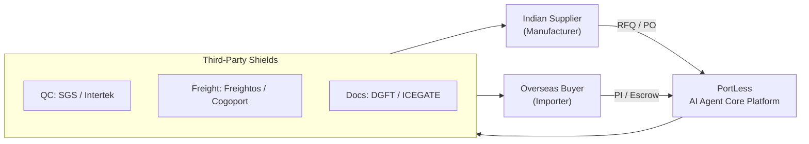

### 3.3 Multi-Agent Orchestration (Conceptual)
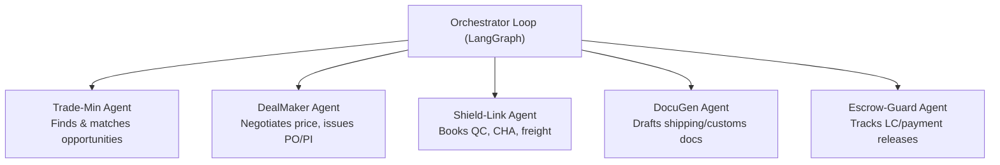

### 3.4 Implementation Phases
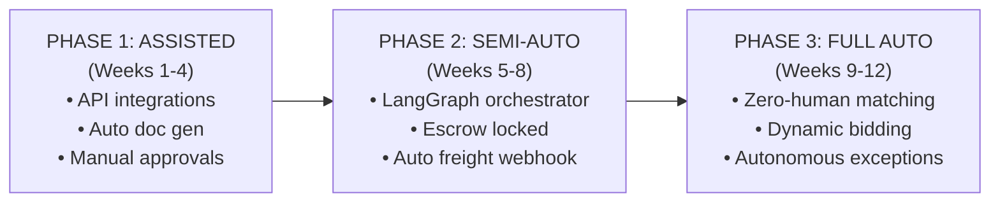

| Phase | Focus | Key Rule |
|---|---|---|
| **1 — Assisted** | Core pipelines + manual compliance | Every doc/booking needs one-click operator approval. |
| **2 — Semi-Auto** | Inter-agent orchestration + financial security | App runs pipeline but halts for approval before payout & freight booking. |
| **3 — Full Auto** | Full automation + dynamic profit harvesting | Autonomous exception resolution unless margin impact > 5%. |

### 3.5 Third-Party Integration Framework
| Stage | Provider Examples | Integration | Agent Action |
|---|---|---|---|
| **QC Check** | SGS, Bureau Veritas, Intertek | SGS Co-care API | Book inspection on "Ready for Dispatch"; hold payment until signed CRF. |
| **Logistics** | Freightos, Cogoport, Flexport | Freightos / Cogoport API | Fetch spot rates, auto-book container, generate tracking webhooks. |
| **Customs** | Registered CHAs | ICEGATE EDI / API | Submit docs, generate Shipping Bill + LEO, track clearance. |
| **Escrow** | Stripe Treasury, Payoneer | B2B APIs | Hold funds, release on validated milestones. |

### 3.6 Technical Stack (HLD-level)
| Layer | Technology | Rationale |
|---|---|---|
| Agent Framework | **LangGraph** | Stateful, cyclical multi-agent loops. |
| LLM Core | **Claude / GPT-class** (routed) | Parse dense export-import laws & schemas. |
| Database | **PostgreSQL + pgvector** | Supplier coords, HS classifications, price history, RAG. |
| Backend | **Python / FastAPI** | High-performance async, native AI integration. |
| Escrow/FinTech | **Stripe Treasury / Payoneer** | Secure global SWIFT/SEPA, multi-currency. |
| Doc Parsing | **Azure Document Intelligence** | High-accuracy OCR for lab tests & BoLs. |

### 3.7 Compliance & Anti-Bypass (Corrected)
> **Correction:** The earlier "double-invoice mask" wording implied unlawful concealment. Replaced with lawful practice.

- **Merchant-of-record model:** PortLess is the contractual exporter/importer-of-record; all invoices and POs are genuine.
- **Switch Bill of Lading:** Recognized carrier service; shipper changed to PortLess (buyer never sees factory identity).
- **Compliance Guard:** Blocks any action that under-declares value, falsifies HS/origin, or hides a sanctioned party — runs before customs filing.
- **Trust Lock (Escrow):** Pays supplier on CRF sign-off; secures buyer funds until delivery — neither party can safely bypass.

### 3.8 India Regulatory & Tax Automation
- **GST Zero-Rated Supply (Sec 16 IGST):** LUT (export without IGST + ITC) or IGST refund path — LUT auto-attached to invoices.
- **FEMA / FIRC:** Export proceeds realized within 9 months; bank wire files matched to shipping bills; missing FIRC flagged.
- **RoDTEP:** DocuGen stamps RoDTEP declaration on Shipping Bills for auto duty-credit scrips.

---

## 4. Low-Level Design (LLD)

### 4.1 Runtime Tiers
| Tier | Role | Tech |
|---|---|---|
| **API Gateway** | Sync edge: auth, validation, webhook ingest, idempotency, command publishing | FastAPI, Pydantic v2, JWT |
| **Agent Runtime** | Long-running reasoning loops ("brain") | LangGraph, LiteLLM router |
| **Workers** | Deterministic integration + saga steps ("hands"); idempotent, retryable | Python consumers, httpx adapters |
| **Outbox Relay** | Publishes DB outbox → bus | Python relay |

### 4.2 Deal State Machine
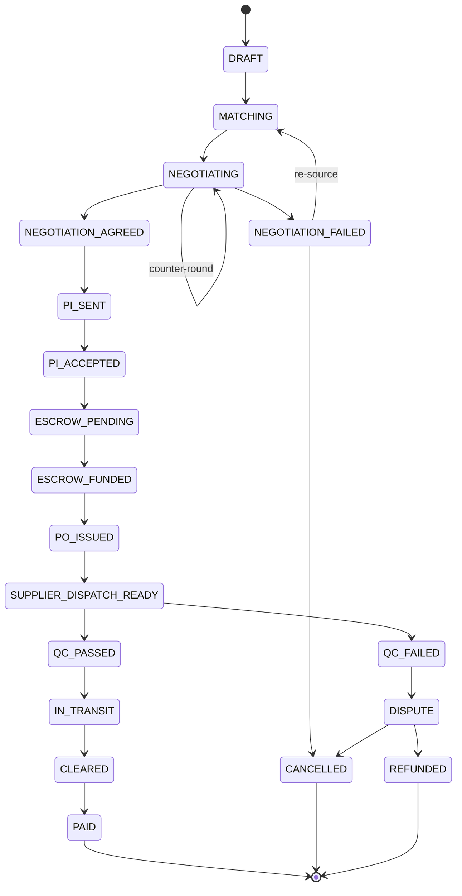

**Guard conditions (enforced in code, never by LLM):**
- `NEGOTIATION_AGREED` requires the converged terms to satisfy `net_margin ≥ margin_floor` (the LLM proposes, the pure-function guard decides).
- `ESCROW_FUNDED` requires verified escrow webhook.
- `PO_ISSUED` requires `net_margin ≥ margin_floor` AND (buyer credit-cleared OR fully prepaid).
- Payout requires `QC_PASSED` + dual-doc match pass.

### 4.3 Composite Match Score (Matching Engine)
$$\text{CMS} = C_{\text{supplier}} \times \left( w_1 \cdot M_{\text{arbitrage}} + w_2 \cdot L_{\text{proximity}} + w_3 \cdot V_{\text{reliability}} \right)$$

| Symbol | Meaning |
|---|---|
| $C_{\text{supplier}}$ | Gatekeeper multiplier (0/1): 0 if GST fail / inactive IEC / DGFT denied list. |
| $M_{\text{arbitrage}}$ | Arbitrage score 0–100: spread between buyer target price and supplier quote. |
| $L_{\text{proximity}}$ | Logistics proximity 0–100: supplier warehouse → nearest exit port distance. |
| $V_{\text{reliability}}$ | Verification/capacity 0–100: business age (MCA), Udyam, shipment frequency. |
| $w_1,w_2,w_3$ | Weights, $\sum w_i = 1.0$ (default 0.5 / 0.3 / 0.2). |

**Profitability:**
$$\text{Net Margin} = \text{Buyer Price (CIF)} - (\text{Sourcing} + \text{QC} + \text{Logistics} + \text{Customs} + \text{Buffer})$$

Decision: CMS ≥ 75 → trigger Sourcing Agent; CMS < 75 → auto-discard.

### 4.3.1 Negotiation Engine (Buyer ⇄ Seller)

After a match clears, the **Negotiator Agent** runs a bounded, auditable bargaining loop between the buyer's target price and the supplier's quote. The agent proposes; deterministic guardrails decide what is acceptable.

**Negotiation policy (per deal):**
| Parameter | Meaning |
|---|---|
| `target_margin_pct` | Desired net margin the agent aims for. |
| `margin_floor_pct` | Hard walk-away threshold (deal frozen below this). |
| `max_rounds` | Max counter-offer rounds before escalation (default 5). |
| `concession_step` | Max price movement allowed per round (anti-overshoot). |
| `batna` | Best Alternative — the next-best matched supplier/buyer to fall back on. |
| `deadline` | Time box; on expiry → escalate or fail per autonomy level. |

**Convergence rule (pure function, outside the LLM):** an offer/counter pair is accepted only if
$$\text{net\_margin}(P_{\text{buyer}}, P_{\text{supplier}}) \ge \text{margin\_floor} \quad\text{and}\quad |P_{\text{ask}} - P_{\text{bid}}| \le \text{concession\_step}.$$

**Loop outcomes:** `NEGOTIATION_AGREED` (terms locked → PI), `NEGOTIATION_FAILED` (re-source via BATNA or cancel), or `approval.requested` (margin marginal / first-time party / rounds exhausted).

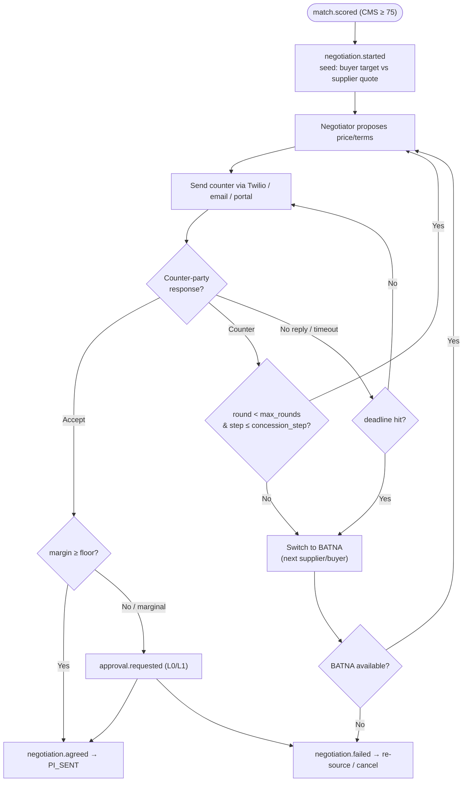

### 4.4 Event-Driven Backbone
**Bus:** NATS JetStream (dev) → Kafka/Redpanda (scale).

**Core Event Catalog:**
| Topic | Producer | Key Consumers |
|---|---|---|
| `opportunity.detected` | Trade-Min Agent | UI, Operator |
| `deal.created` | API | Agent Runtime |
| `match.scored` | Match Engine | Agent Runtime, UI |
| `quote.requested` / `quote.received` | Sourcing Agent | Worker (IndiaMART), Negotiator |
| `negotiation.started` | Negotiator Agent | UI, Operator |
| `negotiation.round` | Negotiator Agent | UI (live bargaining log) |
| `negotiation.agreed` / `negotiation.failed` | Negotiator Agent | DealMaker, UI |
| `pi.sent` / `pi.accepted` | DealMaker / Buyer portal | Escrow Worker |
| `escrow.funded` | Stripe webhook → API | Saga |
| `po.issued` | DealMaker Agent | Supplier portal |
| `qc.booked` / `qc.passed` / `qc.failed` | Shield-Link / SGS webhook | Saga, DocuGen |
| `freight.booked` / `freight.milestone` | Logistics Worker / carrier | UI |
| `customs.filed` / `customs.cleared` | DocuGen / ICEGATE | Payout Saga |
| `payout.requested` / `payout.completed` | Payout Saga | Ledger, UI |
| `approval.requested` / `approval.resolved` | Any agent | HITL Service, UI |
| `deal.exception` | Any | Exception workflow |

**Reliability patterns:**
- **Transactional Outbox** — atomic DB write + publish; no lost events.
- **Idempotency keys** — dedupe commands/webhooks; no double payouts.
- **Saga orchestration** — compensating actions on failure (e.g., freight fail → `po.cancel`).
- **Dead-letter queue** — poison messages surface as UI Exceptions.

### 4.5 Agent Runtime (Planner / Executor / Critic)
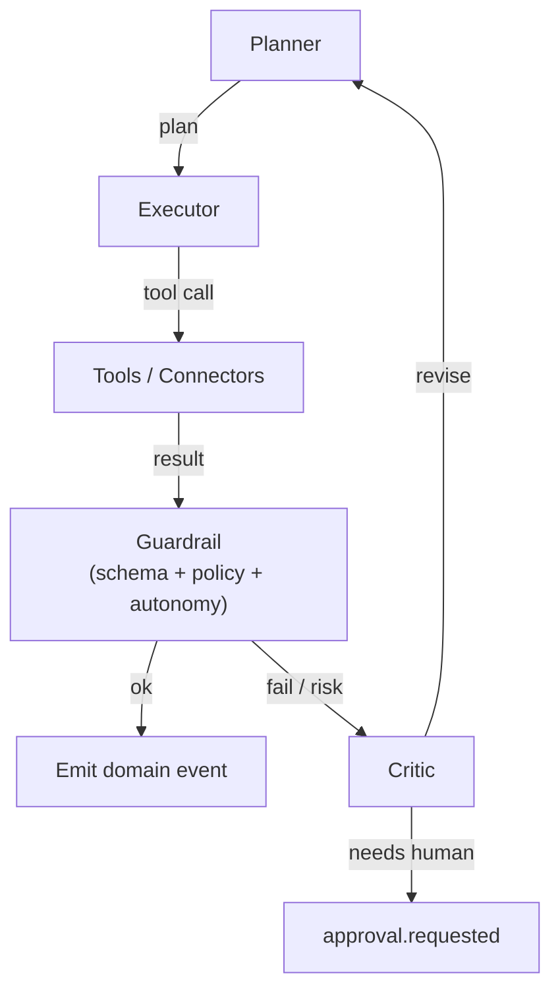

**Agent roster (as services):**
| Agent | Trigger | Tools | Output events |
|---|---|---|---|
| Trade-Min | cron / `scan.tick` | Comtrade, Volza, MacMap | `opportunity.detected` |
| Match Engine | `deal.created` | GSTN, DGFT, MCA, geo | `match.scored` |
| Sourcing | `match.scored(cms≥75)` | IndiaMART, TradeIndia, Twilio | `quote.requested/received` |
| Negotiator | `quote.received` | Pricing calc, BATNA model, Twilio/email/portal | `negotiation.started/round/agreed/failed` |
| DealMaker | `negotiation.agreed` | Pricing calc, PI/PO gen | `pi.sent`, `po.issued` |
| Shield-Link | `escrow.funded` | SGS, Cogoport/Freightos, CHA | `qc.booked`, `freight.booked` |
| DocuGen | `qc.passed` | Doc templates, DGFT CoO, ICEGATE | `customs.filed` |
| Escrow-Guard | `pi.accepted`, `qc.passed` | Stripe/Payoneer, Ledger | `payout.requested` |
| Exception-Resolver | `deal.exception` | All tools + HITL | remediation events |

**Hard guardrails (deterministic, outside LLM):** schema-validated output; money/booking tools require state precondition + policy check + autonomy-level check; margin floor / credit check / dual-doc match are pure functions an LLM cannot override.

### 4.6 HITL Approval Service
```json
{
  "approval_id": "APR-2026-0091",
  "deal_id": "DEAL-2026-IN-ES-0091",
  "action": "RELEASE_SUPPLIER_PAYOUT",
  "summary": "Pay ₹29,40,000 to Guntur Agri after SGS pass",
  "financial_impact_usd": 35400,
  "risk_flags": ["large_payout"],
  "expires_at": "2026-06-20T10:00:00Z",
  "default_on_timeout": "REJECT",
  "deep_link": "https://app/approvals/APR-2026-0091"
}
```

**Autonomy Levels (per action class, configurable):**
| Level | Meaning | Default mapping |
|---|---|---|
| **L0** | Always ask | First-time supplier, payout > $50k |
| **L1** | Ask, auto-approve on timeout | Freight booking within quote |
| **L2** | Auto, notify after | Doc generation, RFQ dispatch |
| **L3** | Fully autonomous, log only | Opportunity scanning, QC booking |

### 4.7 Data Model (PostgreSQL)
```sql
deals(deal_id PK, operator_id, hs_code, status, autonomy_profile,
      margin_floor_pct, est_margin_usd, realized_margin_usd, created_at, updated_at)

parties(party_id PK, deal_id FK, role ENUM('buyer','supplier'),
        legal_name, country, gstin, iec, vat_number,
        verification_status, credit_status, risk_score)

quotes(quote_id PK, deal_id FK, supplier_id, unit_price, currency, valid_until)

match_scores(match_id PK, deal_id FK, composite_score, gatekeeper_passed BOOL,
             arbitrage_score, proximity_score, reliability_score)

escrow(escrow_id PK, deal_id FK, provider, amount, currency, status, ext_ref)

third_party_orders(tpo_id PK, deal_id FK, type ENUM('qc','freight','cha'),
                   provider, ext_ref, status, crf_hash, eta, payload JSONB)

documents(doc_id PK, deal_id FK, type, storage_uri, hash, generated_by, signed BOOL)

ledger(entry_id PK, deal_id FK, payee, amount, currency, direction, status,
       idempotency_key UNIQUE)

approvals(approval_id PK, deal_id FK, action, impact_usd, status, expires_at,
          default_on_timeout, resolved_by, resolved_at)

events(event_id PK, deal_id FK, topic, payload JSONB, occurred_at, seq)
outbox(id PK, topic, payload JSONB, published BOOL, created_at)
embeddings(id PK, owner_type, owner_id, embedding VECTOR(1536), metadata JSONB)
agent_runs(run_id PK, deal_id FK, agent, prompt, tools_called JSONB,
           output JSONB, cost_usd, created_at)
```
Indexes: `deals(status)`, `events(deal_id, seq)`, `ledger(idempotency_key)`, `embeddings USING ivfflat`.

### 4.8 Deal Context (shared state object)
```json
{
  "deal_id": "DEAL-2026-IN-ES-0091",
  "operator_id": "OP-901",
  "hs_code": "090422",
  "deal_status": "QC_IN_PROGRESS",
  "arbitrage_metrics": {
    "estimated_revenue_usd": 45000.00,
    "supplier_payable_inr": 2940000.00,
    "logistics_payable_usd": 3200.00,
    "qc_payable_usd": 450.00,
    "net_margin_usd": 6350.00
  },
  "parties": {
    "buyer": { "company_name": "Iberia Spices SL", "country": "Spain", "verified_vat_number": "ESB12345678" },
    "supplier": { "company_name": "Guntur Agri Products Ltd", "gstin": "37AAAAA0000A1Z1", "iec": "0312045612" }
  },
  "third_party_orders": {
    "quality_check": { "provider": "SGS India", "inspection_status": "SCHEDULED", "certificate_hash_ipfs": null },
    "freight_booking": { "provider": "Freightos", "incoterm": "FOB-Chennai", "carrier": "Maersk Line" },
    "customs_house_agent": { "shipping_bill_number": null, "customs_status": "PENDING_INSPECTION_CRF" }
  }
}
```

### 4.9 Tech Stack & Repo Layout
| Layer | Technology |
|---|---|
| Frontend | Next.js 14, TypeScript, Tailwind, shadcn/ui, TanStack Query, Socket.IO |
| API Gateway | FastAPI (async), Pydantic v2, JWT, Webhook router |
| Agent Runtime | LangGraph, LiteLLM model router, Pydantic tool schemas |
| Workers | Python consumers, httpx adapters |
| Event Bus | NATS JetStream → Kafka/Redpanda |
| Database | PostgreSQL 16 + pgvector |
| Cache/locks | Redis (idempotency, rate-limit, agent memory) |
| Object store | S3-compatible (MinIO in dev) |
| Payments | Stripe Treasury / Payoneer B2B |
| OCR | Azure Document Intelligence |
| Observability | OpenTelemetry + Grafana/Tempo + Langfuse |
| Deploy | Docker → Azure Container Apps / AWS ECS; IaC via Bicep/Terraform |

```
portless/
├─ apps/
│  ├─ web/                 # Next.js Ops Console + mini-portals
│  └─ api/                 # FastAPI gateway (REST + webhooks + WS)
├─ services/
│  ├─ agent-runtime/       # LangGraph graphs + tools
│  ├─ workers/             # saga + integration consumers
│  └─ outbox-relay/        # Postgres → bus publisher
├─ packages/
│  ├─ domain/              # shared types, state machine, event schemas
│  └─ connectors/          # adapters: comtrade, gstn, dgft, sgs, cogoport...
├─ infra/                  # docker-compose, bicep/terraform
└─ docs/                   # specs
```

---

## 5. Workflow

### 5.1 End-to-End Transact Cycle (4 Phases)
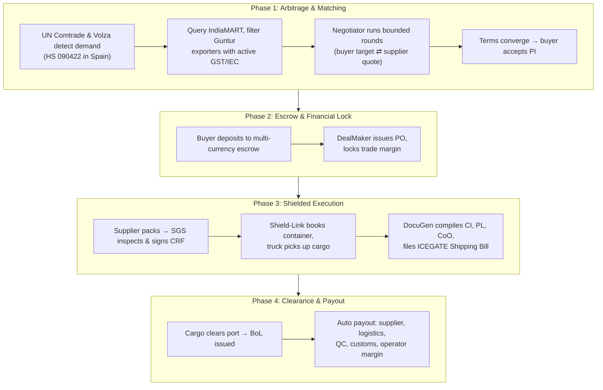

### 5.2 Sourcing & Validation Loop
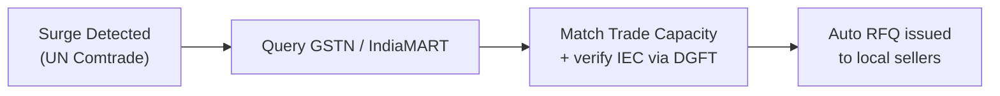

### 5.2.1 Negotiation Phase (after match)
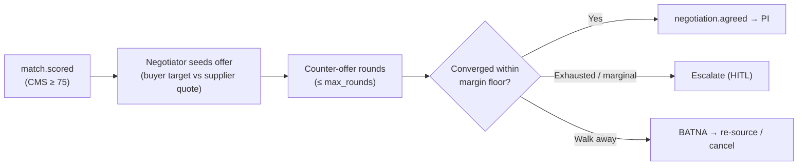

### 5.3 Exception & Dispute Sub-Workflow
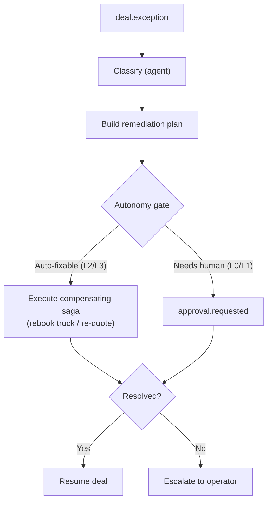

### 5.4 Build Roadmap
| Sprint | Deliverable | HLD Phase |
|---|---|---|
| S1 | Monorepo, docker stack, state machine, schema, event bus, outbox | 1 |
| S2 | Trade-Min + Match Engine, Opportunity Radar UI, GSTN/DGFT connectors | 1 |
| S3 | DealMaker + DocuGen, PI/PO/Invoice gen, mini-portals | 1 |
| S4 | Escrow (sandbox), HITL Approval Service, Autonomy Levels | 2 |
| S5 | Shield-Link (QC + freight), sagas, dual-doc verification | 2 |
| S6 | ICEGATE/CHA filing, RoDTEP/FIRC tracking, Compliance Guard | 2→3 |
| S7 | Exception-Resolver, freight bidding, autonomy promotion, observability | 3 |
| S8 | Hardening: load test, DLQ runbooks, security review, go-live | 3 |

> **Go-live safety rule:** launch money-movement actions at **L0** (always ask); promote to L2/L3 only after N successful supervised deals.

---

## 6. Architecture Diagram

### 6.1 System Topology
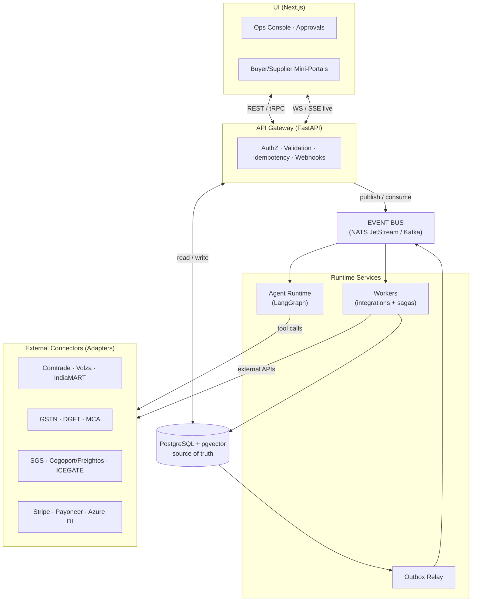

### 6.2 Tier Responsibilities
| Tier | Responsibility |
|---|---|
| **UI** | Operator supervision, approvals, tokenized party actions, live stream. |
| **API Gateway** | Sync edge, webhook ingest, idempotency, command publishing. |
| **Event Bus** | Decouples all tiers; replayable, resilient. |
| **Agent Runtime** | Reasoning over messy data (matching, parsing, negotiation, exceptions). |
| **Workers** | Deterministic money/booking sagas; idempotent + retryable. |
| **Database** | Source of truth; events derive via outbox. |

---

## 7. Flowchart

### 7.1 Happy-Path Deal (Sequence)
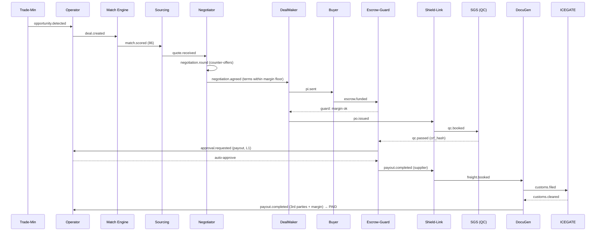

### 7.2 Decision Flowchart (Deal Gatekeeping)
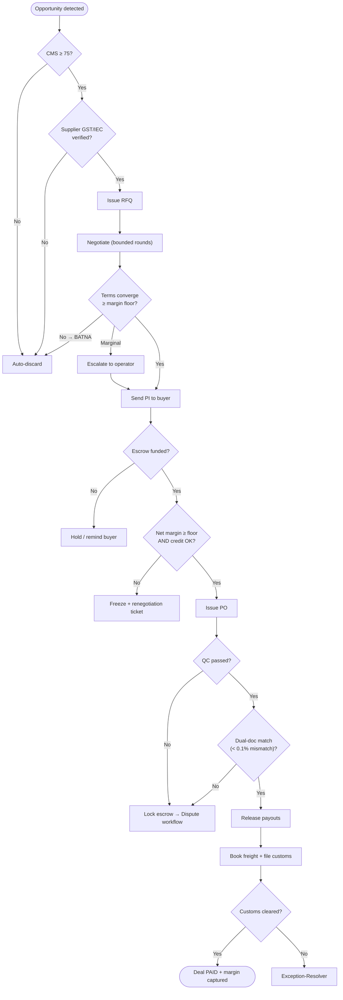

---

## 8. Appendices

### 8.1 Trade Intelligence API Landscape
**Global opportunity & buyer discovery:** UN Comtrade, ITC MacMap, Volza, Trademo, ImportGenius/Panjiva.
**Buyer verification:** VIES (EU VAT), Allianz Trade / Euler Hermes (credit).
**Domestic supplier discovery:** IndiaMART, TradeIndia.
**Indian regulatory verification:** GSTN (GSP), DGFT (IEC/licenses), MCA (API Setu), Udyam (Signzy/Zoop).

Each becomes an adapter in `packages/connectors/` with a uniform interface: `quote()`, `book()`, `status()`, `webhook_verify()`.

### 8.2 Risk Management Matrix
| Risk Event | Impact | Mitigation |
|---|---|---|
| Supplier cargo fails QC | High | QC flags before cargo leaves; payment locked; pickup auto-cancelled. |
| Demurrage / port delays | Medium | Dynamic buffer rates; carrier webhook milestones notify buyer. |
| Incorrect HS code | High | LLM-RAG classifier matched to validated HS database. |
| FX volatility | Medium | Multi-currency escrow buffers locked at PI signing. |

### 8.3 Future Roadmap — Web3 Trust Layer (Nice-to-Have)
- **Stablecoin Escrow (USDC/USDT):** Layer-2 smart contracts release funds on validated Switch BoL + CRF.
- **Immutable Cargo Provenance:** CRF hash stamped on-chain (IPFS/Arweave).
- **Tokenized BoL (eBoL):** ERC-721/1155 title transfer on final escrow payment.
- **Decentralized Notary (SBTs):** Soulbound reputation tokens for buyers/sellers.
- **Schema hooks:** optional `onchain_transaction_hash`, `buyer_wallet_address` on Deal Context.

### 8.4 Developer Portals
- ICEGATE: https://www.icegate.gov.in
- DGFT: https://www.dgft.gov.in
- GSTN Developer: https://developer.gst.gov.in
- UN Comtrade: https://comtradeplus.un.org
- VIES: https://ec.europa.eu/taxation_customs/vies
